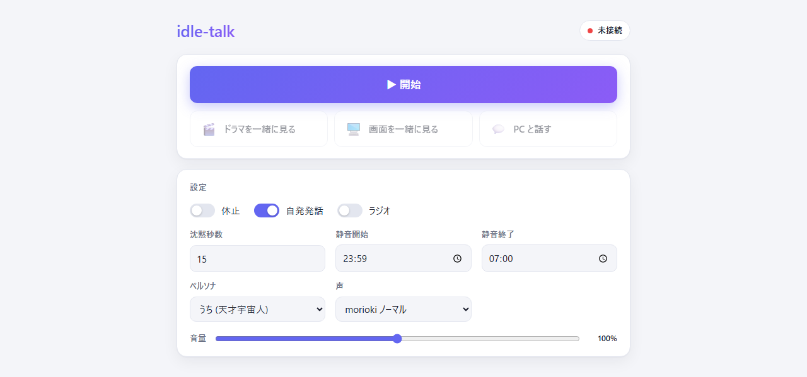

# idle-talk

Windows PC に常駐して、日本語で気軽に雑談できる音声アプリです。音声認識・会話・音声合成はすべて手元の PC で動きます。



## できること

- **話しかければ声で答えます。** AI が話している途中でも割り込めます（「うん」などの相槌では止まりません）。
- **黙っていると AI から話しかけます。** ニュースの見出しを話題にすることもあります。
- **調べないと答えられない質問は、Web で検索してから答えます。**
- **声で相手を見分けて、名前で呼びます。** 事前の登録は要りません。
- **ドラマを一緒に見ます。** 流しているタブの音を聞いて、場面の切れ目にたまに一言つぶやきます。
- **画面を一緒に見ます。** ときどき画面をのぞいて、変化があれば話しかけます。
- **人物設定（ペルソナ）と声を、画面で切り替えられます。**

構成: ブラウザ（マイク・再生）⇄ Director（Python）⇄ llama-server（LLM）/ AivisSpeech（声）/ ReazonSpeech（音声認識）。
設計は [docs/design-idle-talk.md](docs/design-idle-talk.md)、細かい動きは [docs/specification.md](docs/specification.md) にあります。

## 必要なもの

| もの | 用途 | 備考 |
|---|---|---|
| Windows 11 + NVIDIA GPU | LLM | 動作確認は RTX 3060 |
| Python 3.13 以上 | 本体 | |
| [llama.cpp](https://github.com/ggml-org/llama.cpp) の `llama-server` | 会話 | 同梱の設定は Gemma 4 12B（QAT Q4_0、gguf）。軽くしたいなら Qwen3.5-4B Q4_K_M |
| [AivisSpeech](https://aivis-project.com/) | 声 | idle-talk が AivisSpeech Engine を起動できます（`127.0.0.1:10101`） |
| [sherpa-onnx](https://github.com/k2-fsa/sherpa-onnx) + ReazonSpeech | 音声認識（CPU） | モデルは約 680MB（Apache-2.0）。`[asr].engine = "whisper"` で faster-whisper `small`（GPU）に戻せます |
| onnxruntime + [WeSpeaker ResNet34](https://huggingface.co/Wespeaker/wespeaker-voxceleb-resnet34-LM) | 声で相手を見分ける（任意） | モデルは約 26MB（CC-BY-4.0）。無ければ見分けずに動きます |
| Chrome などのブラウザ | マイク・再生・画面 | |

## セットアップ

1. **Python パッケージを入れる**
   ```
   pip install -e .[dev]
   pip install sherpa-onnx
   ```
2. **音声認識のモデルを `data/models/reazonspeech/` に展開する**（約 680MB）
   ```
   curl -L -o reazonspeech.tar.bz2 https://github.com/k2-fsa/sherpa-onnx/releases/download/asr-models/sherpa-onnx-zipformer-ja-reazonspeech-2024-08-01.tar.bz2
   tar -xjf reazonspeech.tar.bz2 -C data/models
   move data\models\sherpa-onnx-zipformer-ja-reazonspeech-2024-08-01 data\models\reazonspeech
   ```
3. **[idle_talk.toml](idle_talk.toml) の `[llm]` を自分の環境に合わせる**
   ```toml
   [llm]
   server = "D:/tools/llama.cpp/llama-server.exe"
   model = "D:/models/gemma-4-12b-it-qat-q4_0.gguf"
   mmproj = "D:/models/mmproj-gemma-4-12b-it-qat-q4_0.gguf"  # 任意。画面を見る機能に使う
   ```
   - `model` を書くと、idle-talk が llama-server を起動し、落ちたら再起動します。
   - `model` を空にすると、自分で起動した llama-server（ポート `[ports].llm`）を使います。
   - `mmproj`（画像を読む部品）を書くと、ドラマモードで画面も見て、画面モードも使えます。空なら音だけです。
   - GPU が 2 枚ある場合、`main_gpu = 0` にすると GPU0 だけに載せます。`-1` だと 2 枚に分けて載ります。
4. **[idle_talk.toml](idle_talk.toml) の `[aivis]` に AivisSpeech Engine の場所を書く**
   ```toml
   [aivis]
   engine = "C:/Program Files/AivisSpeech/AivisSpeech-Engine/run.exe"
   ```
   - `idle-talk.cmd start` が先にエンジンを起動し、`stop` で止めます。
   - 空にするか、AivisSpeech アプリを先に起動しておけば、idle-talk はエンジンを起動しません。
5. **（任意）声で相手を見分けるなら、話者識別モデルを置く**
   ```
   pip install onnxruntime
   curl -L -o data/models/voxceleb_resnet34_LM.onnx https://huggingface.co/Wespeaker/wespeaker-voxceleb-resnet34-LM/resolve/main/voxceleb_resnet34_LM.onnx
   ```
   `idle_talk.toml` の `[voice_id]` で `on = true` にします。

## 起動と停止

リポジトリ直下で:

```
idle-talk.cmd start     # 起動（AivisSpeech Engine・音声認識・本体をバックグラウンドで起動）
idle-talk.cmd stop      # 停止
idle-talk.cmd restart   # 再起動
idle-talk.cmd status    # 動いているかを表示
```

起動したら、ブラウザで **http://127.0.0.1:8000/** を開きます。
HTML ファイルを直接（`file://` で）開くと接続できません。

## 画面の使い方

### 会話する

接続をオフにすると「停止中」になり、マイク・音声認識・発話・ドラマや画面の共有を停止します。サーバは動いたままなので、接続をオンにすれば再開できます。停止前に認識中だった音声は、再接続後の会話やログに追加しません。

1. 右上の **接続** をオンにし、マイクの使用を許可します。これで会話が始まります。
2. 「状態」に今の様子が出ます。

   | 表示 | 意味 |
   |---|---|
   | 待機 | 話しかけを待っています |
   | ユーザー発話中 / 終話確認中 | あなたの声を聞いています |
   | 返答準備中 | 答えを考えています |
   | AI再生中 | AI が話しています |
   | 割り込み確認中 | AI の発話中にあなたの声を拾い、音量を下げて内容を確かめています |
   | 休止 | 「休止」にチェック中か、長く操作が無かったので休んでいます |
   | 再接続中… | 本体との接続が切れました。2 秒ごとに自動でつなぎ直します |

   Web 検索中は「Web で「〜」を調べています…」と出ます。

### 設定欄

変更はすぐに効きます。ただし保存はされず、次回はまた `idle_talk.toml` の値から始まります（音量だけはブラウザが覚えます）。

| 項目 | 内容 |
|---|---|
| 休止 | AI の発話を休止します。音声認識は続きます。外すと再開します |
| 自発発話 ON | 黙っていると AI から話しかけます |
| ラジオ | 返事を待たずに、数秒おきに話し続けます |
| 沈黙秒数 | この秒数黙っていると、AI が話しかけます（10〜3600） |
| 静音開始 / 静音終了 | この時間帯は、AI から話しかけません |
| ペルソナ | AI の人物設定（性格・口調）を切り替えます（`personas.toml` に 2 人以上いるときだけ表示） |
| 声 | AivisSpeech の話者を選びます（AivisSpeech が動いているときだけ表示） |
| 音量 | AI の声の大きさ（0〜200%）。このブラウザにだけ効きます |

### ドラマを一緒に見る

開始後に押せます。ドラマを流しているタブを共有すると、AI もその音を聞きます。

- 共有の画面では「**タブの音声も共有する**」をオンにしてください。音声が無いとエラーになります。
- 画面全体をシステム音声つきで共有しても、idle-talk のタブが鳴らす AI の声は共有の音に入れません（`restrictOwnAudio`、Chrome 141 以降）。古いブラウザでは AI の声も入りますが、AI が話した内容と同じ台詞は捨てます。確実にするにはドラマのタブだけを共有してください。
- 場面の切れ目に、たまに一言つぶやきます。頻度は `[drama]` で変えられます。
- 「今の誰？」などと話しかければ、直近の台詞を踏まえて答えます。
- 台詞が 1 分（`[drama].finale_gap_s`）聞こえなくなると、見終わったとみなして全体の感想を話します。
- `[llm].mmproj` を設定していれば、一言・感想の直前に画面も 1 枚見ます。設定していなければ音だけです。
- 見ている間は、普段の自発発話と無操作による休止が止まります。
- もう一度押すか、ブラウザの「共有を停止」で終わります。

### 画面を一緒に見る

開始後に押せます。`[llm].mmproj` を設定して、LLM が画像を読めるときだけ使えます。

- 共有した画面（タブ・ウィンドウ・画面全体）を、AI が `[screen].interval_s` 秒ごとに見て一言話しかけます。
- 前に話したときから画面があまり変わっていなければ（`[screen].min_diff` 未満）、黙っています。同じページを読んでいる間は話しかけません。
- 音は聞きません。ドラマにはドラマモードを使ってください。ドラマモードとは同時に使えません。
- 見ている間は、普段の自発発話と無操作による休止が止まります。
- もう一度押すか、ブラウザの「共有を停止」で終わります。

**前面のウィンドウを自動で見る**（`[screen].follow_window = true`、Windows のみ、既定はオフ）:

- 共有はせず、そのとき前面にあるウィンドウを idle-talk が撮ります。ウィンドウを切り替えれば、AI が見るものも替わります。
- ウィンドウのタイトルも AI に渡します。ウィンドウが替わると、話す候補になります。
- 1280×720（`width`）まで細かく撮るので、画面の文字もおおむね読めます（応答は 3 秒前後）。
- 次のウィンドウは撮りません: idle-talk 自身の画面、最小化中のウィンドウ、タイトルに `exclude` の語（パスワード管理ソフトなど）を含むウィンドウ。
- 何でも撮るので、見られたくない画面があるときはオフにするか `exclude` に足してください。

### ブラウザ補正なし

開始後に押せます。マイクと AI の声を、ブラウザ（Chrome）のエコー除去などの補正に通さず、idle-talk が直接録って鳴らします。PC で動く別の音声 AI（ブラウザの ChatGPT の音声会話など）とも、スピーカーとマイクでそのまま話せます。共有はしません。

- **スピーカーで使ってください。** 相手は、スピーカーから出る AI の声を自分のマイクで聞きます。AI は、相手の声をマイクで聞きます。
- AI の声は、ブラウザではなく idle-talk がスピーカーに鳴らします。ブラウザが鳴らすと、ブラウザで動く ChatGPT のエコー除去に消されるためです。
- マイクも、ブラウザではなく idle-talk が録ります（`[pc].mic`）。ブラウザのマイクはエコー除去で、ブラウザの ChatGPT の声まで消してしまうためです。
- Python の `sounddevice` が要ります（`pip install sounddevice`）。
- マイクで聞いた発言は、`data/talk.log` に `PC:` で残ります（普段は `USER:`）。
- 話している間は、普段の自発発話・無操作による休止・相槌・名前の質問・記憶の保存が止まります。
- AI と相手は、どちらかが黙るまで話し続けます。止めるときは、もう一度押すか休止にしてください。
- 補正が無いので、AI は自分の声をマイクで拾います。AI が話している間の発言は「待って」「ストップ」などの停止語だけ聞き、ほかは捨てます。

### 会話のコツ

- AI の話を止めたいときは、「待って」「ストップ」などと言うとすぐに止まります。
- 「うん」「へえ」などの相槌なら、AI は少し音量を下げるだけで話し続けます。
- 「はい」「うん」のような 2 字だけの言葉は、AI が話した後 20 秒以内でないと聞き流します。食器の音や咳を聞き違えて反応しないためです。間が空いたら、少し長めに話しかけてください。
- 初めての声だと、2 回ほど話したあとで AI が名前を聞いてきます。答えると、以後は名前で呼びます。別人扱いされたら、同じ名前を答えれば 1 人にまとまります。

### うまくいかないとき

| 困りごと | 対処 |
|---|---|
| 画面に何も出ない・起動しない | `data/idle_talk.log` の末尾を見ます。`idle_talk.toml` の値が範囲外だと起動しません |
| 声が出ない | `data/aivisspeech.log` を見ます。`idle-talk.cmd status` で AivisSpeech が動いているか確かめます |
| 物音に反応しすぎる | `[vad].ratio` を上げます |
| 声を拾ってくれない | `[vad].ratio` を下げます |
| スピーカーだと AI 自身の声やドラマの音を拾う | 同じ内容なら捨てていますが、気になるならヘッドホンを使います |
| ドラマの一言が AI 自身の発言をなぞる | 画面全体の共有で AI の声が入っています。Chrome を 141 以降に更新するか、ドラマのタブだけを共有します |
| 「[5001]」などのエラーが出た | LLM・声・音声認識の一時的な失敗です。次に AI が話し始めると消えます |
| 「画面を一緒に見る」でエラーになる | `[llm].mmproj` を設定して再起動します |

音声認識のログは `data/asr_worker.log` にあります。

## 設定ファイル

[idle_talk.toml](idle_talk.toml) の主な項目です。各項目の説明は、ファイル内のコメントにあります。

| セクション | 内容 |
|---|---|
| `[ports]` | 各サービスのポート（画面は `web`=8000） |
| `[llm]` | llama-server とモデル、画像を読む部品（`mmproj`）、載せる GPU（`main_gpu`） |
| `[aivis]` | AivisSpeech Engine の場所。書けば idle-talk が起動・停止します |
| `[tts]` | 声の話者 ID・話速・音量など |
| `[asr]` | 音声認識のエンジン。短い言葉を聞き流す条件（`short_chars` / `short_reply_s`） |
| `[vad]` | 声の検出感度。物音に反応しすぎるなら `ratio` を上げ、声を拾わないなら下げます |
| `[spontaneous]` | 自発発話・ラジオモードの初期値 |
| `[topics]` | 話題に使うニュースの RSS。`x_trends = true` なら X のトレンドも話題にします（Yahoo! リアルタイム検索、ログイン不要） |
| `[search]` | Web 検索の有無。`realtime = true` なら X の新しい投稿も添えて答えます。on のときは、話題のニュースが尽きたら Bing ニュースで補充もします。`on = false` なら検索も補充もせず、ネットワークにも出ません |
| `[voice_id]` | 声で相手を見分ける。取り違えるなら `threshold` を上げ、同じ人を別人扱いするなら下げます |
| `[drama]` | ドラマモードで一言つぶやく間隔（`interval_s`）、場面の切れ目とみなす無音（`gap_ms`）、確認用の記録（`log_prompt` / `keep_snaps`）、ドラマ中もマイクを聞くか（`mic`。画面の「ドラマ中もマイク」でも切替） |
| `[screen]` | 画面モードで画面を見る間隔（`interval_s`）と、話すのに要る画面の変化（`min_diff`）。差はログの `screen skipped: diff` で確かめます |
| `[pc]` | ブラウザ補正なしモードで AI の声を鳴らす機器（`monitor`）とマイク（`mic`）。空なら Windows の既定の機器。モード中はブラウザのマイクを使わない |
| `personas.toml` | AI のペルソナ（名前・性格・口調）と、全員共通の話し方（トップレベルの `style_rules`）。`prompt` と `style_rules` の変更は保存すれば次の応答から効きます。人の追加・削除は再起動で画面に出ます |

## データとプライバシー

- 音声・書き起こし・画面は外部に送りません。外部に出るのは、ニュースの取得と Web 検索（検索語と読むページの URL）だけです。
- ドラマの台詞は、メモリにだけ置きます（直近 `[drama].window_s` 秒分）。
- 画面は手元の LLM にだけ渡し、使ったら捨てます。
- 次の設定をオンにすると、何を見て AI が話したかを後で確かめられるよう保存します。
  - `[drama].log_prompt = true`: AI に渡した台詞とあらすじを `data/talk.log` に残します。
  - `[drama].keep_snaps` を 1 以上にする: AI に見せた画面を、新しい方からその枚数だけ `data/snaps` に残します（画面モードも同じ）。
- 会話の履歴は `data/idle_talk.db`、発話の文字は `data/talk.log` に保存されます。消すには、これらのファイルを削除してください。
- AI が覚えた記憶は、次のコマンドで確認・削除できます（起動中でも可）。
  ```
  idle-talk.cmd memories              # 一覧
  idle-talk.cmd memories --delete ID  # 1 件削除
  idle-talk.cmd memories --clear      # 全削除
  ```
- 覚えた声と名前も、同じように確認・削除できます。声の特徴は `data/idle_talk.db` にだけ保存します（起動中に消した場合は、再起動後に効きます）。
  ```
  idle-talk.cmd speakers              # 一覧
  idle-talk.cmd speakers --delete ID  # 1 件削除
  idle-talk.cmd speakers --clear      # 全削除
  ```

## 開発者向け

- テスト: `pytest`（外部サービス不要）、`node --test web/tests/*.test.js`
- ソースは `src/idle_talk/`（Python）と `web/`（ブラウザ）にあります。
- 仕様は [docs/specification.md](docs/specification.md)、設計は [docs/design-idle-talk.md](docs/design-idle-talk.md) にあります。

## ライセンス

このリポジトリのコードは [MIT License](LICENSE) です。

次のものはこのリポジトリに含まれず、それぞれのライセンス・利用規約に従います。

- AivisSpeech と音声モデル（話者ごとに規約が異なり、合成音声の商用利用やクレジット表記に条件があるものがあります）
- LLM のモデル（Gemma 4・Qwen3.5 など）と llama.cpp、sherpa-onnx・ReazonSpeech（faster-whisper）
- 外部サービス（DuckDuckGo、Bing、r.jina.ai、Yahoo! リアルタイム検索、ニュースの RSS 配信元）
