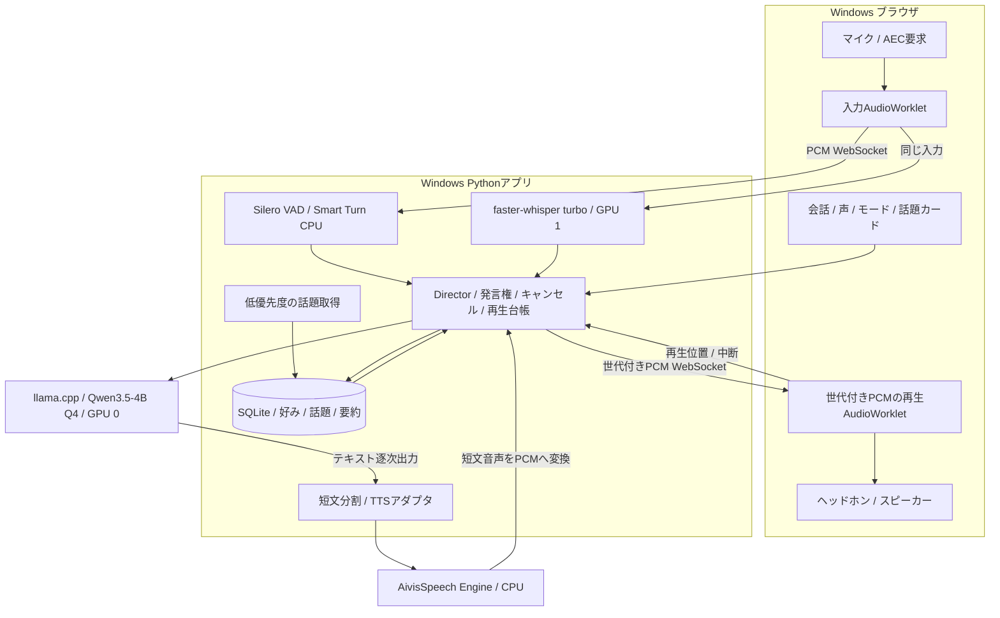

# このPCで常用する、日本語音声雑談の統合アーキテクチャ

作成日：2026-10-09。対象：Windows、利用者1人、日本語の日常会話。状態：設計提案。部品の公式資料とPCの読み取りを確認したが、モデル導入・音声対話・性能測定は未実施。

## 1. 結論

**Windowsのブラウザ + 小さな会話制御部 + Qwen3.5-4B Q4 + faster-whisper turbo + AivisSpeech CPU を初期構成にする。** 音声の入力は再生中も継続し、発言権・再生履歴・自発発話を一つのDirectorが管理する。

大きなモデルやネイティブ全二重モデルから始めるより、短い返答、止まりやすさ、声の好み、ほどよい自発性を先に整える。4Bで会話が浅いと感じた場合は、同じAPIのまま9Bに交換する。これは軽さを優先した設計判断であり、4Bの日本語雑談品質を実測で保証するものではない。

初期通信は **localhostのPCM/WebSocket** に絞る。再生音声にIDを付け、クライアントの再生キューを確実に取り消せることを優先した選択。ヘッドホンを基準に検証する。スピーカーのエコー評価で問題が出たら、Pipecat + SmallWebRTCを比較する。両方を同時に実装しない。

## 2. 元の3案をどう組み合わせるか

| 観点 | A：full-duplex-voice-chat | B：voice-chat-architecture | C：local-voice-chat-architecture | 統合判断 |
| --- | --- | --- | --- | --- |
| 主な強み | 音声系とLLM、収集を分離する構造が明快 | Director、話題カード、段階導入、常用の考慮 | 再生済み履歴、世代番号、相槌と割り込み、測定条件が詳細 | Bの常用方針にCの制御契約を入れ、Aの役割分離を維持 |
| 音声I/O | sounddevice + 自前AEC3 | ブラウザ + WebRTC | ブラウザ + WebRTC、AECの実効性を検証 | ブラウザを採用。初期はPCM/WebSocket、スピーカーは別の合格条件 |
| LLM | Qwen2.5-14B Q4 | 最終案はGemma 4 12B | Qwen3.5-9B Q4、4Bも比較 | 4B Q4で開始、9Bを品質比較に限定 |
| ASR | SenseVoice / Whisper turbo | 最終案はWhisper turbo | Qwen3-ASR-0.6B、vLLM | Windowsで扱いやすいfaster-whisper turbo。常時録音と真のストリーミングASRを混同しない |
| TTS | CosyVoice2 / Kokoro | AivisSpeech | CosyVoice3、Qwen3-TTSなど | AivisSpeechのCPU版から開始。短文単位の合成・逐次再生 |
| タイミング | VAD中心 | Silero + Smart Turn | MaAI + VAD | Silero + Smart Turn。MaAIは相槌改善の追加候補 |
| 会話の整合性 | サンプルだけでは未実装 | 再生した分だけ履歴化 | 生成・送信・再生を区別する具体契約 | Cを採用。音声IDと再生確認を実装条件にする |
| 重くなる要因 | 14B、自前AEC、長い台本 | 12B、埋め込み、記憶MCP | vLLM、WSL2、複数音声モデル、MaAI | ベクトルDB・記憶MCP・vLLM・声クローンは初期版から外す |
| 楽しさ | ニュースと独り言 | フック・感想・問いの話題カード | 会話モード、間合い、弱い興味推定 | 日常の話題とニュースを混ぜ、毎回質問しない |

### そのまま引き継がない前提

- **2枚の12GBは、自動的に単一24GBにならない。** まずモデルをカード間に分割せず、LLMとASRを分担する。カード間分割が常に遅いとも断言しないが、本用途では複雑さを増やす理由がない。
- Aの「100msで割り込み」「ASR約100ms」「TTS約150ms」、Bの「合計約1.1秒」は、このPCの達成値として扱わない。入力長、文脈長、同時処理、再生バッファまで含めて測る。
- AのPoCはダミー音声や簡易検知を含む概念例。実ASR、LLM、AEC、履歴管理が完成した実装の根拠にはしない。
- **Smart Turnは発話終了判定であり、相槌予測器ではない。** 「未完了」と判定するたびに「うん」を再生する実装はしない。[公式説明](https://github.com/pipecat-ai/smart-turn)
- **Windows版AivisSpeechのGPU推論はDirectML。** CUDA用の環境変数だけでGPU 1に固定できるとはしない。CPUで始め、GPU化する場合はエンジンの設定と実際のカード使用量を確認する。[公式README](https://github.com/Aivis-Project/AivisSpeech-Engine)
- Qwen3-ASRの公式Pythonストリーミング経路はvLLM。0.6Bという重みの小ささだけで、Windows常用構成が軽くなるとは限らない。[公式実装](https://github.com/QwenLM/Qwen3-ASR)
- ブラウザのAECは要求・設定確認・実音声評価を行う。WebRTCやWebSocketの選択だけでエコー問題が解決するとは仮定しない。[ブラウザ制約](https://developer.mozilla.org/en-US/docs/Web/API/MediaTrackConstraints/echoCancellation)

## 3. このPCの条件

2026-10-09の今回の読み取り結果。使用量は一時的なスナップショット。

| 項目 | 確認内容 |
| --- | --- |
| GPU 0 | RTX 3060、12288MiB、使用0MiB |
| GPU 1 | RTX 3060、12288MiB、使用4465MiB、空き約7.64GiB |
| NVIDIAドライバ | 616.56 |
| CPU | Ryzen 7 5700X、8コア。16論理プロセッサを確認 |
| RAM | 使用可能な物理総量63.91GiB、空き20.61GiB |
| Windows | 元資料はWindows 11。今回OSのCIM照会はアクセス拒否で、バージョン未再確認 |
| WSL2 | 今回の一覧照会はアクセス拒否。利用可能性を本案の前提にしない |
| 音声機器 | 品質・機器遅延・スピーカー漏れは未測定 |

CPUはレジストリ、RAMはWindowsのメモリAPIで確認した。RAM 64GBだからといって、大部分を新規用途に使える状態ではない。既存アプリを維持し、モデル・キャッシュ・キューの合計を小さくする。

## 4. 最小の実行構成

常駐する主要サーバープロセスは3つ：Pythonアプリ、llama.cpp、AivisSpeech Engine。ASRはPythonアプリ内の専用ワーカーでロードし、イベントループ上で同期推論を実行しない。TTSのCPU負荷は別プロセスへ隔離する。

PythonアプリはUI配信、音声接続、Director、SQLite、低頻度のRSS取得を担当する。uvで環境を分け、CUDA依存DLLの整合性を確認する。初期版でDocker、WSL2、Redis、ベクトルDB、複数LLMを要求しない。

### 部品と交換条件

| 役割 | 初期採用 | 初期設定・交換条件 |
| --- | --- | --- |
| LLM | Qwen3.5-4Bのテキスト用GGUF Q4_K_M、llama.cpp CUDA | GPU 0、ctx 4096、生成1件、思考無効。雑談品質が不足したら9B Q4、ctx 4096で比較 |
| ASR | faster-whisper、large-v3-turbo | GPU 1、int8_float16、language=ja、beam_size=1、バッチ1。VRAM/負荷が問題ならsmall多言語を比較 |
| TTS | AivisSpeech Engine、1つの声を固定 | CPU、同時合成1件。音声は短文ごとに作る。CPUで速度不足ならDirectMLを比較 |
| 音声検出 | Silero VAD、CPU | 開始検出と終了候補を別に扱う。開始用の条件は割り込み測定で調整 |
| 発話終了 | Smart Turn v3.2、CPU量子化版 | VADが無音を検出した後だけ評価。日本語で途中終了が多ければ閾値を調整 |
| 会話制御 | 小さな明示的Director | 停止・モード・発言権はLLM応答を待たずに制御 |
| 記憶・話題 | SQLite、タグ、URL/本文ハッシュ | 初期は埋め込みなし。日本語の語句・タグ照合から始める |

Qwen3.5は思考無効の設定を公式に用意している。llama.cppの採用ビルドとGGUFのテンプレートを合わせ、`enable_thinking=false`が実際に直接応答へ反映されることを確認する。推論内容を隠すだけの設定と、思考生成を止める設定を区別する。画像エンコーダ・mmprojはロードしない。[Qwenモデルカード](https://huggingface.co/Qwen/Qwen3.5-4B)、[llama.cppサーバー](https://github.com/ggml-org/llama.cpp/blob/master/tools/server/README.md)

faster-whisperはCPU/CUDAと量子化に対応するが、公開ベンチマークはこの3060の短い日本語発話の遅延ではない。WindowsでもCUDA 12用cuBLAS/cuDNN 9等の依存を確認する。[公式README](https://github.com/SYSTRAN/faster-whisper)

**最初のASRは発話区間単位。** 常時マイクを受け取るが、認識結果が逐次確定する真のストリーミングASRを標準装備したとは呼ばない。途中結果が必要になったら、上限付きの移動窓・改訂番号付き結果を追加し、再計算負荷を測る。日本語設定を明示し、英語専用モデルを選ばない。[PipecatのWhisper実装も区間単位](https://docs.pipecat.ai/api-reference/server/services/stt/whisper)

### VRAM予算：測定値ではなく上限を決めるための仮置き

| 配置 | 本アプリの設計予算 | 留意点 |
| --- | --- | --- |
| GPU 0：4B Q4 + キャッシュ + 作業領域 | 約3.5〜5GiB | 既存使用は今回0。GPU分割はしない |
| GPU 1：turbo ASR + 作業領域 | 約1.5〜3GiB | 既存4.36GiBに上乗せ。起動後も最低2GiBの空きを目安に確保 |
| TTS/VAD/終了判定 | CPU RAM | TTSのGPU予算は初期0。RAMの増加を記録 |
| 9Bへの交換 | GPU 0で約6〜9GiBを仮予算 | 4Bをアンロードしてからロード。2モデルを並べない |

VRAMに収まっても快適に動くとは限らない。ASRの同時稼働、CPU TTS、既存アプリ併用で遅延を確認する。起動時の空きが不足した場合は小型ASRへ切り替えるか、起動を保留し、既存アプリの停止を要求しない。

## 5. 初期通信をPCM/WebSocketにする理由と限界

今回は同じPCのブラウザ1つだけが相手。外部ネットワーク向けの接続機能より、音声の世代・再生位置を追跡できることを優先する。マイクと再生はAudioWorkletで扱い、モデル推論はサーバーへ置く。[AudioWorklet](https://developer.mozilla.org/en-US/docs/Web/API/AudioWorklet)

- 音声の送受信用接続と、停止・モード・再生確認の制御接続を分ける。大量音声が停止通知を塞がないようにする。
- PCMフレームには`epoch / utterance_id / segment_id / seq / sample_rate`を付ける。クライアントは受信時と再生時の双方で世代を照合する。
- 入力はASRへ渡す時点で16kHz monoへ変換する。ブラウザの音声処理は実際のAudioContextのサンプルレートで行い、16kHz固定と仮定しない。
- 再生側は短いPCMフレームを有界リングバッファへ渡す。TTSの全文WAVをaudio要素に入れて最後まで任せる方式は採らない。
- WebSocket自体には十分なアプリ側のバックプレッシャーがない。再生確認に基づく送信クレジットと、未送信音声の上限を自前で実装する。OS/TCP送信済みの音声も旧世代なら再生しない。[WebSocketの制約](https://developer.mozilla.org/en-US/docs/Web/API/WebSocket)
- AECは`getUserMedia`で要求し、取得トラックの設定を確認する。AudioWorkletの再生との組み合わせで実際に漏れ音を抑えられるかは別途測る。抑制不足ならヘッドホン運用、次にSmallWebRTCとの比較へ進む。

Pipecatを使わない初期版では、音声変換・キュー・停止のコードを自分で持つ負担がある。これは通信・再生制御を小さく検証するための選択であり、Pipecatが重いという性能評価ではない。複数端末、ネットワーク越し、標準の会話サービス連携が必要になればPipecatを優先して再検討する。[SmallWebRTCクライアント](https://github.com/pipecat-ai/pipecat-client-web-transports)

## 6. Directorの制御契約

### 状態を増やしすぎない

音声状態は`READY / LISTENING / GENERATING / SPEAKING / PAUSED_PENDING`。会話モードは独立して`COMPANION / RADIO / LISTENER / QUIET`。音声状態のREADYだけを見て勝手に発話せず、モードと冷却時間も確認する。

発話開始を決めるのはDirectorだけ。ニュース取得、LLM、TTSは提案や結果を返し、自分で音声を再生しない。優先順位は停止・ミュート、ユーザー入力、通常返答、自発発話、話題整形。

### 割り込みと相槌：まず止まれるものを作る

1. AIが話している間も、入力PCM・VADを継続する。
2. ユーザー音声を検出したら、ブラウザの再生を一時停止する。ASRの文字列を待たない。初期版ではこれだけで発言権を譲る。
3. 通常の割り込みでは世代を更新し、LLM・TTSの不要ジョブ・サーバー音声・ブラウザ音声を無効にする。
4. 相槌継続は次の段階で追加する。短い発話が確定し、全文が相槌候補に一致し、AIが質問の回答を待っていない場合に限り、一時停止した同じ発話を継続できる。
5. 「うん、でも」「うん、それで……」は相槌だけに分類しない。「うん」でも直前が質問ならユーザーの回答として扱う。
6. 判定保留は最大600msを初期案とする。発話継続・不確実・タイムアウトなら中止し、続きを聞く。遅いASRのためにAIが話し続けることは避ける。

相槌判定に短いASR結果を使う場合、通常の終了判定とは別の経路が必要になる。初期実装で必須にはせず、短発話の認識コストと誤停止を測ってから有効化する。

### 生成・送信・再生の分離

各音声区間は`generated / sent / rendered / playback_estimated / cancelled`を区別する。AudioWorkletが音声を出力へ渡したことと、機器で鳴ったことは同一ではない。出力遅延を含めた時刻から再生完了を推定し、不明時は確定しない。

履歴へ通常の発話として入れるのは、再生完了を確認できた区間だけ。途中の区間は`interrupted=true`とし、「どこまで聞こえたか不明」を保持する。単語アライメントがなければ、途中の文を最後まで話した扱いにしない。

停止時にはブラウザ側の再生キューをその場で捨てる。古いTTS結果が後から返ってきても、世代照合で破棄する。HTTP要求を取り消してもTTSエンジン内部の計算が止まるとは限らないため、バックエンドの計算停止は別に検証する。止められないエンジンでは同時実行1件と短文上限で残作業を小さくし、新規要求を無制限に積まない。

### キューと文脈の初期上限

| 対象 | 初期設定案 |
| --- | --- |
| マイク前置き音声 | 約200msのリングバッファ |
| 長いユーザー発話 | 約10秒の区間 + 重なりで認識。確定済みと未確定の続きを分け、区間境界を発話終了にしない |
| ブラウザ再生待ち | 通常100〜250ms、最大500msで送信抑制 |
| TTS生成 | 実行1件、未生成の次区間1件まで |
| LLM生成 | 同時1件、1回の返答は原則1〜2文、max_tokens 160から調整 |
| 自発発話候補 | 1件。期限切れ・ユーザー入力で破棄 |
| 会話文脈 | ctx 4096。直近会話・短い要約・明示的な好み・話題カード1件を予算内に収める |
| 話題カード | 最大200件、時事話題は期限を持つ |

これらはモデルの性能値ではなく、有界に動かすための設定案。LLMの160トークンで文が切れた場合は未完成の続きをTTSへ流さず、完了した短文までにする。文字数だけで機械的に切らず、句点・意味のまとまりを優先する。

## 7. 「楽しく日常会話」を作る部分

### 会話の長さと人格

- 返答は原則1〜2文。詳しく聞かれたときだけ長くする。話を聞いていない段階でニュース解説へ戻らない。
- 感想・小さなユーモア・身近な連想を許す。ただし相手の発言を毎回褒めたり、「何かお手伝いできますか」で締めたりしない。
- 毎回質問しない。「一言感想で終える」「共感して待つ」「続きを促す」を使い分ける。
- 知識が必要なら、短く答えた後に必要な補足をする。わからないことを作らない。ニュースの事実と感想を分ける。
- 声は実際に10分聞いて好きなものを1つ選ぶ。同じモデルに存在するスタイルだけを使い、大げさな感情変更は避ける。

声・口調・返答の長さを同時に大量変更しない。まず同じ声で4B/9Bの返答を比較し、次に声を比較する。ベンチマーク点だけで雑談相手を選ばない。

### 日常の話題をニュースと同格にする

話題源は、直前の会話、明示的な好み、前に保留した話、小さな雑談カード、少数RSS。ニュースがないと黙る・ネット取得が終わらないと返答できない設計にしない。

カードは`id / kind / title / facts / unknowns / source_url / published_at / event_at / fetched_at / hook / topic_tags / used_at / expires_at`を持つ。個人的な会話カードには外部出典を要求せず、ニュースでは取得した範囲だけを事実として扱う。

たとえば会話で「最近コーヒーを変えた」と聞いたなら、後で「さっきの豆、前のより好みだった？」とつなぐ。聞いていない習慣や経験を記憶から捏造しない。情報が足りない日は用意した日常カードを使う。

ニュースは「事実を1つ → 小さな感想・身近な連想」で始める。長い要約台本は作らず、会話の途中で次の1〜2文を作る。静かにしている相手へ30〜45秒の独り言を自動開始しない。

### 会話モード

ユーザーの選好が未指定の場合、**作業中の相棒（COMPANION）**を暫定の標準にする。UIから即切替可能にする。

| モード | 自発性の初期設定案 |
| --- | --- |
| 作業中の相棒 | セッション開始時に短い挨拶。以後はユーザー発話終了後30〜90秒の間を取って、ときどき一言。2回反応がなければ数分へ広げる |
| ラジオ雑談 | 明示的に選んだ場合のみ。短い節をつなぎ、節間に1〜3秒の間。1話題20〜45秒を上限候補にする |
| 聞き役 | 自発的な話題開始なし。ユーザーへの返答を中心にする |
| 静かに | 自発発話なし、通常の返答音声も停止。「話して」やUI操作で再開。自動タイマーで解除しない |

呼びかけ後に無反応でも、音声が聞こえていない・考えている・作業中などの可能性がある。「嫌いな話題」と記録しない。

### 相槌は少なく、意味を持たせる

初期版は機械的な「うん」を連発しない。追加するときも、同じ声で事前合成した中立な「うん」「なるほど」を用意し、長い発話の間に上限付きで使う。「わかる」「それは良かった」など意味的な同意はASR文脈があるときだけ生成する。

MaAIは日本語の相槌タイミングと発話交代の改善候補。最小構成を比較基準にして、CPU負荷と聞きやすさが改善した場合に採用する。常時CPUで動かせることと、このPCで無負荷であることは別。[MaAI公式](https://github.com/MaAI-Kyoto/MaAI)

## 8. 常用時の軽さ

セッション状態を`OFF / WARM / ACTIVE`に分ける。OFFはマイク停止・モデル解放。WARMはUIを開いて準備中。ACTIVEは音声セッション中で、モデルを保持する。

**ACTIVE中の数秒の沈黙でLLMをアンロードしない。** 毎回ロードが入ると会話も自発発話も遅れる。終了ボタンまたは無操作が長く続いた場合にセッションを閉じて解放する。常時呼びかけ待ちは初期版で実装しないため、OFFからはUIで開始する。

RSSは30〜60分周期、最大数ソースから開始。取得・抽出はCPUの低優先度タスク。話題のLLM整形はセッション開始前や終了後を基本にし、会話中に同じLLMへ重い要約を投げない。既存カードだけでも会話できるようにする。RAM上のキャッシュとHTTP取得サイズにも上限を付ける。

初期版の重複排除はURLの正規化、本文ハッシュ、タイトル/タグの類似性。日本語の検索は単純なFTSだけを万能視せず、タグや文字部分一致を併用する。話題庫が増え、実際に探せない場合にだけ小型埋め込みを検討する。

明示された好み・避けたい話題・継続事項は保存する。生音声は初期設定で保存せず、ログは時間・ID・キュー長・エラーを中心にする。Web取得は音声推論とは独立し、失敗時は手元のカードを使う。外部記事の文章を制御命令へ昇格させない。

## 9. 導入と合格条件

モデルのダウンロードや本実装に進む前に、この順番で検証範囲を区切る。以下は要求目標であり、現在の達成値ではない。

| 段階 | 作るもの | 次へ進む条件 |
| --- | --- | --- |
| 1：声と頭脳 | 4Bの日本語テキスト雑談、CPU TTSの短文再生 | 本人が声・口調を好む。TTS持続RTF 0.7以下を目指す。遅い場合は短文長・CPUスレッド数・DirectMLを比較 |
| 2：音声で往復 | ヘッドホン、ASR、VAD、終了判定、短文返答 | 発話終了から応答音声まで中央値1.5秒、p95 3秒以内を目標。フィラーで数値を見かけ上短縮しない |
| 3：割り込み | 世代付きPCM、ブラウザ停止、再生台帳 | 人の発話開始から出力停止までp95 300ms以内を目標。遅着音声が復活しない |
| 4：日常の相棒 | 手動話題カード、モード、短期/長期記憶 | 10〜15分の雑談で質問の連発・同じ話の反復・無反応への催促がない |
| 5：相槌と話題取得 | 短い相槌分類、少数RSS、必要ならMaAI | 相槌の誤停止を測り、改善時だけ有効化。ネット障害で会話が止まらない |
| 6：常用 | スピーカー、既存アプリ併用、長時間 | 1時間以上でキューやメモリが増え続けない。自己音声の誤検知、CPU負荷、遅延分布を確認 |

終了判定は最初の短い無音からの待ち時間も含めて測る。ASR・LLM・TTS・通信・再生待ちを個別に記録し、遅い箇所を先に直す。LLMのTTFTだけでは、最初の意味のある返答が聞こえるまでの時間を説明できない。

試験発話は「うん」「うん、でもさ」「えーっと……」「ちょっと待って」「さっきの続き」「その話はいい」「静かにして」を含める。AIが質問した後の「うん」も別ケースにする。音声停止ボタンはASR/LLM故障時も効く。スピーカー試験は10分のAI単独再生で自己音声による割り込みゼロを最初の目安にし、実際の重ね喋りでも聞き取りを測る。

負荷を下げるときは、まず背景生成を止め、文脈・返答・キューを短くする。次にASRを小さくする。会話品質のために9Bへ上げるのは、4Bの返答と同じ条件で比較してからにする。重い声モデルの導入は最後にする。

## 10. 初期採用を見送るもの

| 候補 | 理由・再検討条件 |
| --- | --- |
| 12B〜27B級LLM、CPUへのMoE退避 | 日常雑談の初期品質改善量と遅延を未確認。4B/9B比較で足りない場合に限定 |
| Qwen3-ASR + vLLM | 真のストリーミング認識が必要になり、Windows区間ASRの限界が確認できたとき |
| CosyVoice3 / Qwen3-TTS / Fish | CPU TTSの声または初声遅延が不満で、GPU同時負荷の比較価値があるとき |
| ネイティブ全二重モデル | 日本語・外部話題の注入・実時間性能・このGPU構成での動作を別途確認できたとき |
| 記憶MCP / ベクトルDB | 単一ユーザーのSQLiteで実際に不足が出たとき |
| 自前AEC3 | ブラウザとヘッドホン/WebRTC比較で解決できず、専用の音響経路を持つ必要が出たとき |

LLM-jp-Moshiは日本語全二重の比較候補として残すが、24GB条件のある配布実装を12GB×2でそのまま動くとみなさない。[モデルカード](https://huggingface.co/llm-jp/llm-jp-moshi-v1)

本案で最初に確かめる問いは、**「4Bと好きな声で、10分気持ちよく会話できるか」**。そこで見つかった問題を、モデル・声・タイミングのどの層が解決するか分けて追加する。
