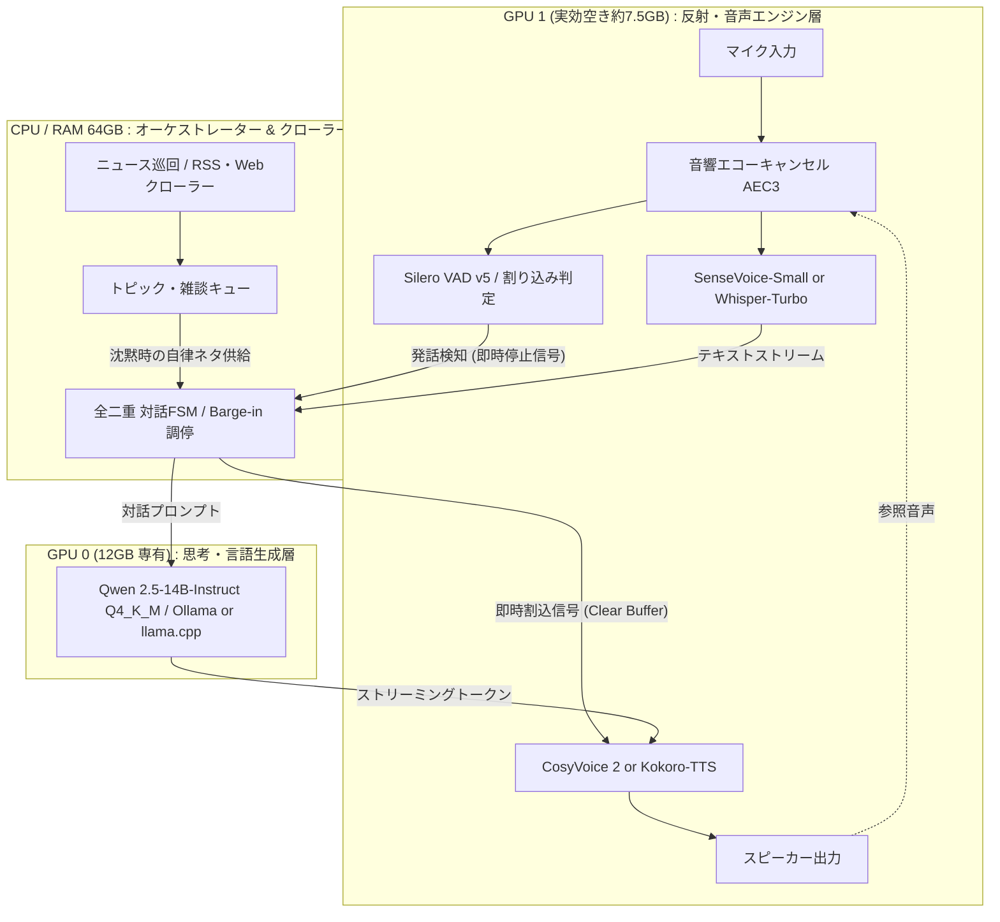
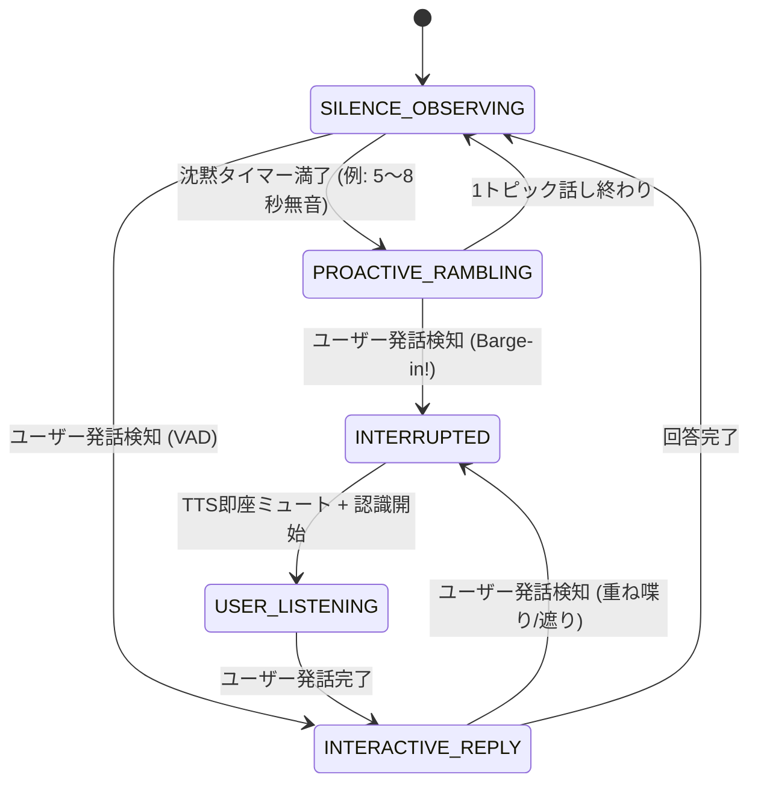

# 全二重・自律発話型 ローカル音声チャット アーキテクチャ設計書 (2026年10月版)

## 1. 概要と要件
- **動作環境**: Windows 11 PC (Dual NVIDIA GeForce RTX 3060 12GB = 計24GB VRAM, RAM 64GB)
- **コア機能**:
  1. 完全ローカル完結の音声対話（外部API非依存）
  2. 全二重（Full-Duplex）通信: ユーザーの発話割り込み（Barge-in）に即座（<100ms）に応答・発話停止
  3. 自律的な情報収集・独り言: Web/RSSから話題・ニュースを自律取得し、沈黙時にラジオDJのように取り留めもなく雑談
  4. シームレスな会話移行: 雑談中に話しかけられたら会話モードへ遷移し、沈黙後に雑談へ復帰

---

## 2. システム構成 (デュアルループ・ハイブリッド分離)

反射的な音声入出力・割り込み制御と、低速・高度な推論・情報収集を物理GPUごとに分離する。



---

## 3. ハードウェア・リソース配分

| デバイス | 割り当てコンポーネント | 推奨モデル / バックエンド | 消費リソース |
| :--- | :--- | :--- | :--- |
| **GPU 0** (12GB) | メインLLM (対話応答、雑談台本生成、要約) | Qwen 2.5 14B Instruct (Q4_K_M) (llama.cpp / Ollama) | 約 9.0 GB VRAM |
| **GPU 1** (実効7.5GB) | 高速ASR (音声認識, 遅延~100ms) | SenseVoice-Small または Whisper-large-v3-turbo | 約 1.5 GB VRAM |
| **GPU 1** (実効7.5GB) | ストリーミングTTS (音声合成, 初声遅延~150ms) | CosyVoice 2 または Kokoro-82M (ONNX/CUDA) | 約 2.0 GB VRAM |
| **CPU / RAM** (64GB) | 音響エコーキャンセル (AEC) & VAD | WebRTC AEC3 + Silero VAD v5 | RAM ~500 MB |
| **CPU / RAM** (64GB) | ニュース収集・キュレーションクローラー | feedparser / Playwright / BeautifulSoup | RAM ~1.5 GB |

---

## 4. 全二重・自律発話 FSM (状態機械)



---

## 5. 主要モジュール詳細

### 5.1. 音響エコーキャンセル (AEC) & Barge-in
- **課題**: スピーカーから流れるAI自身の音声をマイクが拾い、「ユーザーが喋り始めた」と誤判定する。
- **解決策**: WebRTC AEC3 を適用。スピーカーに出力したPCMオーディオを参照信号として入力マイク音声から減算し、ユーザー肉声のみを VAD に渡す。

### 5.2. 自律ニュースハーベスター
- RSS（Yahoo! ニュース トピックス、はてなブックマーク人気エントリ、ITmedia等）から記事ヘッドラインと概要を取得。
- GPU 0 の LLM がアイドル時に「雑談用の30〜45秒の語り台本」として整形し、FIFOキューにストック。

### 5.3. ストリーミング低遅延パイプライン
- LLMはセンテンス単位（句点「。」や読点「、」）でチャンク化してTTSに流し込み、全文生成を待たずに即時音声再生を開始。

---

## 6. PoC 実装コード

```python
import asyncio
import queue
import threading
import time
from dataclasses import dataclass
from typing import Optional
import feedparser
import numpy as np
import sounddevice as sd

# ==========================================
# 1. ニュース巡回モジュール (バックグラウンド収集)
# ==========================================
class NewsHarvester:
    def __init__(self, feed_url: str = "https://news.yahoo.co.jp/rss/topics/top-picks.xml"):
        self.feed_url = feed_url
        self.topic_queue = queue.Queue()

    def fetch_news_loop(self, interval_sec: int = 600):
        while True:
            try:
                feed = feedparser.parse(self.feed_url)
                for entry in feed.entries[:5]:
                    topic = f"【話題】{entry.title}。{entry.description}"
                    self.topic_queue.put(topic)
            except Exception as e:
                print(f"[NewsHarvester] Fetch error: {e}")
            time.sleep(interval_sec)

    def get_next_topic(self) -> Optional[str]:
        if not self.topic_queue.empty():
            return self.topic_queue.get()
        return None


# ==========================================
# 2. 全二重オーディオ & Barge-in コントローラー
# ==========================================
@dataclass
class AudioState:
    is_agent_speaking: bool = False
    is_user_speaking: bool = False
    last_voice_activity: float = time.time()
    interrupt_event: threading.Event = threading.Event()


class FullDuplexAudioEngine:
    def __init__(self, state: AudioState, sample_rate: int = 16000, chunk_size: int = 512):
        self.state = state
        self.sample_rate = sample_rate
        self.chunk_size = chunk_size
        self.tts_audio_queue = queue.Queue()

    def mic_callback(self, indata, frames, time_info, status):
        # 簡易エネルギー/RMS判定 (実運用では Silero VAD + WebRTC AEC を使用)
        volume_norm = np.linalg.norm(indata) / np.sqrt(frames)
        threshold = 0.03

        if volume_norm > threshold:
            self.state.is_user_speaking = True
            self.state.last_voice_activity = time.time()
            if self.state.is_agent_speaking:
                print("\n[Barge-in Detected!] ユーザー発話を検知。発話を中断します。")
                self.state.interrupt_event.set()
                self._clear_playback_buffer()
        else:
            self.state.is_user_speaking = False

    def spk_callback(self, outdata, frames, time_info, status):
        if self.state.interrupt_event.is_set():
            outdata.fill(0)
            self.state.is_agent_speaking = False
            return

        try:
            data = self.tts_audio_queue.get_nowait()
            if len(data) < frames:
                outdata[:len(data)] = data
                outdata[len(data):].fill(0)
            else:
                outdata[:] = data[:frames]
            self.state.is_agent_speaking = True
        except queue.Empty:
            outdata.fill(0)
            self.state.is_agent_speaking = False

    def _clear_playback_buffer(self):
        while not self.tts_audio_queue.empty():
            try:
                self.tts_audio_queue.get_nowait()
            except queue.Empty:
                break


# ==========================================
# 3. 自律対話オーケストレーター (FSM)
# ==========================================
class AutonomousAgent:
    def __init__(self, state: AudioState, audio_engine: FullDuplexAudioEngine, harvester: NewsHarvester):
        self.state = state
        self.audio = audio_engine
        self.harvester = harvester
        self.silence_timeout = 5.0

    async def run(self):
        print("音声チャット開始: 無音状態が続くとAIがニュースを拾って勝手に喋り始めます。")
        while True:
            now = time.time()
            elapsed_silence = now - self.state.last_voice_activity

            if elapsed_silence > self.silence_timeout and not self.state.is_agent_speaking:
                topic = self.harvester.get_next_topic()
                if not topic:
                    topic = "そういえば、最近面白い技術記事を見かけたんだけどさ..."

                await self.speak_stream(f"ねえねえ、{topic} っていう話があるんだけどさ。")
                self.state.last_voice_activity = time.time()

            await asyncio.sleep(0.1)

    async def speak_stream(self, text: str):
        self.state.interrupt_event.clear()
        self.state.is_agent_speaking = True
        print(f"\n[AI 発話開始]: {text}")

        # シミュレーション用ダミーPCM送出
        chunk_len = 512
        t = np.linspace(0, 1, 16000, False)
        tone = np.sin(2 * np.pi * 440 * t) * 0.1
        tone = tone.astype(np.float32).reshape(-1, 1)

        for i in range(0, len(tone), chunk_len):
            if self.state.interrupt_event.is_set():
                print("[AI 発話強制終了]")
                break
            chunk = tone[i : i + chunk_len]
            self.audio.tts_audio_queue.put(chunk)
            await asyncio.sleep(chunk_len / 16000)

        self.state.is_agent_speaking = False


# ==========================================
# エントリーポイント
# ==========================================
def main():
    state = AudioState()
    audio_engine = FullDuplexAudioEngine(state)
    harvester = NewsHarvester()

    crawler_thread = threading.Thread(target=harvester.fetch_news_loop, daemon=True)
    crawler_thread.start()

    with sd.InputStream(channels=1, samplerate=16000, callback=audio_engine.mic_callback, blocksize=512), \
         sd.OutputStream(channels=1, samplerate=16000, callback=audio_engine.spk_callback, blocksize=512):
        
        agent = AutonomousAgent(state, audio_engine, harvester)
        asyncio.run(agent.run())

if __name__ == "__main__":
    main()
```
