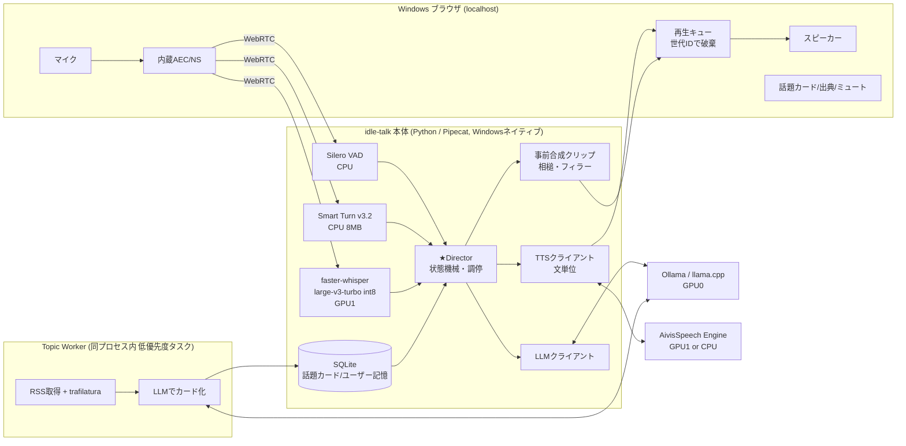
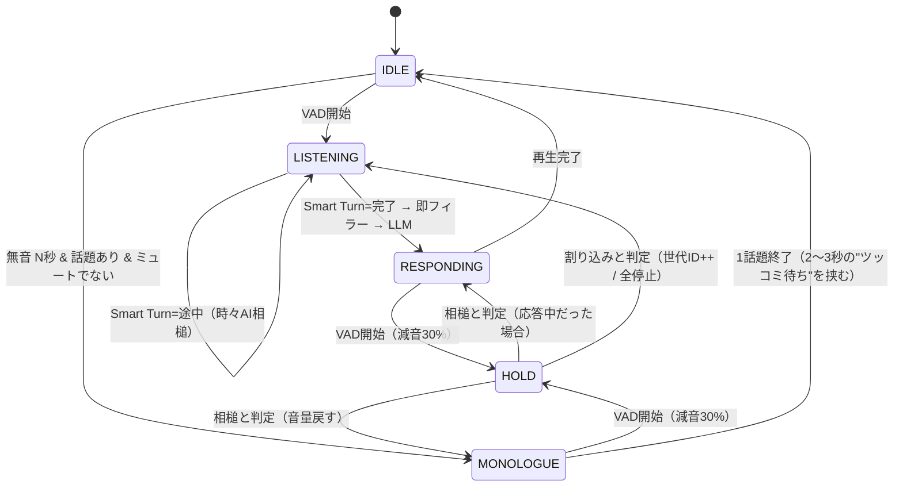

# idle-talk 推奨アーキテクチャ（3案比較の結論）

作成: 2026-10-09 / 対象PC: Win11, Ryzen 7 5700X, RTX 3060 12GB ×2, RAM 64GB
方針: **このPCで常駐できる軽さ** ＞ **楽しい雑談** ＞ 技術的な全二重の完成度

> 数値（VRAM・遅延）はすべて設計目安。未計測。Phase 0 で実測して置き換える。

---

## 1. 3案の比較

| 観点 | A: `full-duplex-voice-chat-architecture` | B: `voice-chat-architecture` | C: `local-voice-chat-architecture-2026-10` |
|---|---|---|---|
| 方式 | カスケード＋RMS閾値で割り込み | カスケード疑似全二重（Pipecat） | カスケード疑似全二重＋MaAI＋厳密な状態管理 |
| 音声I/O・エコー対策 | Python sounddevice + WebRTC AEC3（Windowsで組むのが大変） | ブラウザWebRTCの内蔵AEC | ブラウザWebRTC。AECが効いているか実測せよ、と慎重 |
| 割り込み/相槌 | 音量で即停止のみ。相槌でも止まる | Silero + Smart Turn。相槌は事前合成 | 相槌/割り込み/保留の3分岐、世代番号、再生済み履歴 |
| LLM | Qwen2.5-14B（2026-10時点では旧世代） | Gemma 4 12B / 26B-A4B | Qwen3.5-9B（thinking無効） |
| ASR | SenseVoice / whisper-turbo | whisper-large-v3-turbo / Qwen3-ASR-1.7B | Qwen3-ASR-0.6B（**vLLM必須→WSL2**） |
| TTS | CosyVoice2 / Kokoro（Kokoroは日本語が弱い） | **AivisSpeech**（軽量・VOICEVOX互換） | CosyVoice3 / Qwen3-TTS / Fish S2（重め） |
| 雑談の楽しさ | 見出しを読むだけ | 話題カード（hook/facts/opinion/question） | ラジオ/相棒/聞き役モード、1事実→感想→連想 |
| 実行環境 | Windows | **Windowsネイティブ**、keep_aliveで待機時解放 | Windows＋WSL2（構成が複雑） |
| 軽さ・常駐性 | ◯（ただし品質不足） | **◎** | △ |
| 設計の正しさ | △（PoCはダミー音） | ◯ | **◎** |

**結論**: 骨格は **B**（軽い・Windowsネイティブ・AivisSpeech・待機時解放）、会話制御の作法は **C**（世代番号・再生済み履歴・相槌の3分岐・話題カードの出典管理）、GPU役割分離の考え方は **A/B/C 共通**。A のPoCコードと Qwen2.5、C の vLLM/WSL2 は採らない。

> 補足: 同フォルダに `2026-10-09-lightweight-daily-voice-chat-architecture.md` も存在。方向性は近いが、LLMが Qwen2.5 世代、相槌判定がASR確定後（＝ユーザーが言い終わるまで判定できない）なので、本書で置き換える。

---

## 2. 全体構成



プロセスは **3つだけ**: `idle-talk`（Python）、`Ollama`、`AivisSpeech Engine`。WSL2・vLLM・ベクトルDB は使わない。

---

## 3. 部品とリソース配分

| 場所 | 部品 | 推奨 | VRAM/RAM 目安 | 理由 |
|---|---|---|---|---|
| GPU0 | 会話LLM（会話＋カード生成で共用） | **Qwen3.5-9B Q4_K_M**、thinking無効、ctx 8k | 6〜7.5GB | 単体12GBに余裕で収まる。thinking無効の方法が公式に明記 |
| GPU1 | ASR | **faster-whisper large-v3-turbo**（int8_float16） | 1〜2GB | Windowsで素直に動く。発話区間単位で認識 |
| GPU1 / CPU | TTS | **AivisSpeech Engine**（`--use_gpu` は Windows では DirectML） | 1〜2GB | 軽い・感情スタイル切替・VOICEVOX互換API（:10101） |
| CPU | VAD / 終話判定 | Silero VAD + **Smart Turn v3.2**（日本語対応、int8 8MB） | 〜数百MB | Pipecat に同梱。GPU不要 |
| CPU | 本体・Topic Worker・DB | Pipecat, feedparser, trafilatura, SQLite(FTS5) | 1〜2GB | 重複排除は FTS＋タイトル類似で十分。埋め込みは後回し |

- GPU1 は画面出力と共用（空き約7.6GB）。ASR+TTS で 3〜4GB に抑え、普段使いの余白を残す。
- **2枚にモデルを跨がせない**（PCIe越しで遅く、常用時に両GPUが塞がる）。

### LLM 切替ティア（同じ Ollama で `model` 名を変えるだけ）

| ティア | モデル | 使い所 |
|---|---|---|
| 最軽量 | Gemma 4 E4B（Q4） | GPU0 を他用途に空けたい。全部 GPU1 に寄せる構成も可 |
| **標準** | **Qwen3.5-9B（Q4_K_M）** | 常用 |
| 会話重視 | Gemma 4 12B（要確認: 2026-06 公開の "12B Unified"） | 日本語の口調・ノリが良ければ標準と入替 |

Qwen3.5-9B と Gemma 4 の日本語雑談の「ノリ」は好みが分かれる。Phase 0 で同じ10プロンプトを聞き比べて決める（数値ベンチより耳で決める）。

---

## 4. Director（自作の中核）

### 4.1 状態



### 4.2 相槌か割り込みか（HOLD の判定）

ASR確定を待たずに、**音の長さ → 文字** の順で早く決める。

| 条件 | 判定 |
|---|---|
| 発話 < 0.6秒 で終わり、ASR結果が相槌辞書（うん/へえ/そうなんだ/なるほど/あー/はい…）または空 | 相槌 → 継続 |
| 発話 ≥ 0.8秒 続いた | 割り込み → 即停止（ASRを待たない） |
| 停止語（待って/ちょっと/違う/ストップ/静かに） | 割り込み → 即停止 |
| 判定保留中 | 減音のまま最大0.8秒待つ |

- 停止時は **LLM生成・TTS要求・ブラウザ再生キュー** を世代IDでまとめて破棄（C案）。
- 会話履歴には **再生済みの文まで** だけ残し、途中で切れた文には「（ここで遮られた）」を付ける（B/C案）。これで「さっき言ったよね」の食い違いを防ぐ。
- 初期値は保守的。誤停止率・誤継続率を Phase 1 で数えて調整。MaAI（日本語の相槌・ターン予測、CPU）は Phase 3 の差し替え候補。

### 4.3 待たせない工夫（体感遅延を1秒未満に）

1. Smart Turn が「完了」を出した瞬間に、**事前合成フィラー**（「あー」「なるほどね」「え、それって」）を再生。LLMの初トークン待ちを隠す。
2. LLM出力は「。！？」と読点の長さで区切り、**最初の1文だけ短め**にするようプロンプトで指示 → TTS初声を早める。
3. 返答は基本 1〜3文。長話は MONOLOGUE 側の役割。

目安（未計測）: 終話判定 0.25s → フィラー即時 → ASR 0.2s → LLM初文 0.4s → TTS 0.2s ＝ **本応答 約1.1s、無音は約0.3sで埋まる**。

---

## 5. 「楽しい」ための設計

軽さを保ったまま楽しさを上げるのは、モデルを大きくすることではなく **ネタ・キャラ・間** の設計。

### 5.1 キャラクター（`persona.md` 1ファイル）
- 名前・口調・一人称・好きなもの・苦手なもの・口癖・ツッコミの癖を定義。
- 「自分の意見を持つ」「たまに脱線する」「知らないことは知らないと言う」を明記。
- AivisSpeech のスタイル（通常/楽しい/驚き/しんみり）を、LLM出力の先頭タグ `[楽しい]` で文ごとに切替。**声の表情が変わるだけで雑談感が大きく上がる。**

### 5.2 話題カード（Topic Worker 出力）

```
id, url, source, published_at, fetched_at, title
facts[≤3]        # 記事から確認できた事実のみ
hook             # つかみ「ねえ、〇〇って知ってた？」
take             # キャラとしての感想・意見のタネ
riff             # 身近な連想・脱線ネタ
question?        # 毎回は聞かない（3回に1回程度）
tags, interest_score, used_at, reaction
```

- 取得: RSS 30〜60分おき、**会話中でなく GPU0 が空いている時だけ** カード化。1回に生成するのは5〜10枚まで。
- 情報源: 技術（ITmedia/GIGAZINE/HN）＋一般（NHK等）＋**ゆるネタ枠**（雑学・季節・地域）。ニュースだけだと重くなるので、ゆるネタ枠を必ず混ぜる。
- 記事本文は LLM へのデータとして扱い、指示として解釈しない。出典はUIのカードに表示し、URLは読み上げない（C案）。

### 5.3 話し方の型
- 独り言は **1事実 → 感想 → 脱線/連想** の3拍子、20〜40秒、文ごとに短い間。
- 選ぶ話題は「興味スコア高 7割 / 意外枠 3割」。
- 反応による学習: 「もっと」「へえ！」→ スコア↑、すぐ遮られた/無反応 → 少し↓（弱い重み。明示の「その話いらない」を最優先）。
- **記憶の呼び戻し**: ユーザーが話した好み・予定を SQLite に短文で保存し、「前に言ってた〇〇、続報出てたよ」とつなぐ。これが一番「相手がいる感」を出す。
- 時間帯で振る舞いを変える: 朝は短めの一言、夜はゆっくり。

### 5.4 モード（音声コマンド＋UIボタン）

| モード | 挙動 |
|---|---|
| ラジオ | 無音8〜12秒で話題開始。話題間に間 |
| 相棒（作業中） | 数分に一言。無反応なら間隔を倍々に |
| 聞き役 | 自発発話なし。相槌と返答のみ |
| 静かに | 自発発話停止。呼びかけで復帰 |

---

## 6. 常駐の軽さ

- **Windowsネイティブ**、Python は uv 管理。タスクトレイ常駐（開始/一時停止/モード）。
- GPU固定: Ollama は `CUDA_VISIBLE_DEVICES=0`、faster-whisper は `device_index=1`。AivisSpeech は DirectML のためアダプタ選択を Phase 0 で確認。GPU1を選べない場合は **CPUモード**（5700X、短文単位なら実用の見込み。要計測）。
- **待機時は LLM をアンロード**: Ollama `keep_alive` を10〜15分。呼びかけ時の再ロード数秒は「ん、ちょっと待ってね」フィラーで隠す。
- ASR・VAD・TTS は常駐でも合計 数GB。完全停止はトレイの「一時停止」でマイクごと止める。
- キュー・履歴・話題プールに上限と期限（長時間稼働でメモリが増えない）。生音声は保存しない。

---

## 7. 進め方

| Phase | 内容 | 完了条件 |
|---|---|---|
| 0 計測 | LLM 3候補の聞き比べ、ASR/TTS 同時稼働の VRAM・速度、AivisSpeech の GPU 選択、ブラウザAECの効き | 部品確定、数値を本書に反映 |
| 1 会話の土台 | Pipecat + SmallWebRTC + faster-whisper + Ollama + AivisSpeech。交互会話＋割り込み＋世代ID＋再生済み履歴＋フィラー | 「待って」で300ms以内に止まる、「うん」で止まらない |
| 2 独り言 | persona.md、手書きの話題カード10枚でラジオモード、モード切替 | 1時間放置して破綻しない |
| 3 ネタ収集・記憶 | Topic Worker、ユーザー記憶、反応学習、スタイル切替 | 翌日「前の話」を拾える |
| 4 実験 | MaAI による相槌タイミング、Qwen3-ASR-1.7B（日本語CER改善）、Irodori-TTS（声クローン） | 体感が良くなる物だけ採用 |

ネイティブ全二重モデル（LLM-jp-Moshi 等）は、このPC（12GB×2）での実時間動作が未確認かつニュース連携が弱いため、本線にしない。

---

## 8. 未決事項（ユーザー判断）

- キャラクター像（口調・性格）と AivisSpeech の声
- 話題ソースの比率（技術 / 一般ニュース / ゆるネタ）
- スピーカー運用かヘッドホン運用か（スピーカーならAECの実測が必須）

## 参考
- Gemma リリース履歴 https://ai.google.dev/gemma/docs/releases
- Qwen3.5-9B モデルカード https://huggingface.co/Qwen/Qwen3.5-9B
- Smart Turn https://github.com/pipecat-ai/smart-turn
- AivisSpeech Engine https://github.com/Aivis-Project/AivisSpeech-Engine
- MaAI https://github.com/MaAI-Kyoto/MaAI
- 既存3案: `docs/plans/2026-10-09-full-duplex-voice-chat-architecture.md` / `docs/plans/2026-10-09-voice-chat-architecture.md` / `docs/plans/local-voice-chat-architecture-2026-10.md`
