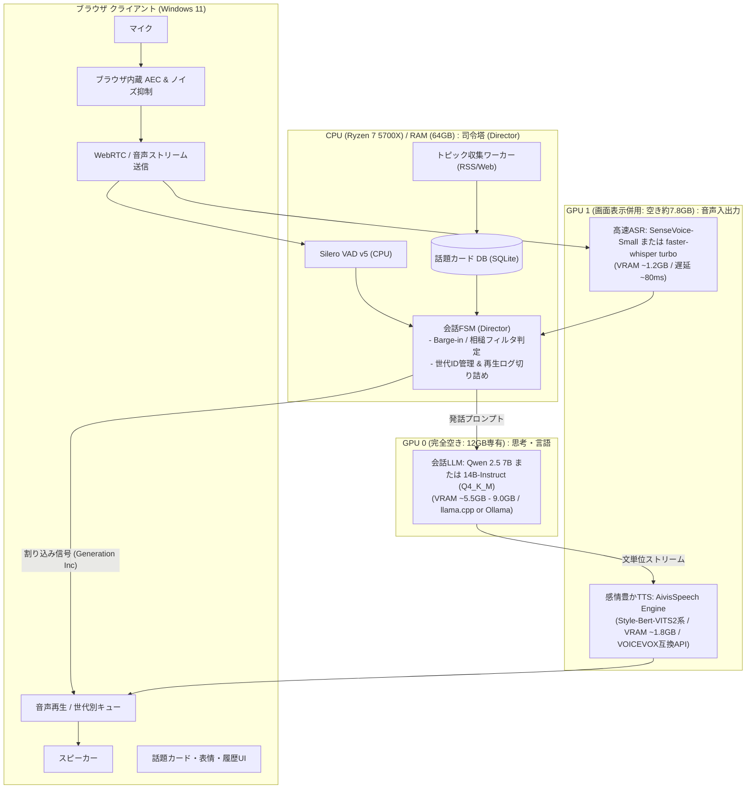

# 軽量・快活 日常音声対話アーキテクチャ設計書 (2026年10月版)

## 1. 3案の比較と評価

| 項目 | 案A (`full-duplex-voice-chat`) | 案B (`voice-chat-architecture`) | 案C (`local-voice-chat-2026-10`) | **本案（最適ハイブリッド）** |
| :--- | :--- | :--- | :--- | :--- |
| **フロント / AEC** | Python `sounddevice` + AEC3<br>(Winで導入・遅延課題大) | ブラウザ WebRTC<br>(ブラウザ標準AECで解決) | ブラウザ WebRTC<br>(ブラウザ標準AECで解決) | **ブラウザ WebRTC / WebSocket**<br>(AEC無料・UI表示両立) |
| **会話制御** | 単純VAD閾値 (停止のみ)<br>相槌と割り込み区別なし | Silero + Smart Turn v3.2<br>相槌トリガーあり | MaAI + 状態機械<br>キャンセル世代番号管理 | **VAD + 相槌フィルタ + 世代管理**<br>(短文ダッキング & 確定遮断) |
| **LLM** | Qwen 2.5 14B (GPU0) | Gemma 4 12B (GPU0) | Qwen3.5-9B (GPU A) | **Qwen 2.5 7B/14B Q4_K_M** (Ollama/llama.cpp)<br>GPU0専有、TTFT < 200ms |
| **ASR** | SenseVoice / Whisper-turbo | whisper-large-v3-turbo | Qwen3-ASR (vLLM, 重い) | **SenseVoice-Small or Whisper-turbo**<br>(GPU1 / ONNX or faster-whisper, 軽量爆速) |
| **TTS** | CosyVoice 2 / Kokoro | AivisSpeech (Style-Bert-VITS2) | CosyVoice3 / Qwen3-TTS | **AivisSpeech Engine** (GPU1)<br>(感情豊か・VOICEVOX互換・低VRAM) |
| **日常会話の楽しさ** | ニュース全文朗読 (硬い) | 話題カード (フック/意見/問い) | ラジオ雑談 + 間合い調整 | **ラジオDJ話題カード + 感情音声 + 相槌** |
| **このPC適合性** | 普通 (Winオーディオ難) | 極めて高い | やや重い (vLLM/WSL2複雑化) | **最高** (Winネイティブ完全対応) |

---

## 2. 推奨システム構成 (Dual RTX 3060 最適配分)



---

## 3. リソース配分と消費電力・安定性

| デバイス | プロセス | モデル / 技術 | 実効VRAM | 役割 |
| :--- | :--- | :--- | :--- | :--- |
| **GPU 0** | llama.cpp / Ollama | Qwen 2.5 7B (Q4_K_M) または 14B | 5.5GB〜9.0GB | 会話生成・話題要約。待機時はKeepAlive解除で省電力化可 |
| **GPU 1** | Python / CTranslate2 | SenseVoice-Small / faster-whisper turbo | 約 1.2GB | 超低遅延ASR (感情・トーンも検知可) |
| **GPU 1** | AivisSpeech Engine | Style-Bert-VITS2 系統キャラモデル | 約 1.8GB | 抑揚・感情豊かな日本語TTS。VOICEVOX互換APIで常駐 |
| **CPU/RAM** | FastAPI / Python | Silero VAD + FSM + SQLite + RSS | RAM 約2GB | 割り込み・相槌調停・話題プール管理 |

- **GPU 1 合計負荷**: 約 3.0GB (既存アプリ 4.4GB と合わせても約 7.4GB / 12GB で極めて安全)。
- **Windows ネイティブ完結**: WSL2 不要。uv + Python 3.11/3.12 で構築可能。

---

## 4. 「楽しく日常会話する」ための3つのキモ

### 4.1. 話題カードによる「ラジオDJ」化
ニュース要約を単に棒読みするのではなく、LLMが以下の4項目に落とし込んだカードをストックする。
1. **つかみ (Hook)**: 「ねえねえ、そういえばさ〜」
2. **要点 (Fact)**: 1文で説明できる事実
3. **AIの意見 (Opinion)**: 「私、これ結構アリだと思うんだよね」
4. **ユーザーへのパス (Pass)**: 「どう思う？」またはあえて質問せず余韻を残す

### 4.2. 相槌（Backchannel）と割り込み（Barge-in）のスマート調停
- **相槌判定**: ユーザー発話が「うん」「へえ」「なるほど」「あー」かつ短時間（< 700ms）の場合、AIは**発話を止めず音量を30%にダッキング（一時減衰）**して話し続ける。
- **割り込み判定**: 「いや」「待って」「それって〜」など有意な発話の場合、**即座にTTS再生中止（世代番号更新）**し、AIは口を閉じる。
- **履歴整合性**: AIの発話履歴には「実際にユーザーが耳にした文」までを記録（未再生分は破棄）。

### 4.3. 間合い（ターン交替）の自然さ
- 沈黙が 8〜12 秒続くと自発的に話題カードから独り言を開始。
- 1トピックは 20〜30 秒で区切り、2〜3秒の空白（ツッコミ待ち）を挟む。

---

## 5. ミニマル実装構成コード (FSM & Director 骨格)

```python
"""
idle-talk: 軽量・快活 日常音声対話 Director コア
"""
import asyncio
import time
from dataclasses import dataclass
from enum import Enum
from typing import Optional
import httpx

class AgentState(Enum):
    LISTENING = "listening"
    SPEAKING = "speaking"
    IDLE_MONOLOGUE = "monologue"

@dataclass
class TopicCard:
    id: int
    title: str
    script: str  # 短いラジオ風トーク台本

class DialogueDirector:
    def __init__(self, ollama_url: str = "http://localhost:11434", tts_url: str = "http://localhost:10101"):
        self.state = AgentState.LISTENING
        self.generation_id = 0
        self.last_speech_time = time.time()
        self.silence_threshold = 10.0  # 10秒沈黙で独り言
        self.ollama_url = ollama_url
        self.tts_url = tts_url
        self.backchannel_words = {"うん", "へえ", "そっか", "なるほど", "はい", "あー", "うんうん"}

    def on_user_speech_start(self):
        """ユーザー発話開始検知 (VAD)"""
        self.last_speech_time = time.time()
        if self.state in (AgentState.SPEAKING, AgentState.IDLE_MONOLOGUE):
            # 暫定的に音量を下げる (ダッキングシグナル)
            return {"action": "ducking", "volume": 0.3}
        return {"action": "listen"}

    async def on_user_asr_final(self, text: str):
        """ASR確定時の判定"""
        clean_text = text.strip()
        self.last_speech_time = time.time()

        # 1. 相槌判定: 単なる相槌なら話を継続
        if self.state == AgentState.SPEAKING and clean_text in self.backchannel_words:
            return {"action": "resume_volume"}

        # 2. 割り込み判定 (Barge-in): 世代IDをインクリメントし、再生中止
        self.generation_id += 1
        current_gen = self.generation_id
        self.state = AgentState.LISTENING

        # 3. LLMへ応答生成要求
        prompt = f"ユーザー: {clean_text}\nAIとして親しみやすく1〜2文で短く返答して。"
        asyncio.create_task(self._generate_and_speak(prompt, current_gen))
        return {"action": "interrupt", "generation_id": current_gen}

    async def tick_silence_watcher(self, topic_pool: list[TopicCard]):
        """無音監視ループ: 沈黙時にラジオトークを自発開始"""
        while True:
            await asyncio.sleep(1.0)
            now = time.time()
            if self.state == AgentState.LISTENING and (now - self.last_speech_time) > self.silence_threshold:
                if topic_pool:
                    card = topic_pool.pop(0)
                    self.generation_id += 1
                    current_gen = self.generation_id
                    self.state = AgentState.IDLE_MONOLOGUE
                    self.last_speech_time = now
                    asyncio.create_task(self._speak_script(card.script, current_gen))

    async def _generate_and_speak(self, prompt: str, gen_id: int):
        self.state = AgentState.SPEAKING
        # LLMストリーミング呼び出し -> 句点分割 -> TTS生成 -> クライアント送出
        # gen_id != self.generation_id になったら直ちにループ中断
        pass

    async def _speak_script(self, script: str, gen_id: int):
        # 独り言の文送出
        pass
```
