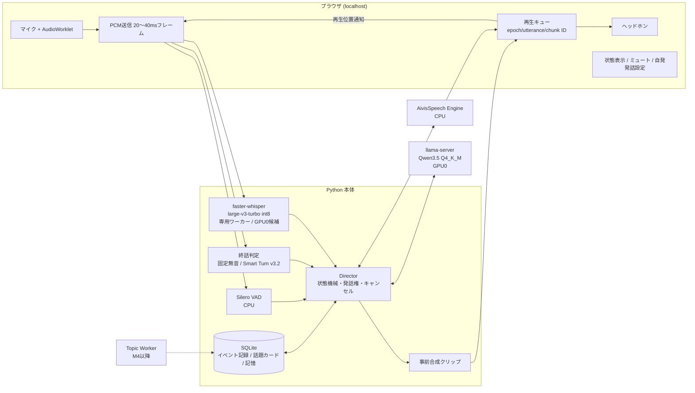

# idle-talk 最終アーキテクチャ（合議結果）

作成日：2026-10-11
対象：Windows 11、利用者1人、常駐する日本語の音声雑談
状態：設計確定版（ただし性能は未実測）。M0 の計測結果で数値と未決事項を確定する。

元資料：
- `2026-10-09-daily-voice-chat-synthesis.md`（案1：統合案）
- `2026-10-09-idle-talk-recommended-architecture.md`（案2：推奨案）
- `2026-10-09-lightweight-daily-voice-chat-architecture.md`（案3：軽量案）

AI-Gougi 合議の結果を整理したもの。
- 1回目：Claude・Codex（R1+R2）。agy は権限エラーで回答を得られなかった。
- 2回目：Claude・Codex・agy（R1+R2）。ASR の配置、割り込み時の動作、M0 と M5 の確認項目を更新した。

---

## 1. 結論

**案1を骨格にする。そこに案2の話題カードと会話ルールを加える。** 構成は次のとおり。

- ブラウザ（localhost）と Python 本体（Director）の間は、自前の WebSocket で PCM 音声をやり取りする。
- 常駐プロセスは3つだけ：Python 本体、llama-server、AivisSpeech Engine。
- 最初はヘッドホンで使う前提にする。
- 楽しさは「間」と「キャラ」で出す。話題カードと記憶は後から足す。
- 大きなモデルや複雑な基盤を入れる前に、次の3点を先に固める。
  - 相手の話を遮らない
  - 短く返す
  - 割り込まれたらすぐ話すのをやめる

最大のリスクは2つある。

1. **発話権の取り違え。** 日本語の言いよどみ（「〜けど」「〜で」）、相槌、訂正を誤判定して、話の途中で応答したり、誤って停止したりすること。モデルを大きくしても解消しない。
2. **応答遅延の積み上がり。** 遅延は「終話判定 → ASR → LLM の最初の文 → TTS」の各段で積み上がる。

## 2. 対象PC

| 項目 | 内容 |
|---|---|
| CPU | Ryzen 7 5700X（8コア16スレッド） |
| RAM | 64GB（空きは約20GB。既存アプリを維持する前提） |
| GPU0 | RTX 3060 12GB（使用量0、専有できる） |
| GPU1 | RTX 3060 12GB（既存アプリが約4.4GB使用、空きは約7.6GB。負荷の山は読めない） |

## 3. 全体構成



### 部品

| 部分 | 初期の選択 | 備考 |
|---|---|---|
| 通信 | 自前 WebSocket + AudioWorklet | 入力は16kHzモノラルPCM。出力は短文単位で、先読みは1チャンクまで |
| LLM | Qwen3.5 Q4_K_M、llama-server、GPU0、ctx 4k、思考無効 | 4Bか9Bかは M0 で決める（§6）。会話中はロードしたままにする |
| ASR | faster-whisper large-v3-turbo、`int8_float16`、`language=ja` | 第一候補は GPU0（2回目の合議で 2対1）。M0 の実測で確定する（§6） |
| TTS | AivisSpeech Engine の CPU 版、声は1つに固定して事前ロード | CPU で遅ければ DirectML（GPU）と比べる |
| 発話検出 | Silero VAD（CPU） | 発話の開始と終了を別々に扱う |
| 終話判定 | 固定無音を基準に、Smart Turn v3.2 と比べる | 日本語での効果は未確認 |
| 保存 | SQLite | イベント記録、話題カード、少量の記憶 |

### 使わない・後回しにするもの

| 要素 | 判断 |
|---|---|
| vLLM / WSL2 | 使わない |
| ベクトルDB / 記憶MCP / 声クローン | 使わない |
| 14B 級のモデル、複数GPUへのモデル分割 | 使わない |
| 待機のたびに LLM を解放 | 省電力モードと長時間離席のときだけ。復帰時はウォームアップする |
| ASR 確定後に相槌を判定する方式（案3） | 停止を始めるには遅すぎるので使わない。意味の判定にだけ使う |
| 会話と話題生成を同時に実行 | しない。会話が始まったら背景の生成を中断できる設計にする |
| ラジオDJ風の長い独演 | 一言の導入にして、反応があれば広げる |
| Pipecat | MVPでは使わない。移行条件は §4.4 |
| RSS Worker | M4 から |

## 4. 会話制御（Director）

### 4.1 状態

`待機 → ユーザー発話中 → 終話確認中 → 返答準備中 → AI再生中 → 割り込み確認中 → 休止`

原則：
- LLM は返答の中身を作る。いつ話すかは Director が決める。
- ユーザーが話し始めたことは、ASR の確定を待たずに VAD で検知する。
- AI の再生中もマイクと VAD を止めない。
- 音を止める処理は、LLM や ASR の完了を待たない。
- 通常の応答、自発発話、相槌クリップは、すべて同じ再生経路とキャンセル経路を通す。

### 4.2 割り込み（停止とキャンセル確定を分ける）

1. AI の再生中に VAD が発話を検知したら、**まず音量を下げる（ダッキング）**。すぐには止めない。ユーザーの相槌で AI が止まってしまう誤停止を減らすため。
2. 300〜500ms の間に、短い音声区間と ASR の途中結果から判定する。
   - **相槌**（「うん」「へえ」）→ 続きから再開する
   - **割り込み**（「待って」「違う」、または一定以上の発話）→ キャンセルを確定する
   - **判断できない** → 停止したままにする

   「待って」などの短い制止を取りこぼさないよう、強い発話や停止語はダッキングを省いて即停止してよい。ダッキングと即停止のどちらを基本にするかは、M1 で誤停止率とユーザーの相槌の頻度を見て調整する。
3. キャンセルを確定したら、次を行う。
   - 世代番号（epoch）を更新する
   - ブラウザの再生キューを破棄する
   - 旧世代の LLM・TTS の結果を捨てる
   - TTS の合成計算を止める

注意：
- 短い発話を相槌とはみなさない。「うん？」は疑問、「いや」は訂正になりうる。
- 停止の閾値（300ms など）は固定せず、実測で決める。

### 4.3 再生済み履歴

- 音声チャンクには `epoch / utterance_id / chunk_id` を付ける。ブラウザは実際の再生位置を返す。
- 会話履歴に確定するのは、**再生が完了したチャンクだけ**。途中で止まったチャンクは「中断された発話」として、停止位置と一緒に記録する。
- 送信の完了を再生の完了とみなさない。
- 単語ごとの時刻がない場合、再生秒数から聞こえた文章を推定しない。
- **AivisSpeech の罠**：通常の `/synthesis` は、接続を切っても合成計算が続く。実験的な `/cancellable_synthesis` を検証する。「古い音声が鳴らないこと」と「計算が止まること」は別々に確認する。

### 4.4 Pipecat への移行条件

次のどれかに当てはまったら、Pipecat + SmallWebRTC と比べる。

- スピーカーでのハンズフリー利用が必須になった
- 音声デバイスの切替、復帰、再接続の保守が重くなった
- スマホや別のPCから接続したくなった

移行しやすくするため、Director の内部イベント名は Pipecat に寄せておく（StartInterruption、TTS の開始・停止、Bot が発話中か、など）。WebRTC を入れても AEC が効く保証はない。合格条件は「自分の声を認識して応答が連鎖しないこと」にする。

Pipecat を入れる前に、まず自前 WebSocket のまま `getUserMedia({ echoCancellation: true })` を試す。WebSocket で受けて Web Audio で再生した音声が、ブラウザの AEC の参照信号に入るかどうかは不確か（agy は効くと主張、Claude は不確かとした）。効けば WebRTC は不要になる。

### 4.5 AI からの相槌（M2 から）

- MVP では入れない。
- 入れるときは次のようにする。
  - トリガーは、ASR の確定を待たず、長めの発話の途中で無音が300〜600ms続いたとき。
  - 鳴らすのは、内容に関係しない短い事前合成クリップ。
  - 1発話につき最大1回。同じクリップを続けて使わず、数秒のクールダウンを置く。
  - 誤発火はすべて記録する。
- Smart Turn は終話判定器であり、相槌のタイミングまで保証しない。効果が足りなければ MaAI などと比べる。

### 4.6 自発発話（M3 から）

- 利用者がオン／オフ、頻度、休止時間帯を設定できるようにする。初期値は控えめにする。
- 話しかけるのは雑談モードのときだけ。作業中や休止中は話さない。
- 1回話しかけて返事がなければ、続けて話しかけない。無反応が続いたら頻度を下げる（待ち時間を延ばす）。
- 話題を準備している間にユーザーが話し始めたら取り消す。会話が進んだら、事前に合成した音声も捨てる。
- 沈黙は「話しかけてよい」という同意ではない。

## 5. 楽しさの設計

優先順位：**返答の仕方と間 → 声と軽いキャラ → 話題カード → 記憶**

### 返答のルール
- 通常の応答は1〜3文。最初の文から中身を言い、その文ができたらすぐ TTS に渡す。
- 毎回質問で終えない（目安は3応答に1回以下。評価で調整する）。
- 話を受けて、小さな感想や視点を足す。
  - 悪い例：「今日はカレー作った」→「何カレーですか？」
  - 良い例：「カレーの日、いいね。翌日のぶんまであると、明日もちょっと楽しみになる。」
- 同じ質問や同じ話題を繰り返さない。

### キャラ
- 「少し好奇心が強い、気軽な同居人」程度にする。長い設定資料は書かず、会話例で口調を固定する。
- 声は AivisSpeech の好きな声を1つ使い、表現は少数にする。感情認識に合わせて声色を頻繁に変えることはしない。

### 話題カード
```
hook / facts / source_url / published_at / expires_at /
angle / optional_question / used_at / user_reaction
```
- 事実と切り口を分ける。質問は任意。
- カードを丸ごと読み上げず、まず一言だけ話す。
- 最初は手作りのカードを10〜20枚、または待機中に LLM に作らせる。RSS は M4 から。
- ニュースには出典と日時を持たせる。

### 記憶
- SQLite に、明示された好みや続いている話題を少量だけ保存する。
- 各記憶に、根拠となった発話、更新時刻、削除可否を持たせる。利用者が確認・訂正・削除できるようにする。
- ASR の不確かな認識からプロフィールを自動で確定させない。

## 6. 未決事項（M0 で決める）

| 論点 | 案A | 案B | 決め手になる計測 |
|---|---|---|---|
| LLM | 9B を本命にする（短文なら遅延差は小さいという見立て） | 4B で始め、9B が明確に好まれたら上げる | 9B Q4_K_M の ctx 4k での VRAM、最初の1文までの時間、20ターンでのキャッシュ効果、30〜50場面のブラインド比較 |
| ASR の配置 | **第一候補**：GPU0 で LLM と同居させる（ASR と LLM はほぼ順番に動く。GPU1 の揺れを避けられる） | GPU1（割り込みの瞬間に ASR と生成中の LLM が重なる恐れ） | GPU1 の既存アプリの負荷変動、同居させたときに LLM 応答がどれだけ遅れるか、**割り込みの瞬間に ASR と LLM が重なったときの遅延** |
| TTS の配置 | CPU | GPU1（DirectML） | 最初の1文の合成時間。CPU で 300ms を超えたら GPU1 と比べる |
| 終話判定 | 固定無音 | Smart Turn v3.2 | 日本語の言いよどみ50試行での早切り数 |

決定ルール：
- LLM は、9B が遅延目標（§8）を満たし、品質で明確に勝てば 9B にする。それ以外は 4B。
- VRAM の上限：
  - LLM：GPU0 で 9GiB 以内（9B を試せる値）
  - ASR：追加分 3GiB 以内
  - アプリ全体：追加の RAM 8GiB 以内
  - これらは予測値ではなく、超えたら構成を見直すための上限。
- Qwen3.5 は混合構造（Gated DeltaNet 系）。llama.cpp で前回と共通する冒頭部分のキャッシュ再利用が効かない場合は、通常の Transformer 構造のモデル（Qwen2.5-7B、Gemma 系）を予備として比べる。
- 思考の無効化は、プロンプトに書くのではなくテンプレート設定で行う。実際の出力に思考が出ていないことを確認する。

## 7. 段階導入

| 段階 | 内容 | 次へ進む条件 |
|---|---|---|
| **M0：計測** | **最初に環境を確認する**：faster-whisper の CUDA/cuDNN DLL が読み込めるか、Qwen3.5 の GGUF が使う llama.cpp の版で動くか。そのうえで、既存の GPU1 アプリを動かしたまま次を同時に測る。① ASR の幻聴率 ② Qwen3.5 4B/9B の最初の1文までの時間とキャッシュ再利用 ③ AivisSpeech CPU 版の最初の音までの時間 ④ ASR を GPU0 に置いた場合と GPU1 に置いた場合（割り込みで LLM と重なる場合を含む） ⑤ VRAM/RAM | §6 の未決事項が決まる |
| **M1：最小MVP** | 音声の往復、固定キャラ、2段階の割り込み停止、再生済み分だけの履歴、イベント記録。相槌と自発発話はなし | 20分の会話で、音声欠け・古い音声の再生・履歴の不整合がゼロ |
| **M2：終話判定と相槌** | 固定無音と Smart Turn の比較、AI からの相槌、割り込み時の相槌判定と再開 | 早切りと誤発火が目標以内（§8）、煩わしさが増えない |
| **M3：楽しさ** | 手作りの話題カード、自発発話（設定可能）、少量の記憶（訂正・削除可）、質問率の制御 | 主観評価の「続けたい」が上がる |
| **M4：常駐** | RSS Worker（静かな時間に短いジョブで動かす）、8時間の連続運転 | 応答の p95 が悪化しない。メモリが増え続けない |
| **M5：スピーカー** | まず自前 WebSocket のままブラウザの AEC が効くかを実測する。効かなければ Pipecat + SmallWebRTC と比べる | 自分の声への応答連鎖がない。割り込みができる |

### ASR の幻聴対策（M0 で効果を測る）
faster-whisper は、短い発話や雑音から存在しない文（「ご視聴ありがとうございました」など）を出しやすい。次の対策を試す。

- VAD で区切った区間の音声だけを ASR に渡す
- `no_speech_prob` と `compression_ratio` の閾値で結果を捨てる
- よく出る幻聴フレーズを除外リストで消す
- `condition_on_previous_text=False` にする

## 8. 計測する指標と初期目標

目標はすべて暫定値で、達成できるかは未確認。

| 指標 | 初期目標 |
|---|---|
| ユーザーの発話終了 → 意味のある最初の音声 | p50 ≤ 1.2秒、p95 ≤ 2.0秒 |
| ユーザーの発話開始 → AI の音声停止 | p95 ≤ 250ms |
| 停止後に旧世代の音声が鳴る | 0件 |
| 話の途中を終話と誤判定する | 50試行で2件以下 |
| 誤停止率、AI からの相槌の誤発火率、AI が話にかぶせた回数 | 記録して改善する |
| TTS の処理時間 ÷ 生成した音声の長さ | p95 < 0.7、連続再生で音が途切れない |
| ASR の文字誤り率、幻聴の件数 | 自分の声で測る |
| 常駐の安定性 | 8時間でメモリが増え続けない、音声が止まらない |
| 資源 | 待機中と会話中のピークで、CPU、RAM、GPU0/1 の VRAM と消費電力を測る |
| 主観 | 20分の会話の後に「続けたい」「テンポ」「煩わしさ」を5段階で記録 |
| 会話 | 質問率、自発発話に応じた割合、1回の会話の長さ |

計測のルール：
- 応答遅延は「終話待ち → ASR 確定 → LLM の最初の合成可能な節 → TTS 合成 → 再生開始」に分けて記録する。
- 事前合成の相槌音は、応答遅延の計測に含めない。
- TTS の目標値は、文の長さ、声、同時負荷を固定した条件で測る。
- 遅い部品が見つかったら、モデルを大きくする前にその部品を改善する。
