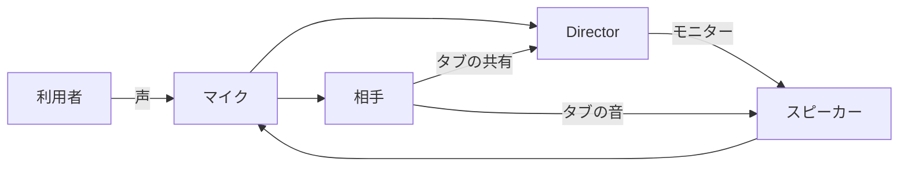
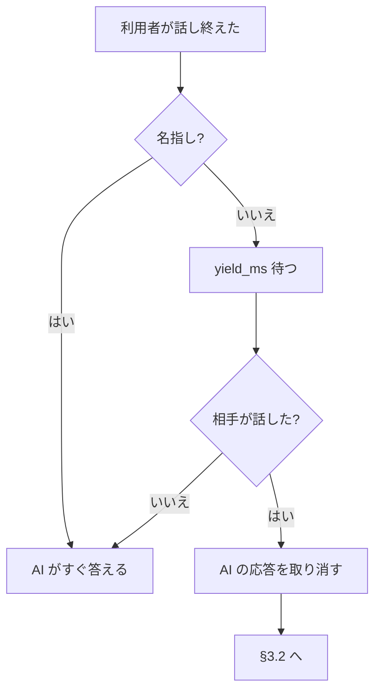
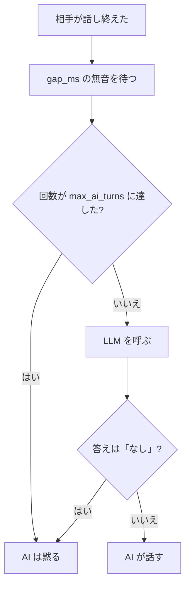

# 相手モード 設計

作成日：2026-10-18
反映先：`docs/design-idle-talk.md` の §6.8
状態：2026-10-18 に「PC と話す」モードとして実装した。実装したのは §0 の方式である。§1 以降は、その前に検討した方式の記録である。

## 0. 実装した方式：PC と話す (2026-10-18 改訂)

### 0.1 改訂の理由

- 利用者は、通常のモードのまま、ChatGPT のデスクトップアプリとスピーカーとマイクで会話できた。
- デスクトップアプリは Chrome と別のプロセスである。アプリのエコー除去は、Chrome が鳴らした AI の声を消さない。
- ブラウザの ChatGPT と話すときだけ、AI の声を Chrome の外から鳴らす必要がある (§8.1)。
- 共有と 3 人の話す順番の規則 (§2〜§3) は、要らないと判断した。

### 0.2 方式

- 画面の「PC と話す」で、ブラウザは `ui.pc=true` を送る。共有はしない。
- 相手 (PC で動く別の音声 AI) の声は、利用者の声と同じくマイクで聞く。経路は今の通常の応答と同じである。
- AI の声は、Director のモニターがスピーカーに鳴らす (§2.3 と同じ仕組み)。ブラウザには文字だけを送る。
- 設定 `[pc].monitor` が、モニターの出力機器を決める。空なら Windows の既定の再生機器である。
- マイクも Director が録る (2026-10-19、`MicCapture`)。設定 `[pc].mic` が入力機器を決める。空なら Windows の既定の録音機器である。モード中、Director はブラウザのマイクの上りを捨てる。ブラウザのマイクは Chrome のエコー除去を通り、ブラウザの ChatGPT の声がほぼ消えたからである。
- マイクの認識結果は、`turns` に role `pc` で残す。`talk.log` には `PC:` で書く。LLM には今までどおり user として渡す。
- モード中は、普段の自発発話・`IDLE_TIMEOUT` 休止・相槌・名前の質問・記憶の抽出を止める。
- 切り替えるとき、Director は鳴っている途中の声を取り消す。出口を変えると、前の出口から再生の報告が来ないからである。
- モニターの機器が開けないとき (sounddevice が無い場合も含む)、Director はモードを始めない。エラー 5006 を返す。
- モード中、Director は duck をモニターに渡さない (2026-10-19)。モニターの声をマイクが拾うたびに音量が下がったからである。割り込みは認識結果で判定する。
- モード中、AI の声の最中に始まった発話は、停止語 (`STOP_WORDS`) を含むときだけ割り込みにする。それ以外は捨てる (events に `pc_echo_suppressed`)。マイクが拾った AI の声は聞き違えられ (「嬉しいわ」→「うれしい」)、文字の一致では捨てられずに中断が続いたからである (2026-10-19)。

### 0.3 限界

- スピーカーでしか使えない。
- モニターの声は、idle-talk のマイクのエコー除去で消えない。拾った AI の声は、自声除外 (文字の一致) だけで捨てる。
- 利用者の声と相手の声を区別しない。どちらも `PC:` として残る。
- AI と相手は、どちらかが黙るまで話し続ける。回数の上限は無い。

### 0.4 変更したファイル

| ファイル | 変更 |
|---|---|
| `src/idle_talk/monitor.py` (新規) | モニター。チャンクを `sounddevice` で順に鳴らし、再生の報告を返す |
| `src/idle_talk/config.py` | `Pc` と `load_pc` |
| `src/idle_talk/director.py` | `pc_on`、出口の切り替え (`_set_pc`)、下りのチャンクをモニターへ、cancel・duck・resume をモニターへ、talk.log の `PC:`、止める機能の条件 |
| `src/idle_talk/protocol.py`・`server.py` | `ui.pc` |
| `src/idle_talk/main.py` | `[pc]` を読み、モニターの機器を開く関数を渡す |
| `web/index.html` | 「PC と話す」ボタン |
| `tests/test_pc.py` (新規) | 設定、モニター、Director の切り替えと記録 |

## 1. 概要

### 1.1 相手モードとは

相手モードは、3 人で声で話すモードである。

- 1 人目は利用者である。
- 2 人目は相手である。相手は、ブラウザで動く別の音声 AI である (例：ChatGPT の音声会話)。
- 3 人目は AI (idle-talk) である。

利用者は、画面の「AI と話す」ボタンで相手モードを始める。相手の画面での設定は要らない。

### 1.2 作る理由

利用者は 2026-10-18 に、ChatGPT の音声会話のタブをドラマモードで共有した。会話は成り立たなかった。原因は次の 2 つである。

- ドラマモードは、相手の発話に答えない。ドラマモードは台詞を溜めて、場面の切れ目に一言を言うだけである。
- AI の声は、相手に届かなかった。ブラウザが鳴らした AI の声を、相手のエコー除去が消した (§8.1)。

### 1.3 目的

- 利用者の声が、相手と AI の両方に届く。
- AI の声が、利用者と相手の両方に届く。
- 相手の声が、利用者と AI の両方に届く。
- 利用者は、相手の画面で設定をしない。

### 1.4 扱わないこと

- 相手の振る舞いの制御。相手は、聞こえた発言に必ず答える。AI は相手を止められない。
- 相手の画面の操作 (ボタンを押す等)。
- ヘッドホンでの利用。相手は、スピーカーから出た AI の声をマイクで聞くからである。
- 4 人以上の会話。

## 2. 音の経路

相手モードでは、全員がスピーカーとマイクでつながる。AI の声だけは、ブラウザではなく Director がスピーカーに鳴らす。

| 誰の声 | 誰に | 経路 |
|---|---|---|
| 利用者 | AI | idle-talk のマイク (今と同じ) |
| 利用者 | 相手 | 相手のマイクに直接入る |
| AI | 利用者 | モニターがスピーカーに鳴らす |
| AI | 相手 | モニターがスピーカーに鳴らし、相手のマイクに入る |
| 相手 | 利用者 | 相手のタブがスピーカーに鳴らす |
| 相手 | AI | 相手のタブを共有する |

### 2.1 利用者の声を AI に届ける

- マイクの音は、今と同じ経路を通る。
- 経路は `Ingress` → 状態機械 → ASR → 応答である。

### 2.2 相手の声を AI に届ける

- 利用者は、相手のタブを共有する。共有の画面で「タブの音声も共有する」をオンにする。
- 利用者は、画面全体ではなくタブを共有する。理由は §2.4 に書く。
- ブラウザは、タブの音を上りで送る。seq に `DRAMA_FLAG` を立てる (ドラマモードと同じ)。
- Director は、タブの音を専用の VAD で区間に分ける。
- Director は、区間を専用の単一ワーカーで認識する。マイクの認識を待たせないためである。
- Director は、認識結果を相手の発話として履歴に足す。
- AI が答えるかどうかは、§3 の規則で決める。

区間に分ける処理は、ドラマモードと共用する。`DramaListener` から区間化の部分を切り出し、`TabSegmenter` にする。

AI は、話者を声で推定しない。マイクとタブは経路が別なので、話者は経路で決まる。

### 2.3 AI の声を鳴らす (モニター)

相手のエコー除去は、Chrome が鳴らした声を消す。Chrome の別のタブが鳴らした声も消す (§8.1)。そこで、相手モード中は Director が AI の声を鳴らす。この仕組みを「モニター」と呼ぶ。

- Director は、下りのチャンクをブラウザに送らない。Director は、チャンクをモニターに渡す。
- モニターは、`sounddevice` でチャンクをスピーカーに鳴らす。Chrome の外のプロセスなので、相手のエコー除去の参照に入らない。
- モニターは、渡された順にチャンクを鳴らす。
- モニターは、取消で古い epoch のチャンクを捨てて止める。
- モニターは、duck と resume で音量を変える。
- モニターは、再生の報告 (`playback` の started / finished / dropped) を Director に返す。形はブラウザの報告と同じである。Director は今と同じ処理で、履歴を確定し、送り出しを制御する。
- ブラウザには、AI の発言の文字 (`text`) だけを送る。画面の表示は今と同じである。
- 設定 `[partner].monitor` が、モニターの出力機器を決める。既定は Windows の既定の再生機器である。

ブラウザの再生 (`web/player.js`) は変えない。相手モード中は、ブラウザに下りのチャンクが届かないだけである。

### 2.4 回り込み

相手モードはスピーカーで使う。マイクは、スピーカーの音を拾う。

**相手のマイク**

- 相手のマイクは、AI の声と利用者の声を拾う。これは目的どおりである。
- 相手のマイクは、相手自身の声も拾う。相手のエコー除去が、これを消す。

**idle-talk のマイク**

- **AI の声**：モニターの音は Chrome の外から鳴る。idle-talk のマイクのエコー除去は、この音を消さない。
  - Director は、自声除外 (認識結果の文字の一致) で捨てる。
  - Director は、モニターの再生中にマイクの閾値を上げる (`vad.playing`)。再生中かどうかは、モニターの報告で決まる。
- **相手の声**：相手のタブの音は Chrome が鳴らす。idle-talk のマイクのエコー除去は、この音を消すと見込む (要確認)。
  - 消えなかった場合は、マイクの認識結果を相手の直近の発話と比べて捨てる。比べ方はドラマモードと同じ (`contains`) である。events に `partner_echo_suppressed` を 1 行残す。
  - マイクの区間がタブの音と重なっていたら、Director は相手の認識を待ってから比べる。上限は ASR の `HTTP_TIMEOUT` である。ドラマモードでは、ドラマ側の認識が後に届くと検出できなかった。待つことで、これを解消する。
  - タブの音が鳴っている間、Director はマイクの閾値を上げる (`EnergyVad.bleed`)。ドラマモードと同じ仕組みである。

**共有したタブの音**

- タブの共有には、相手のタブの音だけが入る。
- 画面全体を共有すると、モニターの AI の声も入る。`restrictOwnAudio` は、Chrome の外の音を除かない。
- 入った場合は、`drama.is_ai_voice` と同じ比較で捨てる。

## 3. 話す順番

相手は、聞こえた発言に必ず答える。そこで、AI が相手に譲る。

AI は次の 2 つを守る。

- AI は、相手と同時に話さない。
- AI は、相手と 2 人だけで話し続けない。

### 3.1 利用者が話したとき

AI は、まず名指しかどうかを見る。

- 名指しは、利用者の発話に AI の呼び名が含まれることである。
- 呼び名は、ペルソナの `name` と `[partner].call_names` である。
- 比べるとき、句読点と空白を除く。部分一致で比べる。

名指しなら、AI はすぐ答える (今と同じ)。

名指しでないなら、AI は相手に先を譲る。

1. AI は、応答の生成をすぐ始める。
2. AI は、最初のチャンクの再生を止めて待つ。待つのは、終話から `[partner].yield_ms` までである。既定は 1500ms である。
3. 待つ間に相手が話し始めたら、AI は生成を取り消す。epoch を +1 する。events に `partner_yield` を 1 行残す。
4. 相手が話し終えたら、§3.2 で答えるかを決める。
5. 待つ間に相手が話さなければ、AI は再生を始める。

相手モード中は、応答の遅延の目標 (G1) を対象外にする。

### 3.2 相手が話し終えたとき

1. Director は、相手の区間の終わりを待つ。
2. Director は、マイクと相手の両方の無音を待つ。長さは `[partner].gap_ms` である。既定は 800ms である。
3. AI の発話の回数を数える。数えるのは、利用者が最後に話してからである。
4. 回数が `[partner].max_ai_turns` に達していたら、AI は黙る。既定は 2 回である。
5. 達していなければ、AI は LLM を呼ぶ。経路は自発発話と同じである (pending・保留・取消・再生完了)。
6. LLM の答えが「なし」なら、AI は黙る。「なし」は回数に数えない。

AI が黙れば、AI と相手のやりとりは止まる。相手は、聞こえたときだけ話すからである。

5 の LLM には、system に次の指示を足す。

- 相手の話に短く反応する。
- 言い足すことが無ければ「なし」とだけ出力する。
- 「なし」は、相手が利用者の質問に十分答えたときだけ使う。

### 3.3 声が重なったとき

- **AI の再生中に相手が話し始めた**：AI はすぐ取り消す。duck を挟まない。events に `partner_yield` を 1 行残す。
- 利用者の割り込みの判定 (`T_confirm`・相槌の判定) は、相手の声には使わない。
- **相手が話している間**：AI は再生を始めない。§3.1 の待ちと §3.2 の無音待ちが、これを守る。自発発話の経路も、タブの音が鳴っている間は再生を待つ。
- **利用者が話し始めた**：今と同じく割り込みとして扱う (設計書 §4.2)。相手も利用者の声を聞いて止まる。

## 4. その他の振る舞い

### 4.1 切り替え

- ブラウザは、`ui.partner` (true / false) で相手モードを切り替える。
- 相手モードは、ドラマモード・画面モードと同時に使えない。
- Director は、後から来たモードを拒否する。エラーは 5006 である。
- 画面は、使えないモードのボタンを無効にする。
- モニターの出力機器が開けないとき、Director は相手モードを始めない。Director はエラー 5006 を返し、理由を画面に出す。

### 4.2 相手モード中に止める機能

| 機能 | 止める理由 |
|---|---|
| 普段の自発発話 | 3 人の会話の邪魔になる |
| `IDLE_TIMEOUT` による休止 | 利用者がマイクを使わなくても、会話は続く |
| AI の相槌 | 相槌が相手に届き、相手が答えてしまう |
| 名前を尋ねる定型文 | 定型文が相手に届き、相手が答えてしまう |
| 記憶の抽出 | 相手の発言が、利用者の事実として混ざる |

### 4.3 相手モード中も使う機能

- 通常の応答
- 利用者の割り込み
- 文脈の無い短い認識結果の破棄。マイクだけに使う。
- 話者識別。マイクだけに使う。AI は利用者を名前で呼び続ける。
- Web 検索。利用者の発話への応答だけで使う。
- ペルソナ

### 4.4 ミュート

- ミュートは、idle-talk のマイクを止める。AI は利用者の声を聞かなくなる。
- ミュートは、相手のマイクを止めない。利用者の声は、相手には届き続ける。

### 4.5 LLM への指示

Director は、system に `PARTNER_PROMPT` を足す。内容は次のとおりである。

- 今は、利用者と相手と 3 人で話している。
- 「利用者:」「相手:」が、誰の発言かを示す。
- 利用者の話を中心にする。
- 相手の意見には、賛成・反論・補足で反応する。
- 相手が言ったことを繰り返さない。
- 相手が AI であることを、繰り返し話題にしない。

### 4.6 履歴と記録

- `turns` の role に `partner` を足す。`role` 列に制約は無い。スキーマの変更と移行は要らない。
- Director は、続いた利用者と相手の発話を 1 つの user メッセージにまとめて LLM に渡す。user が続くと、テンプレートが崩れる場合があるからである。
- 各行の先頭に、`利用者:` か `相手:` を付ける。
- `talk.log` には、相手の発話を `PARTNER:` で書く。
- events には、相手モードの開始と終了を `partner_mode` で残す。

## 5. 利用者の準備

1. スピーカーで使う。相手のマイクに AI の声が届く音量にする。
2. 相手の音声会話を、普段どおり始める。相手の画面での設定は要らない。
3. idle-talk の「AI と話す」を押す。
4. 共有の画面で、相手のタブを選ぶ。「タブの音声も共有する」をオンにする。

README に次の案内も書く。

- 相手のカスタム指示に「3 人で話している。もう 1 人の AI の発言にも反応して」と書くと、会話がまとまりやすい。これは任意である。

## 6. 設定 `[partner]`

| 名前 | 既定 | 範囲 | 意味 |
|---|---|---|---|
| `monitor` | `""` | 0〜100 字 | AI の声を鳴らす出力機器の名前 (部分一致)。空なら Windows の既定の再生機器 |
| `call_names` | `[]` | 各 1〜20 字、10 個まで | ペルソナの `name` 以外の呼び名。ReazonSpeech の表記ゆれに備える (例：ひらがな・カタカナ) |
| `yield_ms` | 1500 | 0〜5000 | 名指しでない利用者の発話の後、相手に譲って待つ時間 |
| `gap_ms` | 800 | 200〜5000 | 相手が話し終えてから、AI が答えるかを決めるまでの無音 |
| `max_ai_turns` | 2 | 0〜10 | 利用者が話してから AI が話せる回数の上限。0 なら相手に反応しない |
| `max_seg_s` | 15 | 3〜60 | 相手の 1 区間の上限。ドラマモードの `[drama].max_seg_s` と同じ |

## 7. 実装

### 7.1 変更するファイル

| ファイル | 変更 |
|---|---|
| `src/idle_talk/config.py` | `Partner` と `load_partner` を足す |
| `src/idle_talk/drama.py` | 区間化を `TabSegmenter` に切り出す |
| `src/idle_talk/partner.py` (新規) | 相手の発話の保持、回り込みの比較、話す順番の判定 (名指し・`max_ai_turns`・`gap_ms`)。状態機械には触れない |
| `src/idle_talk/monitor.py` (新規) | モニター。チャンクを `sounddevice` で順に鳴らす。epoch で捨てる。duck で音量を変える。再生の報告を返す |
| `src/idle_talk/director.py` | `partner_on`、相手モード中は下りのチャンクをモニターに渡す、モニターの報告を `_on_playback` に通す、相手の経路の認識、再生の待ちと `partner_yield`、相手の後の反応、止める機能の条件、`PARTNER_PROMPT`、talk.log の `PARTNER:` (今の `USER:` 行の隣) |
| `src/idle_talk/history.py` | role `partner`。続いた発話をまとめて名札を付ける |
| `src/idle_talk/protocol.py` | `ui.partner` をスキーマに足す |
| `src/idle_talk/main.py` | `[partner]` を読み、モニターを作って Director に渡す |
| `web/client.js`・`web/index.html` | 「AI と話す」ボタン、タブの共有 (`startDramaCapture` を流用)、モードの排他 |
| `idle_talk.toml`・README・設計書 | `[partner]`、利用者の準備、§6.8 |

`web/player.js` は変えない。

### 7.2 テスト

**monitor**

- チャンクを渡された順に鳴らし、started と finished を返す。
- 取消で、古い epoch のチャンクを捨てる。捨てたチャンクには dropped を返す。
- duck と resume で音量が変わる。
- 出力機器は、テストでは差し替える (実機の音は鳴らさない)。

**partner**

- 名指しを判定できる。呼び名は部分一致で、句読点と空白を無視する。
- `max_ai_turns` の回数は、利用者の発話で 0 に戻る。
- 「なし」は回数に数えない。
- 回り込みを比較できる。

**history**

- 続いた利用者と相手の発話が、1 つの user メッセージにまとまる。
- 各行に名札が付く。

**Director**

- 相手モード中、下りのチャンクはモニターに渡り、ブラウザには届かない。ブラウザには `text` が届く。
- 相手モード中、モニターの報告で履歴が確定する。
- 相手モード中、タブの音は相手の発話として履歴に入る。
- 相手モード中、タブの音は利用者の状態機械を動かさない。
- 相手モードがオフなら、タブの音はドラマモードの扱いになり、チャンクはブラウザに届く。
- 名指しでない利用者の発話では、再生を `yield_ms` 待つ。
- 待つ間に相手が話すと、AI は取り消す (`partner_yield`)。
- 待つ間に相手が黙っていれば、AI は再生する。
- 名指しなら、AI は待たない。
- 相手の話の後、`gap_ms` の無音で AI が反応する。
- 回数が `max_ai_turns` を超えたら、AI は黙る。
- AI の再生中に相手が話し始めたら、AI は取り消す。
- マイクの区間がタブの音と重なったら、Director は相手の認識を待ってから比べて捨てる。
- 相手モード中、相槌・名前の質問・記憶の抽出・自発発話は起きない。
- ドラマモード中・画面モード中の `ui.partner=true` は 5006 になる。
- モニターの出力機器が開けなければ、相手モードは始まらず 5006 になる。

## 8. 実機で確かめること

自動テストにはしない。運用フェーズで確かめる。

### 8.1 確認済み：AI の声が相手に届く (2026-10-18)

ChatGPT の音声会話を、普通のマイク (Usb Audio Device) とスピーカーで動かした。同じ問いかけを、スピーカーから 2 通りで鳴らした。

| 鳴らし方 | ChatGPT の反応 |
|---|---|
| Chrome の別のタブ (`web/partner_probe.html`) が鳴らす | 反応しなかった |
| Python (`sounddevice`) が鳴らす | 声を文字にし、質問 (好きな季節) に答えた |

相手のタブのエコー除去は、Chrome の別のタブが鳴らした声も消す。Chrome の外のプロセスが鳴らした声は消さない。§2.3 のモニターは、この結果に基づく。

`partner_probe.html` のボタンは、利用者の操作で押す。JavaScript から `click()` で押すと、ブラウザは音を鳴らさない。

### 8.2 未確認

- **AI の自声**：AI と相手が交互に 20 往復して、idle-talk のマイクが拾った AI の声を、自声除外で捨てきれるか。捨てきれないと、AI が自分の声に答える。
- **相手の声**：idle-talk のマイクのエコー除去が、相手のタブの音を消すか。
- **割り込み**：相手が、AI の声の途中で割り込んで話し出さないか。
- **音量**：相手のマイクが、AI の声を聞き取れる音量か。
- **待ち時間**：`yield_ms` の 1500ms で、相手の話し出しに間に合うか。ChatGPT が答え始めるまでの時間を測って決める。
- **同時発話**：20 往復で、相手と AI が同時に話す回数。
- **発話の頭**：相手が、発話の頭を聞き落とさないか。CABLE で流した確認では、ChatGPT の文字起こしは「お話か、好きな食べ物も教えてください」で、前半が欠けた。原因は分かっていない (要確認：ChatGPT が直前の返事を話していた、または ChatGPT の聞き取りの誤り)。

## 9. 限界

- ヘッドホンでは使えない。
- 相手は宛先に関係なく答える。AI 宛ての質問にも、相手が答えることがある。
- 名指しすれば AI もすぐ答える。ただし、相手と声が重なることがある。
- 名指しでない発言への AI の応答は、`yield_ms` だけ遅れる。
- idle-talk のミュートは、利用者の声を相手から隠さない。
- AI の自声は、認識結果の文字の一致だけで捨てる。言い換えと大きな誤認識は捨てられない。
- 相手の声の認識は、ReazonSpeech の精度に左右される。
- 相手が長く話すと、`max_seg_s` で区間が切れる。Director は、相手が話し終えたと早めに判定することがある。`gap_ms` がこれを和らげる。

## 10. 採らなかった方式：仮想オーディオ機器

### 10.1 方式

仮想オーディオ機器 (VB-CABLE) を、相手のマイクにする方式も検討した。

- ブラウザが、AI の声と利用者のマイクの音を混ぜる。ブラウザは混ぜた音を、`setSinkId` で `CABLE Input` に流す。
- 相手は、`CABLE Output` をマイクにする。
- この方式なら、ヘッドホンで使える。

### 10.2 採らなかった理由

相手の画面での設定が、利用者には難しい。

- ChatGPT は、Chrome のマイクの設定で選んだ機器を使わなかった。
  - Chrome の全体のマイクの設定を `CABLE Output` にしても、元のマイクのままだった。
  - 権限をリセットし、許可の画面で `CABLE Output` を選んでも、元のマイクのままだった。
  - ChatGPT の localStorage に、マイクの機器の記録は無かった。
- ChatGPT は、Windows の既定の録音機器を使った。`mmsys.cpl` の「録音」で既定 (通信も) を `CABLE Output` にすると、ChatGPT はそれを使った。ChatGPT は既定の機器 (`default` か `communications`) を指定していると見られる (要確認：ページの中のコードは見ていない)。
- Windows の既定を変えると、他のアプリのマイクも `CABLE Output` になる。終えたら元に戻す必要がある。

### 10.3 実測 (2026-10-18)

VB-CABLE は、インストール後に再起動しなくても使えた。

`web/partner_probe.html` で、`CABLE Output` をエコー除去ありとなしで同時に録った。

| AI の声の鳴らし方 | エコー除去なし | エコー除去あり |
|---|---|---|
| Chrome が CABLE とスピーカー (既定) に鳴らす | -21.1 dBFS | -79.7 dBFS (消えた) |
| Chrome が CABLE とスピーカー (機器を指定) に鳴らす | -19.6 dBFS | -96.8 dBFS (消えた) |
| Chrome が CABLE にだけ鳴らす | -19.1 dBFS | -19.7 dBFS (残った) |
| Python が CABLE とスピーカーに鳴らす | -7.8 dBFS | -8.0 dBFS (残った) |

Chrome のエコー除去は、Chrome がスピーカーに鳴らした音を参照にする。

ChatGPT のマイクを `CABLE Output` にして、Chrome から CABLE にだけ声を流した。ChatGPT は声を文字にし、質問 (好きな食べ物) に答えた。

## 11. 実装と設計の違い (2026-10-18)

- **相手の認識を待ってから比べる (§2.4)**：実装していない。マイクの認識結果は、その時点で覚えている相手の発話とだけ比べる。idle-talk のマイクのエコー除去が相手のタブの音を消すなら (§8.2)、要らない。
- **相手への反応の生成**：Director は LLM の答えを最後まで受け取ってから読む。「なし」を判定するためである。反応は答え終わるまで鳴らないので、通常の応答より遅れる。
- **反応を読む直前の確認**：答えを受け取った時点で相手が話していたら、AI は読まずに黙る (events に `partner_skip`)。
- **相手が話し始めたときの取消**：FSM に `YIELD` を足した。準備中・再生中なら待機に戻り、epoch を +1 する。利用者の割り込み確認中は譲らない。
- **モードの排他**：相手モードは、ドラマモード・画面モードと同時に使えない。後から来た方を 5006 で拒否する。ドラマモードと画面モードの間は、今までどおり (Director はドラマを優先する)。
- **sounddevice**：普段の動作には要らないので、依存関係には足していない。無ければ相手モードを始めるときに 5006 を返す。

## 12. 用語

実装したら、`docs/spec/specification.md` の用語集に足す。

| 用語 | 意味 |
|---|---|
| 相手モード | 利用者・相手・AI の 3 人で声で話すモード |
| 相手 | 相手モードで話す、ブラウザ上の別の音声 AI (ChatGPT の音声会話など) |
| モニター | 相手モード中に、AI の声を Chrome の外 (Director) からスピーカーに鳴らす仕組み。相手のエコー除去に消されないため |
| 名指し | 利用者の発話に、AI の呼び名 (ペルソナの `name`・`call_names`) が含まれること |
| 譲る | 名指しでない利用者の発話の後、相手が話し始めたら AI の応答を取り消すこと (`partner_yield`) |
