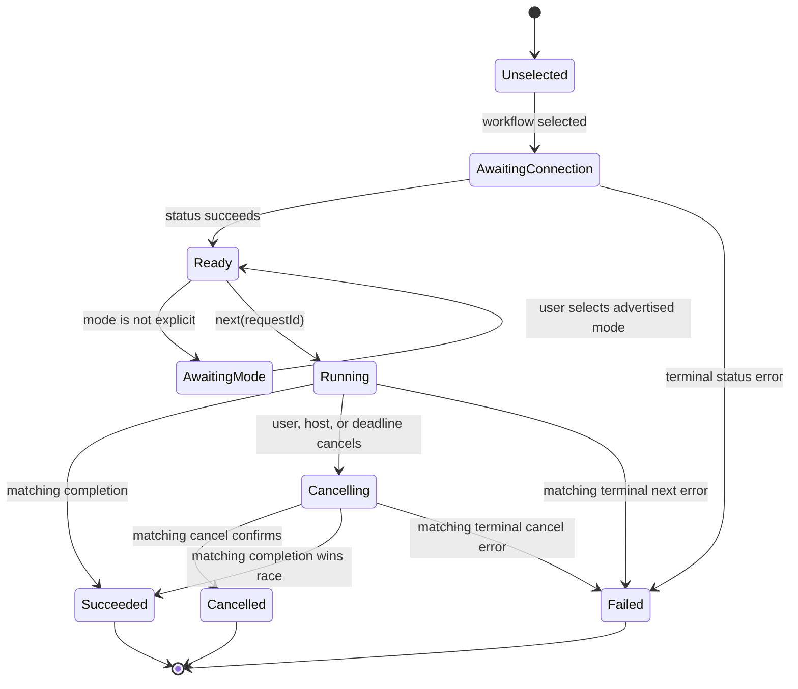

# idle-talk Agent Plugins 1.0.0 design

## Purpose and boundary

This design defines a portable `agent-plugins/idle-talk/` package for a
currently connected idle-talk application. The first release is skills-only:
it guides an agent through connection selection, explicit mode selection, one
turn request, cancellation, and recoverable failure reporting. Installation
does not assert that a local process, browser session, microphone, or
application connection exists.

The future-MCP compatibility boundary stays stable: package identity is root
`plugin.json`, the onboarding skill is `skills/idle-talk/SKILL.md`, and an
optional root `mcp.json` may declare the same named capability. This document
defines that provider-interface contract; it does not implement an MCP server.

## Normative package layout

```text
agent-plugins/idle-talk/
  plugin.json
  skills/
    idle-talk/
      SKILL.md
  mcp.json                 # omitted from the skills-only release
```

`plugin.json` is the sole identity manifest. Its name, version, description,
and onboarding-skill path stay stable across compatible releases.

```json
{
  "$schema": "https://agent-plugins.org/schemas/1.0.0/plugin.schema.json",
  "name": "idle-talk",
  "version": "1.0.0",
  "description": "Guide a connected idle-talk application through safe, user-directed idle conversation.",
  "extensions": { "com.openai": { "onboardingSkill": "./skills/idle-talk/SKILL.md" } }
}
```

In a compatible future release, root `mcp.json` declares a host-supplied
endpoint. `PORT` and credentials are deployment configuration, never package
defaults or skill content.

```json
{
  "$schema": "https://agent-plugins.org/schemas/1.0.0/mcp.schema.json",
  "mcpServers": {
    "idle_talk": { "type": "streamable-http", "url": "https://127.0.0.1:PORT/mcp" }
  }
}
```

## Skills-first workflow and lazy loading

The skill exposes only a stable name and a concrete description for a
*currently connected* idle-talk service. It reads the small connection and
mode contract, reads a mode resource only after that mode is requested, then
invokes only the operation needed for the current user request. Selecting the
plugin alone performs no probe. Installation and unrelated conversations load
no mode resource or connection state, and the package never starts a process
or selects another local service.

## Compatibility provider interface

The skills-only release asks the user to connect the application through the
host before claiming an action ran. A host exposing the named capability must
preserve this contract.

| Operation | Request | Success result | Terminal errors |
| --- | --- | --- | --- |
| `idle_talk.status` | `{}` | `{ "state": "ready" \| "busy", "modes": string[], "connectionId": string }` | `IDLE_TALK_UNAVAILABLE`, `IDLE_TALK_PROTOCOL_MISMATCH` |
| `idle_talk.next` | `{ "mode": "radio" \| "conversation", "requestId": string }` | `{ "requestId": string, "text": string, "mode": string, "cancelled": false }` | `IDLE_TALK_UNAVAILABLE`, `IDLE_TALK_INVALID_MODE`, `IDLE_TALK_BUSY`, `IDLE_TALK_CANCELLED`, `IDLE_TALK_TIMEOUT`, `IDLE_TALK_PROTOCOL_MISMATCH` |
| `idle_talk.cancel` | `{ "requestId": string }` | `{ "requestId": string, "cancelled": true }` | `IDLE_TALK_NOT_FOUND`, `IDLE_TALK_CANCEL_TOO_LATE`, `IDLE_TALK_UNAVAILABLE`, `IDLE_TALK_PROTOCOL_MISMATCH` |

`requestId` is opaque, caller-generated, and unique within a connection. A
replayed `next` with the same ID returns the same terminal result when the
provider supports idempotency; otherwise it returns
`IDLE_TALK_PROTOCOL_MISMATCH` and never creates a second turn. Every success
and error echoes the input ID exactly. A missing or mismatched ID is locally
rejected as `IDLE_TALK_PROTOCOL_MISMATCH`.

All errors use this schema:

```json
{
  "error": {
    "code": "IDLE_TALK_TIMEOUT",
    "message": "The idle-talk application did not finish before the request deadline.",
    "retryable": true,
    "requestId": "opaque-caller-id"
  }
}
```

The skill reports the code and concise recovery action, retains the request ID
for user-directed cancellation or a later request, and does not expose
endpoints, credentials, or stack traces in ordinary conversation.

## Canonical defaults and state machine

| Rule | Canonical default | Decision |
| --- | --- | --- |
| Initial capability | skills only | Installation remains useful before a connection exists. |
| Connection selection | host-configured current connection | Never select or start another service. |
| Mode | `conversation` after stated user intent; otherwise ask | `radio` needs explicit user choice. |
| Request deadline | 30 seconds | At `< 30` seconds wait; at `>= 30` seconds make one cancellation attempt. |
| Retry | zero automatic retries | A later user-directed request uses a fresh `requestId`. |
| Cancellation | user request, host cancellation, or deadline | Send at most one cancel for the running request. |
| Failure disclosure | code plus concise recovery | Do not disclose connection internals. |
| Resource loading | workflow- and mode-triggered | Do not preload or probe on package selection. |



Only `Running` owns an in-flight request. Entering `Cancelling` sends at most
one `idle_talk.cancel(requestId)`. A matching completion that arrives first is
reported once and is terminal. At the deadline, if no matching terminal result
arrives after the one cancellation attempt, report `IDLE_TALK_TIMEOUT` for the
original ID.

## Defense mechanisms, tradeoffs, and failure mapping

Each mechanism has one policy: **reject** stops this request; **warn** reports
an actionable user message while retaining the boundary; **audit** records the
event without adding authority.

| Mechanism | Legitimate case it can reject or impede | Alternative | Policy | One-to-one failure/code mapping |
| --- | --- | --- | --- | --- |
| Skills-only lazy selection | User expects installation to control a local app | Select idle-talk and connect it through the host | warn | `IDLE_TALK_UNAVAILABLE` before a call; no probe occurs |
| Current-connection-only gate | A valid process runs but is not the host-selected connection | Change the host connection and ask again | reject | `IDLE_TALK_UNAVAILABLE` |
| Explicit mode and advertised-mode check | Intent is absent, or a stale client asks for a removed mode | Ask for an advertised mode | warn for omitted intent; reject for unsupported mode | `IDLE_TALK_INVALID_MODE` |
| One in-flight request; no hidden queue | A valid turn arrives while another client is served | User asks again after ready | warn | `IDLE_TALK_BUSY` |
| Opaque ID, echo, and idempotency validation | A legacy provider returns useful data without an ID, or cannot safely replay an ID | Align versions; make a later user-directed request | reject | `IDLE_TALK_PROTOCOL_MISMATCH` |
| Schema validation and no fallback parsing | A provider adds an undocumented field or compatible-looking unapproved shape | Version and publish the contract change | reject | `IDLE_TALK_PROTOCOL_MISMATCH` |
| 30-second deadline and one-cancel limit | Slow valid synthesis completes just after 30 seconds | User submits a new request after reported timeout | warn | `IDLE_TALK_TIMEOUT` |
| Completion-wins cancellation race | User cancels while an already-valid completion crosses transport | Report that completion once; user may make another request | audit | `IDLE_TALK_CANCEL_TOO_LATE`, then matching completion success |
| Cancel request-ID ownership check | Cancel ID is completed, expired, or mistyped | Keep the ID in the message; start a fresh turn if desired | reject | `IDLE_TALK_NOT_FOUND` |
| Provider-confirmed cancellation | User cancels output that would have been useful | Submit a fresh request if still desired | audit | `IDLE_TALK_CANCELLED` or `{cancelled:true}` |
| No automatic retry / fresh-ID rule | A transient failure could have worked on retry | User explicitly retries with a fresh ID | warn | `IDLE_TALK_TIMEOUT`, `IDLE_TALK_UNAVAILABLE`, or `IDLE_TALK_BUSY` |
| Minimal error disclosure | Operator needs endpoint/stack diagnostics for a real outage | Use authorized host/provider diagnostics | audit | Every terminal code shows only code and recovery |
| Per-request failure isolation | One provider call fails while other workflows are valid | Continue unrelated workflows; do not restart/disable plugin | audit | Every terminal code is scoped to its request |

This is exhaustive for provider terminal codes: `status` uses
`UNAVAILABLE`/`PROTOCOL_MISMATCH`; `next` uses `UNAVAILABLE`, `INVALID_MODE`,
`BUSY`, `CANCELLED`, `TIMEOUT`, or `PROTOCOL_MISMATCH`; `cancel` uses
`NOT_FOUND`, `CANCEL_TOO_LATE`, `UNAVAILABLE`, or `PROTOCOL_MISMATCH`. Local
transport loss normalizes to `IDLE_TALK_UNAVAILABLE`; a deadline without a
matching terminal result normalizes to `IDLE_TALK_TIMEOUT`. No mechanism makes
a fallback call, second cancellation, hidden queue, or new turn.

## Permissions and trust boundary

Skills require only packaged-instruction reads. A live capability exists only
when the user or host enables the named current connection. Its surface is
status, user-directed next turn, and cancellation: no filesystem, shell,
arbitrary URL, credential-reading, or process-management operation. The
provider enforces schema and authorization; skill prose grants no authority.

The illustrative loopback URL describes an already connected application. A
deployed manifest uses the secure endpoint accepted by its host. Installation
and a skill mention never imply runtime permission.

## Acceptance and validation

Each scenario gives input, required terminal output, and a pass/fail condition.
`R*` values are opaque caller-supplied request IDs.

| Scenario | Input | Expected output | Pass / fail |
| --- | --- | --- | --- |
| Skills-only discovery | Valid `plugin.json` and `SKILL.md`; no `mcp.json` | Skill discovered; zero capability calls | Pass only with zero calls; any probe fails. |
| Lazy loading | Installed package; unrelated conversation | Zero connection probes, mode-resource loads, and app requests | Pass only with all counts zero. |
| No current connection | Workflow selected without a host connection | Connect guidance; no `status`/`next` | Pass only with no process start/call; any call fails. |
| Explicit/default mode | Ready with `conversation`, `radio`; user asks conversation | `next({mode:"conversation",requestId:"R1"})`, result echoes `R1` and mode | Pass only for exact request/echo; implicit `radio` fails. |
| Omitted mode | Same status; no stated mode | `AwaitingMode`; no `next` | Pass only with a question and zero `next`; silent default fails. |
| Idempotent replay | Replay `next({mode:"conversation",requestId:"R2"})` | Same result with `R2`, or `PROTOCOL_MISMATCH` with `R2` and no second turn | Pass only with no duplicate turn; different ID/result fails. |
| Deadline boundary | `R29`, `R30`, `R31` at 29.999, 30.000, 30.001 seconds | Cancel count `0/1/1`; matching terminal result for each | Pass only for counts and exact IDs; extra cancel fails. |
| Cancel success | `next(R3)` running; `cancel({requestId:"R3"})` | `{requestId:"R3",cancelled:true}` or `CANCELLED` with `R3` | Pass only with one cancel and one terminal cancellation; later text fails. |
| Cancel not found | `cancel({requestId:"R4"})` after it expires | `IDLE_TALK_NOT_FOUND`, `requestId:"R4"` | Pass only with this code and no new `next`; retry/queue fails. |
| Cancel too late | `next(R5)` completes before `cancel({requestId:"R5"})` is handled | `IDLE_TALK_CANCEL_TOO_LATE`, `R5`, plus one already-terminal completion | Pass only if completion reports once and no second cancel/turn occurs; marking cancelled fails. |
| Cancel unavailable | Running `R6`; provider disconnects during `cancel({requestId:"R6"})` | `IDLE_TALK_UNAVAILABLE`, `R6`, reconnect guidance | Pass only with one attempt and no retry; automatic call fails. |
| Cancel protocol mismatch | Running `R7`; cancel result omits/changes ID or schema | `IDLE_TALK_PROTOCOL_MISMATCH`, preserved input `R7` | Pass only if rejected with no fallback parsing/call. |
| Next cancelled | Provider ends `next(R8)` through user/host cancellation | `IDLE_TALK_CANCELLED`, `requestId:"R8"` | Pass only if reported once; later completion fails. |
| Timeout | `next(R9)` has no matching result after deadline and one cancel | `IDLE_TALK_TIMEOUT`, `R9`, `retryable:true` | Pass only with one cancel/no auto-retry; another `next` fails. |
| Invalid mode | `next({mode:"removed",requestId:"R10"})` | `IDLE_TALK_INVALID_MODE`, `R10` | Pass only with advertised-mode guidance/no retry; fallback mode fails. |
| Busy | `next(R11)` while provider busy | `IDLE_TALK_BUSY`, `R11` | Pass only with retry offer/no queue; hidden queue fails. |
| Unavailable | `status`, `next(R12)`, or cancel loses provider | `IDLE_TALK_UNAVAILABLE`, input ID when supplied | Pass only if scope ends without process start/retry; global disable fails. |
| Protocol mismatch | Any status/next/cancel response has bad schema or ID | `IDLE_TALK_PROTOCOL_MISMATCH`, input ID when supplied | Pass only if rejected without fallback parsing; accepting it fails. |
| Compatibility boundary | Add optional `mcp.json` | Identity, skill path, defaults, error schema, and state semantics unchanged | Pass only if every named artifact/semantic matches; moving identity or skill fails. |

Validation checks:

1. Search skill and manifest text for timeout, deadline, mode, and retry. Each
   reference resolves to the canonical-defaults table or a derived value; no
   second timeout, implicit mode fallback, or automatic retry.
2. Execute every row above and record input, terminal output, ID, and call
   counts. This explicitly covers cancellation terminal codes `CANCELLED`,
   `NOT_FOUND`, `CANCEL_TOO_LATE`, `UNAVAILABLE`, and `PROTOCOL_MISMATCH`.
3. Validate `plugin.json`, optional `mcp.json`, and every capability result
   against schema. Reject mismatched IDs and undocumented response shapes.
4. Verify failure isolation: a terminal result leaves unrelated agent workflows
   usable and does not start, restart, or disable an application.

## Design tradeoffs

| Choice | Benefit | Cost and deliberate decision |
| --- | --- | --- |
| Skills first | Guidance works at smallest connection surface | Live action waits for configured connection. |
| Root manifest boundary | Portable shape remains stable | Future MCP declarations preserve published contract. |
| Explicit current connection | Preserves user control | Host setup may be needed. |
| Zero automatic retry | Avoids duplicate turns | User explicitly requests another attempt. |
| Narrow capability contract | Cancellation and failures stay auditable | New features need a versioned contract change. |
| Strict schema and ID validation | Prevents cross-request/incompatible output | Permissive legacy responses are rejected. |

Out of scope: implementation, deployment, security hardening, CI,
distribution, and any MCP server/provider implementation.
