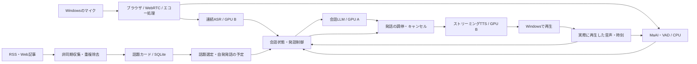

# ローカルLLMによる自発的な全二重音声雑談：アーキテクチャ案

調査基準日：2026年10月9日。日本語、Windows PC、利用者1人を前提とする。

## 推奨する構成

**このPCでは、ストリーミングASR・ローカルLLM・ストリーミングTTSに、日本語の発話タイミング予測と独立した話題収集を組み合わせる構成を推奨する。**

目指す体験は「話しかけないと動かないアシスタント」よりも、ラジオのパーソナリティと雑談相手を兼ねるもの。黙っていると、拾っておいたニュースから短い話を始める。こちらが「それさ……」と入れば発言権を譲り、「うん」と相槌を打つだけなら話を続ける。

音声入出力、会話生成、ニュース収集を別々に進め、発話の最終決定だけを一つの制御部に集める。これにより、ネット取得や記事の要約が遅くても、聞き取りと割り込み処理を継続できる。

これは設計提案であり、今回実施したのは資料調査とPC構成の読み取り。モデルのインストール、推論速度測定、実際の音声対話は未実施。

## このPCで確認した条件

| 項目 | 今回の確認結果 |
| --- | --- |
| GPU | NVIDIA GeForce RTX 3060、12GB × 2枚 |
| GPU空きメモリ | 調査時点で約11.8GiB / 約7.6GiB。既存アプリの使用量により変化 |
| CPU | AMD Ryzen 7 5700X |
| 物理RAM | Windowsのメモリ情報で約63.91GiB |
| 音声機器 | マイク、スピーカー、ヘッドホンの品質・遅延は未確認 |

12GBのGPUを2枚搭載していても、単一GPU向け実装から自動的に24GBとして使えるわけではない。モデル分割には実装の対応が必要で、カード間転送も発生する。この用途では、まず**LLM用と音声用にカードを分ける**。

## 2026年10月時点で押さえるべき進展

### 全二重は一枚岩ではない

| 段階 | できること | この案での扱い |
| --- | --- | --- |
| 音声入出力の全二重 | 再生中もマイク音声を受け取り続ける | 必須 |
| 会話制御の全二重 | 発話途中の入力を解釈し、相槌・継続・割り込み・譲歩を選ぶ | 必須。実際の挙動を試験する |
| ネイティブ音声モデルの全二重 | 同一モデルが音声ストリームを直接聞きながら生成する | 比較・将来の交換候補 |

単にTTS再生中も録音できるだけでは、求める体験には足りない。一方、ASR→LLM→TTSという構成そのものが全二重を不可能にするわけでもない。

2026年3月の **DuplexCascade** は、短い入力断片を継続的にLLMへ渡し、会話制御用トークンで待機・応答・相槌を制御する方式を示した。ただし公開モデルは英語・Qwen2-7B-Instructベースであり、今回の日本語構成へ置き換えるだけで論文の性能が再現するとはいえない。本案はその「発話全体の終了を待たずに更新する」という考え方を参考にする。[論文](https://arxiv.org/abs/2603.09180)、[公開モデル](https://huggingface.co/sbintuitions/DuplexCascade/blob/main/README.md)

日本語の会話タイミングには **MaAI** が有力。日本語の発話交代・相槌予測に対応し、CPU実行と音声チャンク入力が可能。2026年8月には単一チャネルのVAPも追加された。本案では、文字列だけでは失われる間や韻律を扱うために採用候補とする。[MaAI公式](https://github.com/MaAI-Kyoto/MaAI)

2026年9月の研究では、全二重モデルでも「必要だから自分から話し始める」判断には課題が報告されている。英語での評価であり日本語へ直接一般化はできないが、**自発的な雑談の開始を音声モデル任せにしない**という設計判断を補強する。[研究](https://arxiv.org/abs/2609.19596)

### ネイティブ全二重モデルの採用判断

| 候補 | 公式資料で確認できる強み・条件 | 今回の判断 |
| --- | --- | --- |
| LLM-jp-Moshi-v1 | 日本語のネイティブ全二重音声対話。試作段階。公式デモ条件はLinux GPU・VRAM 24GB以上 | 日本語全二重の比較対象。2枚の3060での分割・量子化・実時間動作は未確認 |
| PersonaPlex | 音声と役割を指定できる全二重対話。相槌や発話の重なりに対応 | 英語系の比較対象。日本語品質とこのPCの実時間動作は未確認 |
| MiniCPM-o 4.5 | 全二重音声・映像、ローカル実行。公式には低リソースGPU向け12GB条件あり。音声対話は英語・中国語対応 | 12GBでのネイティブ全二重検証に有力。日本語音声対話の本採用根拠にはしない |

根拠：[LLM-jp-Moshiモデルカード](https://huggingface.co/llm-jp/llm-jp-moshi-v1)、[PersonaPlex公式研究紹介](https://research.nvidia.com/labs/adlr/personaplex/)、[MiniCPM-o公式モデルカード](https://huggingface.co/openbmb/MiniCPM-o-4_5)

**「日本語で、単一の音声モデルが直接聞きながら話すこと」が必須なら、今回の調査範囲では、このPCで安定動作すると確認済みの組み合わせは示せない。** LLM-jp-Moshiの対応実装での検証、または単一24GB以上のGPUでの評価を別途行う必要がある。24GBを用意するだけで、ニュース連携や雑談品質まで解決するわけではない。

## 全体構造

### 1. 音声を聞き続ける経路

- マイク入力はAIの発話中も継続する。入力と出力の処理を独立させる。
- Windows側のブラウザが音声機器を扱い、バックエンドへWebRTCで渡す。
- ブラウザのエコーキャンセル・ノイズ抑制を要求し、実際に適用されているか確認する。WebRTCの使用だけでスピーカー漏れが解消するとは仮定しない。
- 初回の評価はヘッドホンを使用する。スピーカー利用は、エコーによる誤割り込みを別に評価する。
- MaAIへ渡すAI側音声は、生成した未再生データではなく、再生時刻に合わせた参照信号とする。ネット・再生バッファの遅延を補正する。

### 2. 速い会話制御

音声検出と会話タイミング予測を常時動かし、大きいLLMの応答待ちから独立させる。MaAIはタイミング判断の信号として使い、発話の意味や相槌かどうかの最終判断にはASR結果と会話状態も使う。

| 入力・状況 | 推奨する動作 |
| --- | --- |
| ユーザーが「うん」「へえ」など短い相槌 | AIの話を継続。必要なら音量を少し下げる |
| 「ちょっと待って」「違う」「それって」 | 発話を止め、入力の続きを聞く |
| 相槌か割り込みか判別できない | 一時的に音量を下げ、判別後に継続または中止 |
| ユーザーが言いよどむ | 音響予測と文脈から続きを待つ。短い無音だけで回答を始めない |
| ユーザーが長く話している | 適切な箇所で短い相槌。頻度上限を設ける |
| 「静かにして」 | 自発発話を停止。明示的に再開するまで解除しない |

初期版は、聞き手の発言権を奪わない保守的な判定から始める。日本語では単語数だけの判定が扱いにくいため、英語向けの最小単語数をそのまま転用しない。

### 3. 会話LLM

LLMへ渡すのは、直近の会話、実際に話した内容、今の話題カード、ユーザーの関心・避ける話題、会話制御部の判断。記事全文や過去の全ログを毎回渡さない。

ASRの暫定結果には改訂番号を付ける。意味がまとまった更新で応答案を準備できるが、重要な語の修正が入ったら古い案を破棄する。入力が更新されるたびに全文を再生成する実装は避ける。

通常のテキストLLMの生成APIでは、開始済みの推論へ新しい入力を途中から注入できない。入力更新は会話制御部が受け取り、短い生成単位の境界で反映するか、必要なら生成をキャンセルして開始し直す。AIが話し続けている間も、聞き取り・相槌判定・停止判断は独立して進める。

待機・相槌・応答・発話継続・発話権を譲る、を内部の行動として分離する。普通のQwenに制御用の文字列を追加しただけで、DuplexCascadeの専用学習済み挙動が得られるとは仮定しない。まず明示的な状態制御と小規模な行動出力で実装し、日本語での誤動作を測る。

### 4. 発話出力とキャンセル

音声出力を管理する主体は一つにする。ニュースを読む音声と会話の返答音声を、別の処理から勝手に同時再生させない。

- 発話ごとにIDとキャンセル世代番号を付ける。
- 本当の割り込みでは、LLM生成・TTS生成・サーバー待機音声・クライアント再生待ちをまとめて中止する。
- 遅れて届く古い世代の音声も破棄する。
- 「生成済み」「送信済み」「再生済み」を区別する。
- 会話履歴には再生済み部分だけを反映する。途中で切れた文は切れたことを明記し、正確な単語境界が取れない場合は完了した節までに制限する。
- 相槌なら中止せず継続する。判定保留中は短く減音し、音声キューを無制限に増やさない。

これがないと、実際には聞いていないニュースの結論について「さっき説明した」と返す、割り込んでも古い音声が流れ続ける、といった問題が起きる。

## 推奨する初期部品

| 役割 | 第一候補 | 採用理由・確認事項 |
| --- | --- | --- |
| 音声対話の配線 | Pipecat + SmallWebRTCTransport | 個人向けローカル構成。自前の会話制御を組み込みやすい |
| 発話タイミング・相槌 | MaAI、日本語モデル、CPUから開始 | 音響的な会話タイミングを独立して判断 |
| 緊急の音声検出 | 軽量VAD | ASRやLLMが遅れても入力開始を把握 |
| ASR | Qwen3-ASR-0.6B | 日本語対応。まず小さいモデルで速度と精度を測る |
| 会話LLM | Qwen3.5-9B、GGUF Q4、思考モード無効 | 単一12GB GPUに収める候補。遅延が大きければ4B級を比較 |
| TTS | Fun-CosyVoice3-0.5B-2512 | 日本語、テキスト入力と音声出力の両方のストリーミングに対応 |
| 音声品質の比較 | Qwen3-TTS-0.6B / 1.7B、Fish Audio S2-Pro | 好みの声・表現力と計算負荷を実機比較 |
| 話題・会話の保存 | SQLite + 全文検索 | 小規模な個人用の履歴、出典、重複管理 |
| Web取得 | RSS取得、本文抽出、必要時の検索 | 会話経路から独立させる |

PipecatのSmallWebRTCは、外部サービスのアカウントを必要としないローカル・自己ホスト向けの選択肢。独自の発話制御を接続できる仕組みもある。ただし今回挙げたASR・TTSについて、すべてが標準プラグインとして無改造でつながるとは確認していない。[Transport選択](https://docs.pipecat.ai/client/concepts/choosing-a-transport)、[外部ターン制御](https://docs.pipecat.ai/api-reference/server/utilities/turn-management/external-turn-management)

Qwen3-ASRは日本語とストリーミングに対応するが、公式Python実装のストリーミングはvLLMバックエンドに限られる。公開例は2秒チャンクなので、そのままでは機敏な会話に不十分な可能性がある。短いチャンクへの変更と、精度・計算量・暫定結果の安定性を一緒に検証する。[ASR公式](https://github.com/QwenLM/Qwen3-ASR)、[公式ストリーミング例](https://github.com/QwenLM/Qwen3-ASR/blob/main/examples/example_qwen3_asr_vllm_streaming.py)

Qwen3.5-9Bは、会話経路では思考モードを無効にする。Q4のメモリと速度は使用する変換モデル・推論エンジン・文脈長で変わるため、モデル名だけでは確定しない。[公式モデル説明](https://huggingface.co/Qwen/Qwen3.5-9B/blob/main/README.md)

CosyVoice3は日本語と入力・出力両方向のストリーミングを公式に掲げている。TTSの主候補は、モデルサイズだけでなく「文章を書き終える前に音声生成を始められるか」で選ぶ。[CosyVoice公式](https://github.com/QwenAudio/CosyVoice)

Qwen3-TTSは日本語・ストリーミング対応モデルを公開しているが、モデルの対応と、選んだサーバーAPIから逐次音声を受け取れることは別。Fish S2-Proも日本語と表現力を比較する有力候補だが、4B級で負荷が大きい。両者とも公表された最小遅延を3060の性能値として扱わない。[Qwen3-TTS公式](https://github.com/QwenLM/Qwen3-TTS)、[Fish Speech公式](https://github.com/fishaudio/fish-speech)

## GPU・実行環境の分担

| 場所 | 実行内容 | 初期のメモリ予算 |
| --- | --- | --- |
| GPU A：空きが多いカード | Q4の会話LLM、短い会話文脈 | 総量7〜10GiBを設計上の目安とする |
| GPU B | ASR 0.6B + CosyVoice3 + 音声ランタイム | 総量4〜7GiBを目安とし、既存アプリ分の余裕も確保 |
| CPU / RAM | MaAI・VAD・状態制御・記事取得・DB・低優先度処理 | 音声制御用のCPU時間を確保 |
| Windows | ブラウザUI、マイク入力、音声再生 | オーディオ処理をここへ置く |
| WSL2 / Linux | vLLM ASR、TTS、LLMサーバー、対話制御 | 各プロセスの依存環境とGPU割当を分離 |

上記の予算は測定値ではない。ピークメモリ、キャッシュ、ASRとTTSの同時稼働で検証する。vLLMが音声用GPUの大部分を先に予約するとTTSが入らないため、予約量を明示的に抑える。RTX 3060は消費メモリだけでなく計算能力も共有するので、メモリに入ることと実時間動作は別に判定する。

LLMの文脈はまず8K程度までを候補とし、直近会話・短い要約・選択した数件の話題に絞る。ニュースの要約も同じLLMを使う場合、前景会話を優先し、バックグラウンド生成は短い単位で中断可能にする。モデルを2枚のGPUへまたがらせる構成は、この分担の評価後に比較する。

ASRの累積音声も有界にする。発話の区切りで認識状態を確定・更新し、長い発話には重なりを持つ窓と確定テキストを使う。音声キュー、話題の待機列、履歴にも上限と期限を設ける。ネットワークへの音声送信を止めることと、推論サーバー上で生成が停止したことは別に確認する。

WSL2はLinux系音声推論の環境として提案するもので、今回このアプリの環境を構築したわけではない。マイクをWSL内へ直接接続せず、Windowsのブラウザで扱う。Windowsからの接続・WebRTC到達性も実装時に確認する。[MicrosoftのCUDA on WSL資料](https://learn.microsoft.com/en-us/windows/ai/directml/gpu-cuda-in-wsl)

## ニュースと取り留めのない雑談

### 話題収集

初期版は少数のRSSと、関心のあるサイトの公開情報から始める。10〜30分程度の更新周期を設計値とし、会話が始まったときにはすでに話題を用意しておく。さらに聞かれた詳細だけをその場で検索する。

記事は「話題カード」へ変換する。

| 保存項目 | 目的 |
| --- | --- |
| タイトル、URL、媒体 | 出典へ戻れる |
| 公開日時、出来事の日時、取得日時 | 古い出来事の再掲載を今日のニュースと混同しない |
| 確認できた事実、取得範囲 | 見出しだけから本文の詳細を作らない |
| 不明点・取得失敗 | 自信のある創作で埋めない |
| 会話の切り口 | 驚き、疑問、身近な連想など |
| 類似記事・同一出来事のID | 別媒体の同じ話を繰り返さない |
| 話したか・反応・保留理由 | 相手の関心へ合わせる |

記事内の命令文はニュースの内容として扱い、アプリの指示やツール実行命令へ昇格させない。通常のニュース説明には、URLを口で読み上げず、画面に出典カードを置く。

### 話題選定と発話開始

話題の選定と、話し始めてよいかの判断は分ける。

- 関心との一致、新鮮さ、意外性、話しやすさ、最近話していないことを評価する。
- 関心の近い話題を中心に、ときどき違う分野も混ぜる。
- 反応が薄いときは追及せず、話題を変えるか間を置く。
- 発言権を制御する層が、今の発話状態・静音設定・休止時間を見て開始を許可する。
- 定期取得の完了そのものを「今すぐ話す」イベントにしない。

ニュースの要約を読み続けると雑談になりにくい。発話は、**一つの事実 → 短い感想または問い → 身近な連想**を基本にする。事実と推測は言い方でも区別する。毎回ユーザーへ質問して回答を迫る必要はない。

### 推奨する会話モード

| モード | 挙動 |
| --- | --- |
| ラジオ雑談：今回の主目的 | 20〜45秒程度の話を、短い間を置いて自発的に続ける。ユーザーが入れば会話へ移る |
| 作業中の相棒 | ときどき一言。無反応なら間隔を広げる |
| 聞き役 | 自発的な話題開始を止め、相槌と返答を中心にする |

長い独り語りも一括で音声化せず、短い節の単位で先へ進める。1〜3秒程度の自然な間を置くことと、いつでも割り込めることを両立させる。数値は初期設定案であり、利用者の好みに調整する。

「その話はいい」「別の話」「もっと詳しく」「続けて」「少し静かにして」を基本の音声操作にする。停止・マイクミュートは画面からも即座に操作できる。

## 記憶

長期記憶には、明示された好み・避けたい話題・継続中の話題を保存する。セッション記憶には、今話していること・話したニュース・中断した発話を保存する。ニュース庫とユーザーについての記憶は分ける。

無言を「嫌い」、相槌を「賛成」と断定しない。興味の推定には弱い重みを付け、本人の明示的な訂正を優先する。生の音声は初期設定では保存せず、必要な診断時に限って保存を選べるようにする。

音声認識・会話生成・音声合成はローカル実行。Webアクセスは話題収集のために使う。検索を外部サービスへ送る場合も、会話全文ではなく必要な検索語だけを送る設計とする。

## 品質の判定と導入順序

### まず測る値

| 指標 | 初期の合格目標案 |
| --- | --- |
| 本当の割り込みから再生停止まで | p95で300ms以内を目指す。クライアントで測定 |
| 発話終了から最初の応答音声まで | 中央値1.5秒以内、p95で2.5秒以内を目指す |
| 相槌で誤って話を止める割合 | 日本語の相槌・割り込みテストで別々に計測 |
| TTSの持続性能 | ASR同時稼働時も実時間より速い。RTF 0.7以下を目標に余裕を確保 |
| 会話状態の整合性 | 未再生の内容を「話した」と扱う事例がない |
| 長時間稼働 | 1時間以上で音声遅延・キュー・メモリが増え続けない |

これらは要求値であり、このPCで達成した性能値ではない。低遅延の一般論や、H200・5090など別GPUのベンチマークから換算しない。

### 導入順序

1. **日本語の音声経路を検証する。** ASRとTTSを同時稼働し、実時間性能とGPUメモリを測る。ネイティブ全二重が絶対条件なら、この時点で候補の動作検証も行う。
2. **割り込みと履歴を完成させる。** 「うん」「待って」「それは違って」「ええと……」の区別、遅れて届く音声の破棄、再生済み履歴の管理を確認する。
3. **MaAIと会話LLMを統合する。** タイミング予測に基づく相槌・譲歩を加え、日本語の会話を評価する。
4. **自発的な発話を加える。** まず手動で用意した話題カードで、静かにする・続ける・話題変更の制御を確かめる。
5. **非同期ニュース取得を加える。** 出典、日付、重複、取得失敗を保持する。
6. **声と長時間品質を調整する。** CosyVoice3、Qwen3-TTS、Fish S2-Proを同じ条件で比較し、好みと遅延の両方で選ぶ。

最初から大きなLLM、複数の推論サーバー、網羅的な検索、ベクトルDBを載せるより、この順序で会話の基盤を固める。

## 将来、ネイティブ全二重へ交換するとき

ニュース収集・話題カード・記憶・画面UIは共通化できる。ただし音声モデルを差し替えるだけで、外部ニュースや生成テキストを任意のタイミングで注入できるとは限らない。

採用条件は、日本語の品質、実時間性能、外部事実の入力、会話中の状態更新、停止、再生済み履歴、長時間の文脈管理が実際に動くこと。音声モデルと別LLMの双方が同時に発話を生成する場合も、最終的な出力は一つの調停部で管理する。

モデル・コード・学習済み重みの利用条件は別の場合があるため、採用する具体的な配布物で確認する。特にMaAIはコードと各学習済みモデルの条件を分けて記載している。[MaAIの利用条件](https://github.com/MaAI-Kyoto/MaAI#-license)

**優先するのは、いつでも聞いていて、必要なときに止まり、興味のある話を自然に続けられること。そのための中心は、最大モデルの選択より、会話タイミング・再生状態・話題の準備を一貫して制御する仕組みである。**
