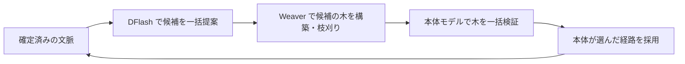

# uzu の高速化原理と llama-server への導入可能性

初回調査日: 2026-10-28（JST）。以下はソース解析とローカル CLI の確認時点の記録。

同日追記: 実機比較を実施したところ、現在の Gemma 4 12B QAT と build 11564 の組み合わせでは候補の採用率が 0% で、DFlash は高速化しなかった。測定条件・結果・切り分けは [実機比較結果](research-dflash-benchmark-2026-10-28.md) を参照。以下の「未測定」は初回解析時点を指す。

## 結論

uzu の高速化は、先読みのアルゴリズム、専用ドラフトの学習、量子化形式、GPU カーネルの組み合わせによる。単一の演算を移植して公開比較と同じ倍率を得られる根拠はない。

llama.cpp には既に DFlash があり、手元の llama-server も対応オプションを持つ。最初の実験は既存 DFlash の有効化でよい。uzu 固有の有力な移植候補は Weaver の適応的な木の構築と、その木をまとめて検証する処理。ただし、専用の学習済み重みと推論エンジン側の変更が必要になる。

Apple M5 向けの Metal カーネルは RTX 3060 に直接組み込めない。CUDA 向けに考え方を移す場合も、llama.cpp にある低精度演算との比較が必要。

## 調査対象とローカルで確認できたこと

- uzu: `1763a366c048e2065343619a28524d493faf5391`（main の取得時点）。
- llama.cpp: `5d7793d6fcce4eb4b11ab5be856dfa4e4c8fde9b`（master の取得時点）。
- lalamo: 量子化実装 `lalamo/compressed/utils/yaqa.py`、量子化仕様、Hadamard 関連ファイルを確認。
- ローカル設定: `idle_talk.toml` のモデルは `D:/models/gemma-4-12b-it-qat-q4_0.gguf`、サーバーは `D:/tools/llama.cpp/llama-server.exe`。
- `nvidia-smi` の列挙結果: RTX 3060 12,288 MiB × 2。
- 当該 EXE の `--version`: `0.6.0-dev (build 11564, commit 08ffba21e)`、Windows x86_64。
- 当該 EXE の `--help`: `--spec-type` に `draft-dflash`、`draft-eagle3`、`draft-mtp`、`draft-dspark` 等を列挙。`--spec-draft-model` / `-md` と `--spec-draft-n-max` も存在。

CLI の対応確認は、現在のモデルとの組み合わせや実行時の対応を保証するものではない。ローカル EXE と上記 master は別のコミットであり、性能や挙動が一致するとは扱わない。

## 1. 複数トークンに重みの読み出しを使い回す

通常の生成では、次の 1 トークンを生成するたびに大きなモデルの行列演算が必要になる。低バッチの量子化モデルでは、演算能力より GPU メモリから重みを読み出す帯域が制約になりやすい。

DFlash は、小さなドラフトで複数の候補を一度に作る。その候補を本体モデルでまとめて検証すると、複数トークンに対して読み出した重みを再利用でき、行列×ベクトルより行列×行列を使いやすくなる。先読みで誤った候補は本体の出力として採用しない。

概算の判断式は次のとおり。

```text
T1 = 通常生成の 1 トークン当たり時間
Tv = 候補の一括検証時間
Td = ドラフト生成時間
To = 木の構築・同期・状態更新などの追加時間
K  = 1 ラウンドで実際に出力できた平均トークン数

速度比 ≈ K × T1 / (Td + Tv + To)
```

例えば K=5、ラウンドの処理時間が通常の 2 トークン分なら、概算は 2.5 倍。ただしこれは説明用の仮定であり、この PC の測定結果ではない。候補を 16 個出しても 16 個が採用されるわけではなく、候補数を増やすだけでは速くならない。

llama.cpp の現行 DFlash もブロックを一括提案し、本体の中間表現をドラフトに渡す。これは uzu から新たに移植しなくても利用できる部分。

根拠: [llama.cpp DFlash の説明と起動例](https://github.com/ggml-org/llama.cpp/blob/5d7793d6fcce4eb4b11ab5be856dfa4e4c8fde9b/docs/speculative.md#dflash-draft-dflash)、[uzu の提案処理](https://github.com/trymirai/uzu/blob/1763a366c048e2065343619a28524d493faf5391/crates/uzu-engine/src/speculators/dflash_tfm.rs#L198)。

## 2. Weaver: 一本道ではなく、当たりやすい候補の木を作る

一本道の先読みは、途中の予測が外れると、それより先を利用しにくい。Weaver は DFlash の出力や本体の表現から分岐候補を作り、限られた予算を深さと幅に配分する。

- 確信がある部分: 長い候補列を伸ばす。
- 不確実な部分: 複数の候補に枝分かれさせる。
- 本体: 木にある候補を一括評価し、本体が選んだトークンに沿った経路を採用する。



実装では `tree_budget`、`max_tree_depth`、`rounds`、`expand_per_round`、`expand_width` が分かれている。`shapes.json` を GPU 名または default で選ぶため、木の形もハードウェアに合わせている。Weaver は学習済み重みをロードするモデルであり、汎用の枝刈りルールだけをコピーすれば再現できる仕組みではない。

確率的な生成には Gumbel ノイズを利用し、ドラフト側と本体側で対応する seed を使う。全候補の評価後に経路を選べる構成が、候補ごとの往復を減らす。一方、実装には GPU 完了待ち、木の読み出し、CPU 上の採用経路の探索が残る。「CPU 同期が一切ない」という意味ではない。

確認した llama-server の通常の DFlash 経路はドラフトをトークン列として渡し、列の prefix を検証する。現行ソースには DFlash2/LiliCorr の候補 lattice もあるが、ドラフト側で列に変換される。uzu の Weaver による適応的な木を本体で検証する経路と同じものとは扱えない。

移植するなら、少なくとも以下が必要になる。

1. Weaver のモデル定義、重みの変換・格納、対象モデルとの接続。
2. 木の親子関係、各ノードの位置、祖先だけを参照する attention mask。
3. 分岐した KV 状態を共有し、採用経路を確定するキャッシュ管理。
4. 温度、top-p、繰り返し抑制、grammar 等と整合するサンプラー。
5. 木の構築・枝刈りを CUDA で実行する処理。

根拠: [木の設定と重みロード](https://github.com/trymirai/uzu/blob/1763a366c048e2065343619a28524d493faf5391/crates/uzu-engine/src/speculators/dflash_tfm.rs#L63)、[Weaver 本体](https://github.com/trymirai/uzu/blob/1763a366c048e2065343619a28524d493faf5391/crates/uzu-engine/src/encodable_block/weaver.rs)、[GPU 候補選択と Gumbel ノイズ](https://github.com/trymirai/uzu/blob/1763a366c048e2065343619a28524d493faf5391/crates/uzu-engine/src/backends/metal/kernel/weaver/weaver_selection.metal)、[本体のサンプリング](https://github.com/trymirai/uzu/blob/1763a366c048e2065343619a28524d493faf5391/crates/uzu-engine/src/engine/language_model/stream/stream.rs#L711)、[採用経路の探索](https://github.com/trymirai/uzu/blob/1763a366c048e2065343619a28524d493faf5391/crates/uzu-engine/src/trie.rs#L271)、[llama.cpp のドラフト生成](https://github.com/ggml-org/llama.cpp/blob/5d7793d6fcce4eb4b11ab5be856dfa4e4c8fde9b/common/speculative.cpp#L1336)、[llama-server の検証](https://github.com/ggml-org/llama.cpp/blob/5d7793d6fcce4eb4b11ab5be856dfa4e4c8fde9b/tools/server/server-context.cpp#L4952)。

## 3. Gated DeltaNet の木の検証と状態更新

Qwen 系のハイブリッドモデルでは、attention の KV に加えて更新される再帰状態も扱う必要がある。候補の枝ごとに大きな状態を保存・復元すると、木の検証自体が重くなる。

uzu の専用カーネルは、祖先関係と三角行列の計算を使って木をまとめて評価する。確認した Metal 実装は最大 32 ノードを扱い、確定後に採用された経路の K/V・減衰・beta を使って状態を進める。候補ごとの大きな再帰状態のチェックポイントを避けるための設計である。

これはモデルの構造に依存する。Gemma 4 12B の高速化に、そのまま同じ処理を足す対象ではない。llama.cpp に Gated DeltaNet の CUDA/Metal 演算があることと、この木の検証方式が同じように実装済みであることも区別する。

根拠: [木の検証カーネル](https://github.com/trymirai/uzu/blob/1763a366c048e2065343619a28524d493faf5391/crates/uzu-engine/src/backends/metal/kernel/gdn/tree_verify/tree_verify.metal)、[採用経路での状態更新](https://github.com/trymirai/uzu/blob/1763a366c048e2065343619a28524d493faf5391/crates/uzu-engine/src/encodable_block/mixer/delta_net.rs#L68)、[llama.cpp の CUDA Gated DeltaNet](https://github.com/ggml-org/llama.cpp/blob/5d7793d6fcce4eb4b11ab5be856dfa4e4c8fde9b/ggml/src/ggml-cuda/gated_delta_net.cu)。

## 4. Hadamard 変換、W4A8、M5 の行列演算

重みを 4bit にしてメモリ転送量を減らし、推論中の入力も動的に INT8 にする。適切な行列形状なら、専用の整数行列演算器を利用できる。量子化前にランダムな Hadamard 変換で外れ値を分散し、入力の INT8 化による誤差を抑える。

回転の基本的な関係は、直交行列 R に対して次のとおり。

```text
x' = R x
W' = W R^T
W'x' = W R^T R x = Wx
```

実際には重みも量子化するため誤差があり、グループ、scale、zero-point、符号、レイアウトを対応させる必要がある。現在の Q4_0 GGUF の入力に変換だけを挿入すると、この等式の前提を満たさない。既存モデルを再量子化する工程と、GGUF 側の対応する表現・演算の設計が必要になる。

uzu の実装には入力と出力の Hadamard 用の符号データ、動的 INT8 量子化、Metal の `mpp::tensor_ops::matmul2d` の呼び出しがある。INT8 はすべての演算に無条件で使うのではなく、MXU 対応、行列の形、データ型、量子化レイアウト、GEMM/GEMV の選択で切り替える。

開発元の説明では、M5 の特性に合わせて低精度演算と先読みを共同設計し、重みの PTQ に続けて scale/zero-point を調整する蒸留も実施している。この部分も、サーバー設定だけでは再現できない。

llama.cpp にも CUDA の Q8 入力量子化、量子化行列演算、融合処理、Metal の tensor operations がある。したがって「uzu は INT8・融合処理・行列演算器を使うが llama.cpp は使わない」という比較は成立しない。追加の価値を判断するには、同じ量子化誤差と行列形状で CUDA の既存経路より速いことを示す必要がある。

根拠: [Hadamard 用重みと符号のロード](https://github.com/trymirai/uzu/blob/1763a366c048e2065343619a28524d493faf5391/crates/uzu-engine/src/encodable_block/linear/rht_wrapper.rs#L139)、[動的 INT8 量子化](https://github.com/trymirai/uzu/blob/1763a366c048e2065343619a28524d493faf5391/crates/uzu-engine/src/backends/metal/kernel/common/activation_quantization.h)、[INT8 の適用条件](https://github.com/trymirai/uzu/blob/1763a366c048e2065343619a28524d493faf5391/crates/uzu-engine/src/backends/metal/kernel/matmul/matmul_metal_kernel.rs#L189)、[Metal の行列演算](https://github.com/trymirai/uzu/blob/1763a366c048e2065343619a28524d493faf5391/crates/uzu-engine/src/backends/metal/kernel/matmul/common/mxu_fragment/fragment_matmul.h)、[llama.cpp の CUDA MMQ](https://github.com/ggml-org/llama.cpp/blob/5d7793d6fcce4eb4b11ab5be856dfa4e4c8fde9b/ggml/src/ggml-cuda/mmq.cuh)、[llama.cpp の Metal 行列演算](https://github.com/ggml-org/llama.cpp/blob/5d7793d6fcce4eb4b11ab5be856dfa4e4c8fde9b/ggml/src/ggml-metal/kernels/mul_mm.metal)、[開発元による設計説明](https://trymirai.com/blog/speculative-decoding-in-uzu)。

## 導入候補の優先順位

| 候補 | 現状 | この環境での扱い |
|---|---|---|
| 通常の DFlash | llama.cpp とローカル CLI に存在 | 最初の比較実験。新規移植は不要 |
| Weaver による木の提案・検証 | 確認した通常の DFlash 経路とは異なる | 中〜大規模の開発。専用モデル、木の attention、cache、sampling、CUDA が必要 |
| Gated DeltaNet の木の検証 | uzu に専用実装あり | 対象の Qwen 系で検討。現在の Gemma 用の優先項目ではない |
| Hadamard + W4A8 | 重み形式とカーネルを含む設計 | 再量子化、品質確認、CUDA 演算との比較が必要 |
| M5 専用 Metal カーネル | Apple GPU 用 | RTX 3060 に直接利用不可 |
| GPU 内の量子化・融合・まとめ実行 | llama.cpp にも実装あり | 未融合の区間を profiling してから、個別の演算を改善 |

## 次に測るべき具体的な実験

Gemma 4 12B 用の元ドラフト [z-lab/gemma4-12B-it-DFlash](https://huggingface.co/z-lab/gemma4-12B-it-DFlash) が公開されていることを確認した。[設定](https://huggingface.co/z-lab/gemma4-12B-it-DFlash/blob/main/config.json)にはブロックサイズ 16 と、利用する本体の層が指定されている。名前が似た任意の小型モデルに交換できる方式ではない。

1. 現在の QAT Q4_0 を本体として、対応するドラフトを current build でロードできるか確認する。元の本体と QAT モデルの差が採用率に与える影響は未確認。
2. 同じ本体、prompt、文脈長、sampling、出力長条件で DFlash なしとありを比較する。
3. 候補数は少ない値から振り、例えば 2/4/8/15 の各値で、平均採用トークン数とラウンド時間を測る。これは実験案であり、推奨値や最適値を測定済みという意味ではない。
4. idle-talk の日本語会話を対象に、TTFT、生成 tokens/s、応答全体の時間、最初の読み上げ可能な文が出るまでの時間、VRAM 使用量を記録する。コードや数学だけの結果から会話の採用率を推定しない。
5. GPU 分割、CPU offload、KV cache、Flash Attention の条件を固定し、ドラフトの追加で本体が VRAM から押し出されないか確認する。RTX 3060 が 2 枚あっても、単一の高速な共有メモリ領域と同じとは扱わない。
6. DFlash でも採用率が低いのか、採用は多いが検証や同期が遅いのかを分ける。前者ならドラフトの適合性、後者なら CUDA の一括検証や同期削減を優先し、その後で Weaver の開発価値を判断する。

先読みは主に生成段階の改善で、長い入力の処理や音声合成まで同じ倍率で短縮するわけではない。公開されている uzu の総合比較から、Weaver 単体の寄与や RTX 3060 での速度向上率は特定できない。

この調査で確認できたのは「導入可能な原理と既存機能、追加開発が必要な境界」まで。実機での高速化率、対象 QAT モデルのドラフト採用率、追加 VRAM、出力分布の一致は未測定。
