<!-- spec-doc:last-reviewed-commit=cbd2205d15f348d48577405d9bcfe624dc582bf3 reviewed-at=2026-10-14 -->

# 仕様書

<!--
このファイルは /spec-doc コマンドが git 差分から自動で追記・更新する。
- 先頭のマーカー行は /spec-doc が「前回どのコミットまで確認したか」を記録するためのもの。
  手で編集しない（初回はマーカーなしのままでもよく、その場合 /spec-doc が初回モードで動く）
- 構成: 対象（機能 / モジュール / API / 設定 など）ごとに節を分ける
- 実装手順ではなく「何が・どう振る舞うか」（仕様・挙動・設計意図）を書く
- 文体: 1 文 1 事実。状態遷移・分岐のある流れは Mermaid 図を添える。新しい用語は末尾の「用語集」に足す
-->

本書は、実装 (`src/idle_talk/`, `web/`) が今どう動くかをまとめる。

- 設計の根拠: `docs/design-idle-talk.md`
- タスク分解: `docs/plans/plan-idle-talk.json`
- 起動手順と運用フェーズの実機確認: `README.md`

## このアプリでできること

idle-talk は、PC に常駐する日本語の音声雑談アプリである。利用者は 1 人で、Windows 11 で動く。

- 利用者が話しかけると、AI が声で答える。
- AI が話している途中でも、利用者は話して止められる。
- AI は沈黙が続くと、自分から話しかける (自発発話)。
- AI は返事を求めずに話し続けることもできる (ラジオモード)。
- AI は調べないと分からない質問に、Web を検索して答える。
- AI は声で話し相手を見分け、名前で呼ぶ。
- AI は利用者と一緒にドラマを聞き、ときどき感想を言う (ドラマモード)。
- AI の人物設定 (ペルソナ) と声は、画面で切り替えられる。

## 全体構成

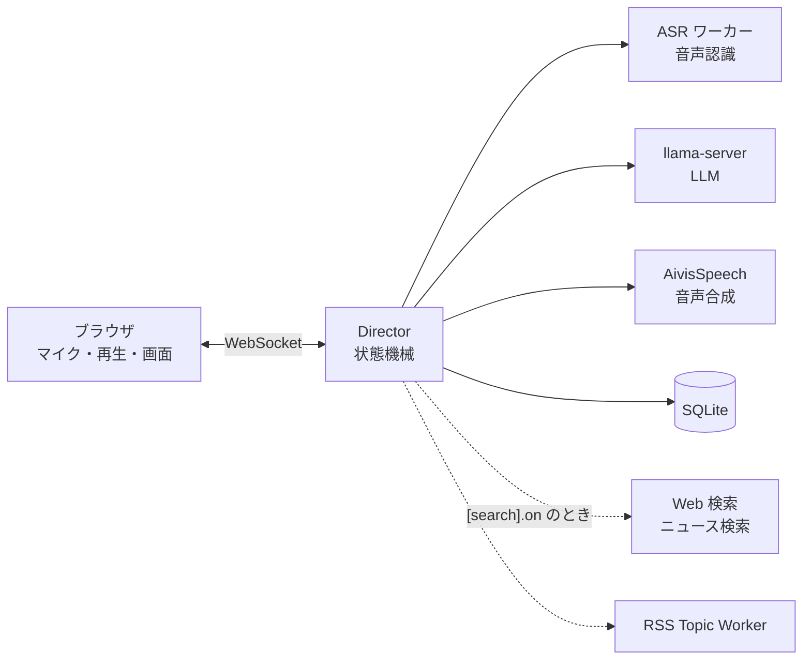

- Director は Python の単一イベントループで動く。
- ASR ワーカーは ReazonSpeech を使う。設定で faster-whisper に戻せる。
- 外部ネットワークに出るのは次の 2 つだけである。
  - RSS Topic Worker
  - `[search].on` のときの Web 検索とニュース検索 (「Web 検索」節)
- 他の通信はすべて 127.0.0.1 で閉じる。
- 音声・書き起こし・ドラマの台詞・声の特徴は、外部に送らない。
- 利用者はヘッドホンとスピーカーのどちらでも使える。
- スピーカーからの回り込みは、2 つの仕組みで抑える。
  - ブラウザの AEC (`echoCancellation: true`)
  - 自声除外 (「割り込み判定」節)

### LLM のモデル

- `idle_talk.toml` の `[llm].model` が LLM のモデルを決める。
- 現在の設定は Gemma 4 12B (QAT Q4_0) である。
- Gemma 4 12B は GPU0 で約 7.4GB を使う。
- 思考は `enable_thinking=false` で無効にする。
- 以前の Qwen3.5-4B は方言の聞き取りに弱かった。そのため置き換えた。
- Qwen3.5-4B の行は、設定ファイルにコメントで残す。

## プロセスと起動

| プロセス | 起動 | 既定ポート | 備考 |
|---|---|---|---|
| Director | `python -m idle_talk.main` | WS 8765 / Web 8000 | 引数は下記 |
| ASR ワーカー | `python -m idle_talk.asr_worker` | 8090 (`--port`) | 127.0.0.1 固定。詳細は下記 |
| llama-server | `[llm].model` があれば Director が起動・監督する。無ければ手動 | 8080 | 起動引数は `llm_supervisor.build_llama_argv` |
| AivisSpeech | 手動 | 10101 | 話者 ID の既定は 888753760 |

- Director の主な引数: `--web-port`、`--data-dir` (既定 `data`)、`--pid-file`、`--llm-url` / `--tts-url` / `--asr-url`。
- llama-server の起動引数は `--jinja` と `enable_thinking=false` を含む。これで思考を無効にする。
- AivisSpeech の話者 ID は `idle_talk.toml` の `[tts].speaker` か `--speaker` で変える。
- ASR ワーカーのポート 8090 は、設計書に定義が無い。実装上の既定値である (要確認)。

### ASR ワーカー

- ASR ワーカーは、起動時に `[asr].engine` のモデルを 1 回ロードする。
- `reazon` (既定) は ReazonSpeech (sherpa-onnx) を CPU で動かす。
  - スレッド数は `[asr].threads` で決める。
  - int8 版のモデルがあれば int8 版を使う。
  - 長い音声は 25 秒ごとに切って認識する。
- `whisper` は faster-whisper `small` を CUDA/float16 で動かす。
- パッケージやモデルが無いと、ASR ワーカーは exit 2 で終わる。

### 起動・停止 (`ctl`)

- `python -m idle_talk.ctl start|stop|restart|status` で起動と停止をする。
- Windows では `idle-talk.cmd` が同じことをする。
- `ctl start` は ASR ワーカーと Director を端末から切り離して起動する。
- `[aivis].engine` があれば、`ctl start` はその前に AivisSpeech Engine を起動する (`ctl.start_aivis`)。
  - 引数は `--host 127.0.0.1 --port <[ports].tts> --no-use_gpu` (`[aivis].use_gpu = true` なら `--use_gpu`) と `--output_log_utf8` である。
  - `/version` が応答するまで最大 `ctl.AIVIS_READY_TIMEOUT_S`=90 秒待つ。Director の起動時のウォームアップと声の一覧取得に間に合わせるためである。
  - 起動に失敗しても、待ち切れなくても、Director は起動する (声が出ないだけ)。
  - 既に `[ports].tts` で応答していれば起動しない (AivisSpeech アプリを先に起動した場合など)。
  - PID を `data/aivisspeech.pid` に書く (エンジン自身は書かない)。`ctl stop` は、この PID のプロセスだけを子プロセスごと止める。
- 二重起動は pid ロックで検出し、exit 4 で拒否する。
  - `ctl` は PID ファイル (`data/idle_talk.pid` / `data/asr_worker.pid`) の生存を確認する。
  - `asr_worker` も、`--pid-file` があれば同じ検査をする。
- 出力は `data/idle_talk.log` / `data/asr_worker.log` / `data/aivisspeech.log` に追記する。
- Director のログは INFO 以上を出す。形式は `日時 レベル ロガー名: 本文` である。

停止の流れ:

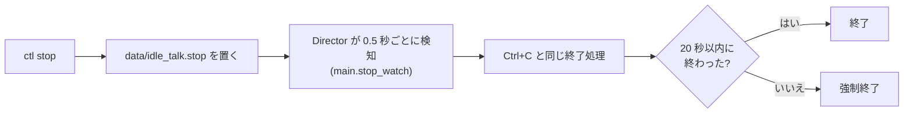

- 強制終了までの待ち時間は `ctl.STOP_TIMEOUT_S`=20 秒である。
- 強制終了すると、llama-server が残ることがある。
- ASR ワーカーは、待たずに強制終了する。
- Director は、起動時に残っていた停止ファイルを消す。
- 終了時 (Ctrl+C) に、`director.close()` が `run_meta` を 1 行書く。その後でストアを閉じる。

### 記憶と声の管理 (`ctl memories` / `ctl speakers`)

- `ctl memories` は保存した記憶を一覧にする。
- `ctl speakers` は覚えた声を一覧にする。表示は名前と、平均に使った発話数である。
- `ctl speakers` は声の特徴そのものを表示しない。
- どちらも `--delete ID` で 1 件、`--clear` で全件を削除する。
- どちらも起動中に使える。
- `speakers` の削除は、再起動後に効く。

### ログと記録

- 会話の文言は `data/talk.log` (UTF-8) に追記する。
  - 形式は `日時 USER: …` / `日時 AI: …` である。
  - ロガーは `idle_talk.talk` である。他のログには流さない。
  - 利用者の発話は、ASR の確定時に書く。
  - AI の発話は、再生を終えたチャンクだけを確定時に書く。DB の turns と同じ規則である。
  - 途中で止まった AI の発話は `AI(中断):` と書く。
- Director は、起動中 60 秒ごとに RSS / VRAM を `soak_sample` として記録する。計測に失敗しても、ログだけ残して続ける。
- `main` は CLI 引数と `idle_talk.toml` だけを使う。
- 環境変数 `LLAMA_URL` / `AIVIS_URL` / `AIVIS_SPEAKER` は、M0 計測と実機試験だけが読む。

## 設定ファイル (`idle_talk.toml`)

設定ファイルの読み方:

- Director は、起動時のカレントディレクトリから `idle_talk.toml` を読む。
- リポジトリ直下以外で起動するときは、`--config <path>` で場所を指定する。
- ファイルが無ければ、既定値で動く。
- 未知のキー・型違い・範囲外の値は、起動時に `ValueError` になる。
- 値が範囲外だと idle-talk は起動に失敗する。画面ではなく `data/idle_talk.log` の末尾で原因を見る。

起動後に読み直すかどうか:

| セクション | 読み直し |
|---|---|
| `[tts]` | 合成のたびに更新時刻を見て、変わっていれば読み直す |
| `[ports]` / `[asr]` / `[vad]` / `[spontaneous]` / `[llm]` / `[topics]` / `[search]` / `[voice_id]` / `[drama]` | 起動時だけ読む |
| `personas.toml` (別ファイル) | system プロンプトを作るたびに更新時刻を見て、読み直す |

### ポート (`[ports]`)

- `[ports]` のキーは `ws`、`asr`、`llm`、`tts`、`web` である。
  - `ws` は Director の WebSocket である。
  - `web` は `web/` の静的配信である。
- 既定値は「プロセスと起動」の表と同じである。
- `config.load_ports` が読む。`main` / `asr_worker` / M0 計測が使う。
- 値は 0〜65535 の整数でなければならない。
- 優先順位は、CLI 引数 (`--port` / `--web-port` / `--*-url`) → 設定ファイル → 既定値 の順である。
- M0 計測では、環境変数 `LLAMA_URL` / `AIVIS_URL` が設定ファイルより優先する。
- AivisSpeech と、監督しない llama-server は手動で起動する。`llm` / `tts` を変えたら、各サーバの待受ポートも合わせる。
- Director が起動する llama-server には、`[ports].llm` (または `--llm-url` のポート) を渡す。

### 画面の配信と `/config.json`

- `main` は `[ports].web` のポートで `web/` を 127.0.0.1 に配信する (`main.start_web`、標準ライブラリ `http.server`)。
- `/config.json` は次の項目を返す。
  - `ws_port`: WebSocket のポート
  - `ui`: 設定欄の初期値。`speaker` と `persona` を含む
  - `speakers`: 声の選択肢
  - `personas`: ペルソナの選択肢 (`[{id, name}]`)
- `index.html` はポート番号を持たない。`/config.json` を読んで接続する。
- URL に `?port=` があれば、`index.html` はそのポートを使う。
- 画面は http://127.0.0.1:8000/ で開く。
- `file://` で開くと Origin が `null` になる。このとき WS は 4003 で拒否される。

### 声 (`[tts]`)

話者:

- `[tts].speaker` が話者 ID を決める。
- 話者 ID は、AivisSpeech が声 (モデル) とスタイルの組ごとに振る整数である。
- 話者 ID は、`/audio_query` と `/synthesis` の `speaker` パラメータに渡す。
- 既定の話者 ID は 888753760 (`config.DEFAULT_SPEAKER`) である。
- 優先順位は、`--speaker` → 設定ファイル → 既定値 の順である。
- M0 計測では、環境変数 `AIVIS_SPEAKER` が設定ファイルより優先する。
- 負数・非整数・`[tts]` の未知キーは `ValueError` になる。
- 使える ID は、AivisSpeech の `GET /speakers` で確認する。
- インストールされていない ID を指定すると、合成のたびに AivisSpeech がエラーを返す。起動時には検査しない。

声パラメータ (`config.VOICE_PARAMS`、`config.load_voice`):

| `[tts]` のキー | AudioQuery のキー | 範囲 |
|---|---|---|
| `speed` | `speedScale` | 0.5〜2.0 |
| `intonation` | `intonationScale` | 0〜2 |
| `tempo_dynamics` | `tempoDynamicsScale` | 0〜2 |
| `pitch` | `pitchScale` | -0.15〜0.15 |
| `volume` | `volumeScale` | 0〜2 |
| `pause` | `pauseLengthScale` | 0 以上 |
| `pre_silence` | `prePhonemeLength` | 0 以上 |
| `post_silence` | `postPhonemeLength` | 0 以上 |

- 範囲は、AivisSpeech Engine 1.2.0 の openapi の記載に従う。
- 範囲外・非数値は `ValueError` になる。
- `TtsClient` は `/audio_query` の結果のうち、指定したキーだけを上書きする。その後 `/synthesis` に渡す。
- 指定しなかったキーは、AivisSpeech の既定値のままである。
- 出力は `clients.TTS_RATE`=24000Hz モノラルに固定する。`web/player.js` の再生レートと一致させるためである。

起動後の反映 (`main.TtsSettingsReloader`):

- `TtsSettingsReloader` は、合成のたびに設定ファイルの更新時刻を見る。
- 更新時刻が変わっていれば、話者と声パラメータを読み直す。次の発話から効く。
- 話者は、ファイルの `speaker` の値が前回と変わったときだけ反映する。声パラメータだけの編集で、画面の選択を戻さないためである。
- 不正な値は警告し、前の値を保つ。
- `--speaker` を指定したときは、ファイルの話者で上書きしない。

画面の「声」選択欄:

- `main` は `/config.json` を配信するときに、AivisSpeech の `GET /speakers` を取得する (`SpeakerChoices`、`TtsClient.speakers`)。
  - 取れたら覚えて、以後は取り直さない。取れるまでは要求ごとに取り直す (AivisSpeech が後から起動しても、画面を読み直せば選択欄が出る)。
  - 取得するのは talk スタイルだけである。
  - 表記は「話者 スタイル」である。
- 一覧は `/config.json` の `speakers` で渡す。初期値は `ui.speaker` (起動時の話者) で渡す。
- 一覧を取得できなければ、画面は選択欄を出さない。
- 一覧に無い ID は 5006 になる (一覧が取れていない間は検査しない)。
- 選んだ話者は、`ui` メッセージの `speaker` で届く。
- `TtsSettingsReloader.set_speaker` が、次の文の合成からその話者を使う。
- 画面での選択は保存しない。再起動すると設定ファイルの値に戻る。
- `--speaker` を指定していても、画面からは変えられる。
- 起動時に合成済みの相槌クリップは、再起動まで前の声のままである。

### 発話検出 (`[vad]`)

| キー | 既定値 | 範囲 | 意味 |
|---|---|---|---|
| `adaptive` | true | bool | 閾値を自動で決める。false なら `threshold` 固定 |
| `ratio` | 3.0 | 1 より大、100 以下 | 自動校正の閾値 = 推定した雑音 × `ratio` |
| `min_threshold` | 100 | 0 より大、32767 以下 | 自動校正の閾値の下限 |
| `threshold` | 500 | 0 より大、32767 以下 | 発話とみなすフレームの RMS (16bit PCM) |
| `onset_ms` | 100 | 20〜1000 の整数 | 閾値以上がこの長さ続いたら発話開始 |

- 自動校正では、雑音の推定がそろうまで `threshold` を使う。そろうまでは非再生フレーム 1 秒ぶん (`vad.NOISE_WARMUP_MS`) である。
- `onset_ms` は 20ms (1 フレーム) 単位に切り捨てる。
- `onset_ms` は、短い物音 (クリック・衝突音) を発話にしないためにある。
- `config.load_vad` が読み、`main` が `EnergyVad` を作る。
- 物音で発話扱いになりすぎるときは、`ratio` か `onset_ms` を上げる。
- 声を拾わないときは、`ratio` を下げる。

自動校正の動き (`vad.EnergyVad`):

- 雑音の推定:
  - `EnergyVad` は、AI 再生中でないフレームの RMS を dB で追う。
  - 静かな方へは速く追う。時定数は `NOISE_DOWN_TAU_MS`=500ms である。
  - うるさい方へはゆっくり追う。速さは `NOISE_UP_DB_PER_S`=0.5dB/秒である。
  - 発話は断続的なので、推定は雑音の床に留まる。5 秒話し続けても +2.5dB である。
  - 部屋が恒常的にうるさくなると、推定が追いつくまで時間がかかる。その間は発話区間が終わりにくい。
- 回り込みの推定:
  - `EnergyVad` は、AI 再生中のフレームの RMS を平均する。時定数は `ECHO_TAU_MS`=2 秒である。
  - 再生中の閾値は「回り込み × `ratio`」以上に上げる。
  - 回り込みの値は再生をまたいで保つ。
  - 最初の再生の数秒は、閾値が低めになり得る。自声除外と雑音判定で補う。
  - 再生中の利用者の声も、平均に入る。
- 「再生中」の定義:
  - 現行 epoch の送出済みチャンクが、`finished` / `dropped` の報告待ちである間を指す。
  - Director は、上り音声を受けるたびに `vad.playing` を設定する。

### 機能別の設定 (`[asr]` / `[search]` / `[voice_id]` / `[drama]`)

- いずれも `config.load_*` が読む。
- セクションが無ければ既定値で動く。

| セクション | キー (既定値、範囲) | 備考 |
|---|---|---|
| `[asr]` | `engine` (`reazon`) / `model_dir` (`data/models/reazonspeech`) / `threads` (2、1〜32) | `engine` は `reazon` か `whisper`。変えたら再起動する |
| `[search]` | `on` (false) / `engines` (`["duckduckgo","bing"]`) / `read_page` (true) | `engines` は空でなく、既知のエンジンだけを並べる。`on` が false なら外部に出ない |
| `[voice_id]` | `on` (false) / `model` (`data/models/voxceleb_resnet34_LM.onnx`) / `threshold` (0.6、0 と 1 を含まない) | モデルや onnxruntime が無ければ warn し、識別なしで動く |
| `[drama]` | 下表 | すべて整数 |

`[drama]` のキー:

| キー | 既定値 | 範囲 | 意味 |
|---|---|---|---|
| `interval_s` | 90 | 10〜3600 | 前の一言から最低これだけ空ける (秒) |
| `gap_ms` | 2500 | 500〜30000 | 台詞がこれだけ途切れたら場面の切れ目とみなす |
| `window_s` | 180 | 30〜1800 | 台詞をメモリに置く範囲 (直近の秒数) |
| `min_chars` | 60 | 0〜2000 | 前の一言から溜まった台詞がこれ未満なら黙る |
| `ctx_chars` | 1200 | 100〜4000 | LLM に渡す台詞の上限字数 |
| `max_seg_s` | 15 | 3〜60 | 台詞の区間をこの秒数で強制的に切る |
| `finale_gap_s` | 60 | 10〜1800 | 台詞がこれだけ聞こえなければ感想を話す (秒) |
| `finale_min_chars` | 600 | 0〜20000 | 前の感想から聞いた台詞がこれ未満なら感想は言わない |
| `digest_chars` | 800 | 100〜2000 | 台詞がこれだけ溜まったらあらすじメモに要約する |

- 同梱の `idle_talk.toml` は `interval_s`=15、`gap_ms`=800 で上書きしている。

### ペルソナ (`personas.toml`)

ファイルの書き方:

- `personas.toml` は、設定ファイルと同じフォルダに置く (`persona.PersonaBook`)。
- `[<id>]` ごとに 1 人を書く。
  - `name`: 画面の表示名
  - `prompt`: 名前・性格・口調・一人称
- トップレベルの `default` が、起動時のペルソナを決める。省略時は先頭のペルソナである。
- 内容が不正なら `ValueError` になる。
- ファイルが無ければ、組み込みの 1 人 (`persona.DEFAULT`、気さくな雑談相手) だけで動く。
- 画面の選択欄は、ペルソナが 2 人以上のときだけ出る。
- 同梱のペルソナは次の 3 人である。
  - `wai`: 博多弁の天才宇宙人。一人称は「うち」。既定
  - `haru`: 気さくな友達
  - `shino`: 丁寧語の聞き上手

プロンプトへの使い方:

- system プロンプトは「選んだペルソナの `prompt`」+「共通の話し方の決まり `persona.STYLE_RULES`」である。
- この system プロンプトを、通常応答・自発発話・ドラマの一言に使う。
- 記憶の抽出と名前の抜き出しには使わない。
- `STYLE_RULES` の中身:
  - 2〜4 文で話す。
  - 感想や話題を添える。
  - 口調は人物設定に従う。履歴の口調には合わせない。
  - 箇条書きと記号を使わない。
- 声はペルソナと別である。画面の「声」(`ui.speaker`) で選ぶ。

切り替えと読み直し:

- 画面の「ペルソナ」は `ui.persona` を送る。次の応答から切り替わる。
- 一覧に無い id は 5006 になる。
- 切り替えても、会話の履歴は残す。
- `PersonaBook` は、system プロンプトを作るたびにファイルの更新時刻を見る。変わっていれば読み直す。
- そのため、`prompt` の編集は再起動なしで効く。
- 読み直した内容が不正なら warn し、前の内容を使い続ける。
- ペルソナの増減と `name` の変更は、再起動後に画面へ反映する。`/config.json` の `personas` で渡すためである。

## WebSocket プロトコル (設計書 §12.1)

### 接続制御

- Director は 127.0.0.1 にだけバインドする。それ以外を指定すると、起動時に例外になる。
- Origin のホストが `localhost` / `127.0.0.1` / `::1` 以外なら、close 4003 で拒否する。
- Origin が無い接続も拒否する。
- 接続は常に 1 本である。新しい接続が来たら、旧接続を close 4001 で閉じる (後勝ち)。
- 2 回目以降の接続では、Director が epoch を +1 して `cancel` を送る。旧音声を無効にするためである。
- `hello` の version が 1 以外なら、close 4002 になる。
- `hello` がスキーマ違反でも、close 4002 になる。
- Director は `PING_INTERVAL` (5s) ごとに `ping` を送る。
- pong の未応答が 2 回続くと、Director は切断扱い (close 1001) にする。

### テキストメッセージ

- Director は、受信メッセージを JSON Schema (`protocol.MESSAGE_SCHEMA`) で検証する。
- スキーマ違反と不正な JSON は、`error` 5006 を返して破棄する。

| t | 方向 | 主なフィールド |
|---|---|---|
| `hello` | B→S | `version`(=1), `sample_rate`(=16000), `client_id`(1〜64 文字) |
| `playback` | B→S | `epoch`, `utterance_id`, `chunk_id`, `position_ms`(0〜600000), `state`(started/finished/dropped) |
| `ui` | B→S | `mute`, `on`, `radio`, `interval_s`(10〜3600 秒), `quiet_start` / `quiet_end`(HH:MM), `speaker`(話者 ID), `drama`(タブ共有中か), `persona`(ペルソナ id、1〜64 文字) |
| `ping` / `pong` | 双方向 | `ts` |
| `duck` | S→B | `epoch`, `gain`(0〜1) |
| `cancel` | S→B | `new_epoch` |
| `resume` | S→B | `epoch` |
| `state` | S→B | `state`(状態名), `muted` |
| `error` | S→B | `code`(4000〜5999), `message`(200 字以内) |

- 現行 epoch と異なる `playback` は、黙って破棄する。
- `hello` を受けると、Director は現在の `state` を 1 件送る。状態遷移が起きるまで画面が「未接続」のままになるのを防ぐためである。
- 新しい接続では、Director は送出待ち・未報告のチャンクを捨てる。
- 前の接続で再生されずに残った自発発話は、取り消す。

スキーマ外のメッセージ (S→B):

| t | フィールド | 用途 |
|---|---|---|
| `text` | `epoch`, `utterance_id`, `text` | AI 発話の各チャンク送出時に送る。今のブラウザは表示せず無視する |
| `search` | `query`, `active` | Web 検索の開始 / 終了 |
| `links` | `items: [{title, url}]` | 画面の URL 欄に出すページ |

- `text` は `MESSAGE_SCHEMA` に無い。ブラウザから受信すると 5006 になる (要確認: 設計 §12.1 への追加要否)。
- `search` と `links` は設計書 §3.1 に記載がある。

### バイナリフレーム

上り (ブラウザ → Director):

- 形式は「先頭 u32 LE の連番」+「16kHz mono s16le PCM」である。
- 1 フレームは 20〜40ms である。
- 1MiB を超えるフレームと 4 byte 未満のフレームは、破棄する。
- 連番の最上位ビット (`protocol.DRAMA_FLAG`=0x80000000) は、音の出どころを表す。
  - 立っていれば、共有したタブの音 (ドラマモード) である。
  - 立っていなければ、マイクの音である。
- 連番は、マイクとタブで別々に数える。

下り (Director → ブラウザ):

- 形式は「16 byte ヘッダ」+「PCM」である。
- ヘッダは `<epoch, utterance_id, chunk_id, length>` (u32 LE × 4) である。
- 1 チャンクは最大 1MiB である。

## エラーコード (設計書 §12.2)

| コード | 種別 | 意味 |
|---|---|---|
| 4001 | WS close | 接続の置き換え (設計書の表では 4002 と意味欄が併記されている。要確認) |
| 4002 | WS close | version 不一致 / 不正な hello |
| 4003 | WS close | Origin 不許可 |
| 5001 | error | LLM のタイムアウト・停止 |
| 5002 | error | TTS の失敗・タイムアウト |
| 5003 | error | ASR の失敗 |
| 5004 | error | DB の異常 |
| 5005 | error | マイクデバイスの喪失 |
| 5006 | error | ui / playback の範囲外値、不正なメッセージ |
| exit 4 | プロセス | 二重起動 |

## 状態機械 (設計書 §4)

- 状態は 7 つある: `idle` / `user_speaking` / `eot_check` / `preparing` / `ai_playing` / `interrupt_check` / `rest`。
- 遷移は、副作用の無い純関数 `fsm.transition` が決める。
- Director は、イベントをキューで直列に適用する。
- Director は、遷移ごとに `state` メッセージを 1 件送る。

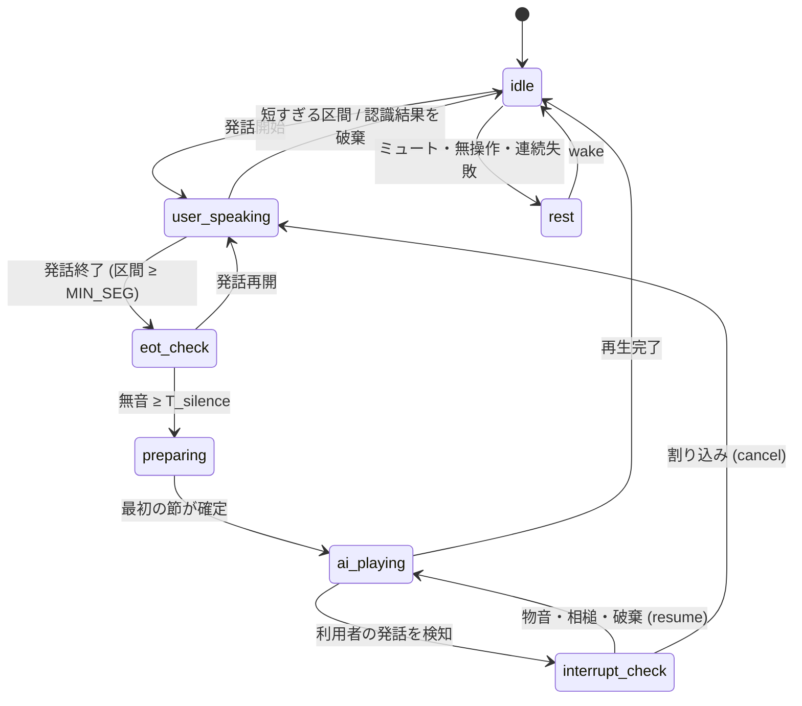

各遷移の詳細:

- `idle` → `user_speaking`:
  - 条件は VAD の発話開始である。ミュート中は無視する。
  - Director は ASR を開始し、記憶抽出を中断する。
  - 自発発話の準備中・再生中なら、`duck` する。取消は認識結果まで保留する。
  - 語が出れば取り消す。語が出なければ `resume` する。
- `user_speaking` → `eot_check`:
  - 条件は、区間長 `MIN_SEG` (200ms) 以上での VAD 終了である。
  - 区間が `MIN_SEG` 未満なら、雑音として破棄し `idle` へ戻る。
- `eot_check` → `preparing`:
  - 条件は、無音が `T_silence` (400ms) 以上で、終話判定が真であることである。
  - Director は ASR を確定し、LLM を呼ぶ。
  - 途中で発話が再開したら、`user_speaking` へ戻る。
- `preparing` → `ai_playing`:
  - 条件は、現行 epoch の最初の合成可能な節が確定したことである。
  - 生成中に利用者が話し始めたら、生成を取り消す。
- `ai_playing`:
  - 利用者が停止語を言ったら、即 cancel する。
  - それ以外の発話では、`duck` (gain `DUCK_GAIN`=0.2) して `interrupt_check` へ進む。
  - 再生を終えたら、履歴を確定して `idle` へ進む。
- `interrupt_check`:
  - Director は `duck` のまま認識結果を待つ。時間切れでは止めない。
  - 区間が `MIN_SEG` 未満で終わったら (物音)、`resume` して `ai_playing` へ戻る。
  - 語が認識され、確認窓内の相槌なら、`resume` して `ai_playing` へ戻る。
  - 停止語・普通の発話・確認窓を過ぎた相槌なら、cancel して `user_speaking` へ進む。
- `DISCARDED` (認識結果を捨てた):
  - 捨てる理由は、ASR 失敗・幻聴・語なし・自声のいずれかである。
  - 最新の区間で発話が終わっているときだけ発生する。
  - `user_speaking` / `eot_check` なら、区間を破棄して `idle` へ進む。
  - `interrupt_check` なら、`resume` して `ai_playing` へ戻る。
- `interrupt_check` の間に再生し終えた場合:
  - FSM はその完了通知を捨てる。
  - `resume` のときに、Director が完了を再確認して `idle` へ進める。
- 任意の状態 → `rest`:
  - 条件は、ミュート・無操作 `IDLE_TIMEOUT` (1800s)・連続失敗のいずれかである。
  - 生成中・再生中なら、epoch を +1 して cancel する。
  - `rest` からは wake で `idle` に戻る。

## epoch と取消 (設計書 §3.2)

- epoch は u32 の単調増加カウンタである。
- epoch は、取消が確定したときだけ +1 する。U32 の最大値の次は 0 である。
- 旧 epoch の音声チャンク・再生通知・完了通知は、すべて破棄する。
- 取消と完了が同時に起きても、旧 epoch の完了は履歴に確定しない。
- 取消は、LLM / ASR の完了を待たない。
- 通常応答・相槌・自発発話の再生と取消は、同じ経路 (`ResponsePipeline.play_utterance` / `cancel`) だけを通る。

## 割り込み判定 (設計書 §5.1)

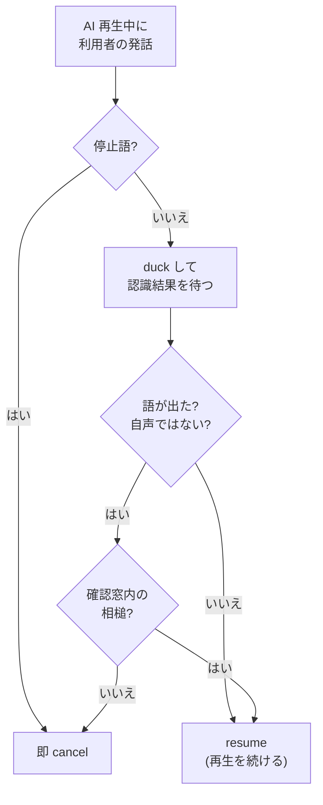

停止語:

- 停止語 `STOP_WORDS` は「待って / 違う / ちょっと / ストップ」である。
- 判定は NFKC 正規化の後で行う。
- 停止語と一致すれば、停止語とみなす。
- 停止語を含み、長さが停止語 +2 文字以内でも、停止語とみなす。
- 停止語は、duck を経ずに cancel する。

相槌:

- 相槌語は「うん / うんうん / へえ / ふーん / ええ / はい / なるほど / そう / そっか」である。
- 相槌語が確認窓 `[開始, 開始 + T_confirm)` (T_confirm=400ms) の内側なら、相槌とみなして再生を再開する。
- 疑問形 (末尾が ? / ？) は相槌とみなさない。停止する。
- 相槌語以外の語も相槌とみなさない。停止する。
- 実際には、確認窓 (400ms) はほぼ間に合わない。発話終了後の無音 hangover (200ms) と ASR を待つためである。そのため、再生中の相槌は多くの場合に停止になる (要確認: `T_confirm` の見直し)。

発話が無かったとみなすもの:

- 語が無い認識結果 (英数字・かな漢字を含まない) は捨て、再生を続ける。
- ASR の失敗と幻聴も、同じく捨てて再生を続ける。雑音で止めないためである。

自声除外:

- 対象は、AI 再生中 (自発発話を含む) に始まった発話である。
- 認識結果から句読点・空白を除く。それが直近の AI 発話本文の部分文字列なら、自分の声とみなして捨てる。
- 捨てたときは、応答も取消もしない。再生を続ける。
- 捨てたときは、`events` に `echo_suppressed` を記録する。
- 言い換えと部分的な誤認識は、検出できない。
- 短い語が偶然一致すると、利用者の発話を捨てることがあり得る (要確認)。

強い発話:

- 次のどちらかを満たす発話を、強い発話とする。
  - 確認窓の終わりまで続く。
  - AI の平均音量の `STRONG_UTT.volume_ratio` (2.0) 倍以上である。

## 応答パイプライン (設計書 §3.3 / §4.3)

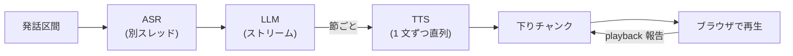

LLM と TTS:

- Director は、LLM の出力をストリーミングで受ける。
- 句点・読点などで最初の合成可能な節が確定したら、その節を TTS に渡す。
- TTS は 1 文ずつ直列に合成する。
- 応答の生成上限は `clients.LLM_MAX_TOKENS`=300 である。2〜4 文程度にあたる。
- LLM の SSE チャンクは、`delta.content` が null でも受け付けて読み飛ばす。llama-server は最初のチャンクで null を送るためである。

タイムアウト `HTTP_TIMEOUT`:

| 相手 | 時間 | 超えたとき |
|---|---|---|
| LLM | 最初のトークン 5s、全体 20s | 5001 |
| TTS | 1 文 3s | 5002。その文を飛ばし、次の文へ続ける |
| ASR | 区間長 ×2 + 2s | 5003。その発話を破棄する |

- ASR のソケットのタイムアウトと接続断も、`AsrTimeout` / `AsrFailed` に変換する。
- Ingress は、ASR のどの失敗も握り、その発話だけを捨てる。WS の接続は保つ。

ASR の実行:

- Director は、ASR を単一ワーカースレッド (`director._offload_asr`) で区間順に実行する。
- 結果はイベントループに戻して処理する。
- 認識中も、再生通知・音声送出・LLM・TTS は止まらない。
- 後続の区間の認識待ちがあるときは、終話 (SILENCE) を最後の区間の結果で確定する。
- 割り込みの認識が `T_confirm` を超えて返っても、Director はそれまで `duck` のまま待つ。
  - 語が出れば、取り消してその発話に応答する。
  - 捨てられた (失敗・幻聴・語なし・自声) ときは、再生を続ける。

ASR の幻聴除外:

- `no_speech_prob` > 0.6 のセグメントは捨てる。
- `compression_ratio` > 2.4 のセグメントも捨てる。
- 境界値ちょうどは採用する。
- ReazonSpeech は `no_speech_prob` を出さない。そのため 0 とする。
- ReazonSpeech の `compression_ratio` は、本文から計算する。定義は faster-whisper と同じ (UTF-8 長 / zlib 圧縮長) である。
- 語が出ない結果は、セグメントを返さない。
- 1 音 (+促音・長音・小書き・句読点) だけの結果も返さない。例は「え」「あっ」「何」である。物音の聞き違いだからである。
- 「うん」など 2 音以上は残す。

LLM の停止と再起動:

- LLM が停止したら、Director は定型句に縮退する。
- llama-server は `LLM_RETRY` に従って再起動する。
  - バックオフは 1s → 2s → 4s である。
  - 600s の窓の中で最大 3 回まで再起動する。
  - 4 回目は再起動しない。Director を休止 (`rest`) に移し、警告ログを出す。
- 再起動が働くのは、Director が llama-server を起動した場合だけである。
- `idle_talk.toml` の `[llm]` のキー: `server` (実行ファイル)、`model` (gguf パス)、`ngl`、`ctx`。
- `model` を指定すると、`main` が起動時に llama-server を起動する。
- `main` は `/health` が 200 になるまで待つ。上限は `LLM_READY_TIMEOUT_S` (120s) である。
- llama-server の出力は `<data-dir>/llama-server.log` に追記する。
- `llm_supervisor.watch` は、`WATCH_INTERVAL_S` (0.5s) ごとにプロセスの終了を調べる。
- 終了していれば、`LlmSupervisor.on_crash` (バックオフ + 再起動) を呼ぶ。
- Director が終了するときは、監督中の llama-server も止める。
- 次の場合、Director は llama-server を起動も監督もしない。この場合、落ちても再起動しない。
  - `[llm].model` が空のとき
  - 起動時に、同じポートで llama-server がすでに応答しているとき。二重起動を避けるためで、警告ログを出す

AivisSpeech の呼び方:

- Director は `/audio_query` → `/synthesis` の順に要求する。
- `/cancellable_synthesis` は使わない。AivisSpeech Engine 1.2.0 で 501 Not Implemented のためである。
- `/synthesis` は、切断後も計算が続く。
- 中止した文の結果は、epoch の不一致で破棄する。
- 中止後に残る計算は、合成中の 1 文ぶん (`tts_sentence` 以内) である。
- Director は、起動時に `TtsClient.warmup` で 1 回空合成してから待ち受ける。
  - 初回の合成は、GPU (DirectML) の初期化で約 14 秒かかる。`tts_sentence` (6s) を超えるためである。
  - タイムアウトは `WARMUP_TIMEOUT_S` (60s) である。
  - 失敗しても警告ログだけ出し、起動を続ける。

## 履歴 (設計書 §5.2)

- AI 発話の履歴には、ブラウザが `finished` を返したチャンクの本文だけを確定する。
- 割り込まれた発話は `completed=0` とし、停止位置 `stop_position_ms` を記録する。
- LLM に渡す履歴は、直近 `N_TURNS` (8) ターンである。
- 履歴を切り詰めたときは、ログを 1 件残す。

## 記憶 (設計書 §3.4)

抽出のタイミングと内容:

- 応答の再生が完了して IDLE に戻ったとき、Director は記憶を抽出する。
- 対象は、未処理の利用者発話の直近 `MEM_BATCH`=4 件である。
- `MIN_UTTERANCE_CHARS`=6 文字未満の発話は対象外である。
- LLM は、本人が明言した好み・習慣・予定・続いている出来事を抜き出す。
- 形式は「利用者は〜」の 1 文である。

保存の規則:

- 「利用者」で始まる行だけを採用する。
- 1 回に `MAX_PER_UTTERANCE`=3 件までである。
- 1 件は `MAX_CHARS`=60 文字までである。
- 句読点・空白を除いて同じ内容なら、更新時刻だけを進める。
- 根拠は、最後の発話の utterance_id である。
- 保存は `MAX_MEMORIES`=30 件までである。
- 超えたら、更新時刻が古い `deletable=1` の行から消す。

取消と失敗:

- 抽出中に利用者が話し始めたら、抽出を取り消して LLM の受信を打ち切る。
- 抽出中に休止に入ったときも、同じく取り消す。
- 未処理分は、次の応答の完了後に再試行する。
- 抽出中は、自発発話を発火しない。LLM を取り合わないためである。
- 抽出に失敗しても、ログだけ残して会話を続ける。

プロンプトへの使い方:

- 通常応答と自発発話の system プロンプトに、記憶を箇条で添える。
- 記憶は更新が新しい順に並べる。
- LLM には「関係するときだけ触れる」「無いことを覚えているふりはしない」と指示する。
- `idle-talk memories` で一覧を見る。`--delete ID` / `--clear` で削除する (`deletable=1` のみ)。

## 終話判定と AI の相槌

終話判定:

- 既定の終話判定は、固定無音 (`FixedSilence`) である。
- Smart Turn v3.2 相当のアダプタに差し替えられる。
- 早切りの件数で G4 を比べる。

AI の相槌 (§6.1):

- 相槌は、内容に依存しない事前合成のクリップを使う。
- 無音が `SIL_BACKCHANNEL` (300ms) 続いたら、相槌を再生する。
- 相槌は 1 発話につき最大 1 回である。
- 相槌の間隔は `BC_COOLDOWN` (5s) 空ける。
- 無音が `T_silence` に達した時点で相槌が未完了なら、取り消す。このとき `backchannel_misfire` を記録する。
- 相槌は、G1 の遅延集計から除外する。

## 自発発話

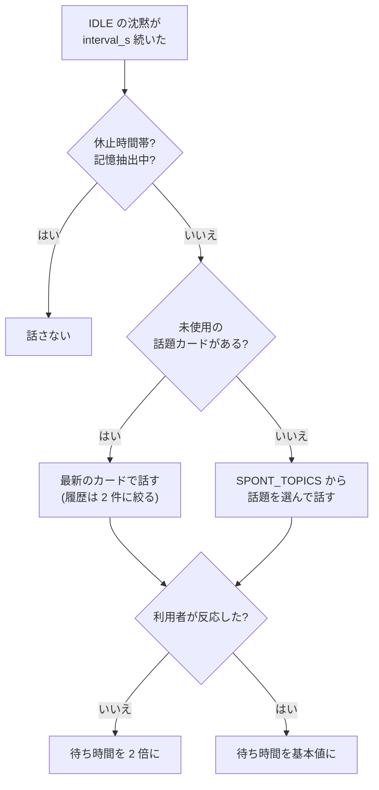

設定:

- 自発発話の既定はオフである。
- 自発発話は雑談モードのときだけ動く (要確認: 用語集を参照)。
- `idle_talk.toml` の `[spontaneous]` が、起動時の値を決める (`config.load_spontaneous`)。
  - キーは `on` / `interval_s` / `quiet_start` / `quiet_end` / `radio` である。
- 画面の設定欄の初期値は、`/config.json` の `ui` で同じ値が渡る。
- ページは接続時に、その値を `ui` メッセージで送り返す。

いつ話すか:

- IDLE の沈黙が `interval_s` 秒続いたら、AI が話しかける。
  - `interval_s` の既定は 1200 で、範囲は 10〜3600 である。
- 沈黙は、IDLE になった時刻から測る。応答の再生終了と、自発発話の再生終了がその時刻にあたる。
- `main.spontaneous_loop` は、`SPONT_TICK_S`=1 秒ごとに `director.spontaneous_tick` を呼ぶ。
- 無操作休止 `IDLE_TIMEOUT` の判定も、同じ呼び出しで行う。
- 休止時間帯 (既定 22:00〜07:00) は話さない。
- 無反応が続くたびに、待ち時間を 2 倍に延ばす。30 秒なら 30, 60, 120… と延びる。
- 利用者が話すと、待ち時間を基本値に戻す。
- 沈黙を同意とはみなさない。

何を話すか:

- 自発発話の指示には、話題の種を 1 つ添える。前の会話と違う話題を振らせるためである (`director._pick_topic`)。
- 未使用・期限内の話題カードがあれば、公開日時が最新のカードを 1 枚使う。
  - 使うのは、見出しと概要である。
  - 概要は、タグを除いて `CARD_FACTS_MAX`=200 字に切る。
  - 使ったカードには、その場で `used_at` を記録する。再利用しない。
- カードが無ければ、`director.SPONT_TOPICS` から無作為に話題を選ぶ。
- カードで話すときは、履歴を直近 `CARD_TURNS`=2 件に絞る。
- カードで話すときは、`CARD_PROMPT` / `RADIO_CARD_PROMPT` で次のように指示する。
  - 前の話の情景や言い回し (天気・音など) を繰り返さない。
  - 概要に無い事実を付け足さない。
- この指示は、独り語りが続くと自分の言い回しを真似て同じ情景を繰り返すためにある。

休止と取消:

- 利用者の操作 (発話・応答・設定変更) が `IDLE_TIMEOUT`=1800 秒無いと、休止 (`rest`) に入る。
- 休止中は、自発発話も止まる。
- ミュートなしの `ui` で待機に戻る。画面の「開始」による接続と、設定変更がこれにあたる。
- 無操作・連続失敗による休止も、同じく `ui` で待機に戻る。
- 準備中・再生中に利用者の発話を検知したら、`duck` する。
  - 認識で語が出たら、取り消す。反応ありとみなし、待ち時間を基本値に戻す。
  - 語が出なければ、`resume` して最後まで話す。
- 保留中に再生し終えた場合は、保留を解除したときに完了とする。

### ラジオモード

- ラジオモード (`radio`) は、返事を期待しない独り語りである。
- 既定はオフである。画面の「ラジオ」チェックで切り替える。
- ラジオモードは、`on` がオフでも動く。
- 1 本話し終えたら、`spontaneous.RADIO_GAP_S`=3 秒の沈黙で次を話す。
- ラジオモードは、`interval_s` と無反応による倍増を使わない。
- 指示は `director.RADIO_PROMPT` である。
  - ラジオのパーソナリティとして 3〜5 文話す。
  - 話題は、直前の続きか、話題カード / `SPONT_TOPICS` の話題である。
  - 質問・呼びかけをしない。
- ラジオモードは、記憶抽出中でも待たずに発火する。llama-server は 4 スロットで並行処理するためである。
- ラジオモードは、無操作休止 (`IDLE_TIMEOUT`) に入らない。聞き流し前提のためである。
- ラジオモードでも、休止時間帯は守る。
- 利用者が話せば、通常どおり取り消して応答する。応答の後で再開する。

### 質問率

- 質問率 `RATIO_Q` は、3 応答に 1 回以下である。

## Web 検索 (設計書 §6.3)

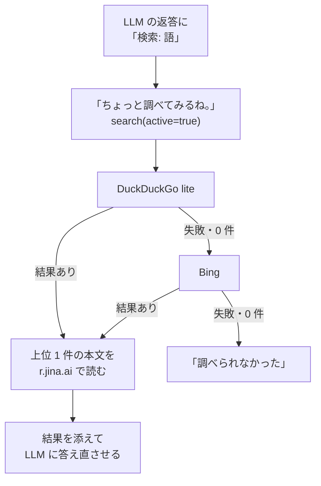

検索の指示:

- `[search].on` のとき、通常応答の system に検索の指示を足す。
  - 今日の日付を添える。
  - 「調べないと答えられない質問・『もっと詳しく』には、1 行で『検索: 検索語』とだけ出力」と指示する。
- 自発発話とドラマの一言では、検索しない。

返答から指示を見つける:

- 「検索:」「リンク:」は、返答の先頭にあるとは限らない。
- そのため、節ごとに探す (`web_search.find_mark`)。
- 指示より前の文だけを読み上げる。
- 指示以降は読まずに、LLM の受信を閉じる。
- 検索語は、指示の後ろ (その節の残り) である。

検索中の声と表示:

- 検索を始めたら、`SEARCH_NOTICE`「ちょっと調べてみるね。」を流す。通常の再生経路を通る。
- 同時に `search` (active=true) を送る。
- `SEARCH_WAIT_S`=5 秒を超えたら、`SEARCH_WAIT_NOTICE`「もう少し待ってね。」を 1 回だけ流す。

取得:

- `engines` の順に試す。既定は DuckDuckGo lite (`lite.duckduckgo.com/lite/`) → Bing の HTML である。
- 失敗・0 件なら、次のエンジンへ進む。
- 1 回の取得は `FETCH_TIMEOUT_S`=8 秒までである。
- 取得にはブラウザの User-Agent を付ける。
- Bing のリンク (`/ck/a?...&u=a1<base64url>`) は、元の URL に戻す。
- `read_page` なら、上位 1 件の本文を r.jina.ai (テキスト形式) で読む。
- 本文が読めなければ、抜粋だけで答える。
- 全エンジンが失敗したら、「調べられなかった」と答える。

答え直し:

- 検索結果を、最後の利用者発話に添える。
  - 上位 `MAX_RESULTS`=5 件の見出しと抜粋。計 `RESULTS_MAX_CHARS`=800 字まで
  - 本文の抜粋。`PAGE_MAX_CHARS`=800 字まで
- 履歴は直近 `ANSWER_TURNS`=4 ターンに絞る。
- 結果に無いことは推測させない。
- 検索中に割り込みで epoch が変わっていたら、2 回目の LLM は呼ばない。
- このとき、HTTP は打ち切らない。結果を捨てる。

リンク:

- 「ページや URL を求められたら、1 行で『リンク:』とだけ出力」という指示も足す。
- この指示を足すのは、次のどちらかがある間だけである (http(s) の URL のみ)。
  - 直近の検索結果
  - 自発発話で使った話題カードの記事
- 返答が「リンク:」なら、URL は読み上げない。「画面に表示するね。」と言う。
- 同時に、`links` で URL を送る。
- LLM が書いた URL は使わない。
- 話題カードで話すときは、聞かれる前に記事の URL を送る。

### 話題カードの補充

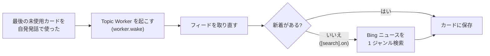

- 自発発話で最後の未使用カードを使ったら、Director が Topic Worker に補充を要求する (`worker.wake`)。
- Worker は、定期取得を待たずにフィードを取り直す。
- 新着が無く `[search].on` なら、Worker は Bing ニュース (新しい順) を検索する。
  - `NEWS_QUERIES` のジャンル順に、1 回に 1 ジャンルを検索する。
  - 概要の無い記事は除く。
  - トップや一覧のページは除く。
  - 重複は URL で除く。
- 補充は `REFILL_MIN_S`=300 秒に 1 回までである。
- 休止中の補充要求は無視する。
- `[topics].feeds` が空でも、`[search].on` なら Worker を作る。

## 話者識別 (設計書 §6.4)

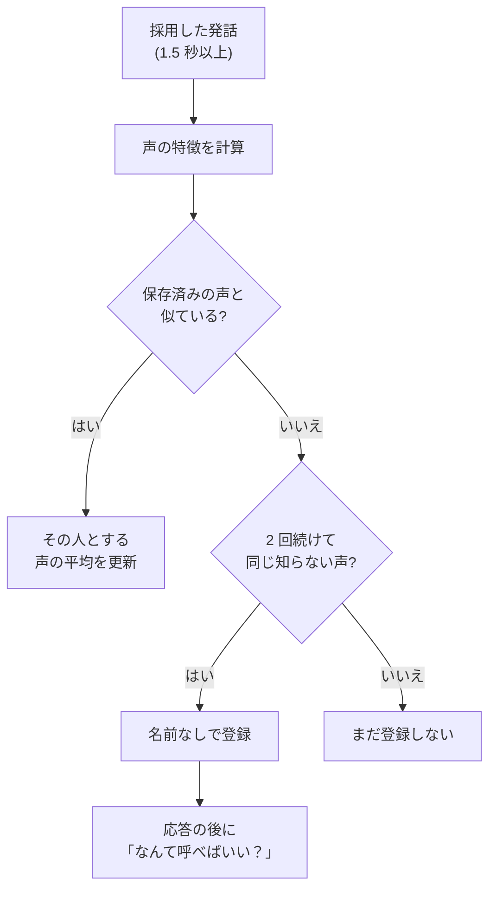

声の特徴の計算:

- 話者識別は、`[voice_id].on` でモデルが読めたときだけ有効である。
- 対象は、区間が `MIN_VOICE_MS`=1500ms 以上の発話である。
- 声の特徴 (話者埋め込み) は、WeSpeaker ResNet34 (ONNX) で計算する。
- モデルの入力は、Kaldi 互換 80 次元 fbank から時間平均を引いたものである。
- 計算は CPU の 2 スレッドで行う。
- 計算は ASR と並行に、別スレッドで行う。応答遅延には足さない。

照合と登録:

- 照合するのは、認識結果を採用した発話だけである。語なし・幻聴・自声で捨てた発話は除く。
- 保存済みの声とのコサイン類似度の最大値が `threshold` 以上なら、その人とみなす。
- 一致したら、その人の声の平均を更新する。
- 過去分の重みは `MAX_WEIGHT`=20 で頭打ちにする。
- 短い発話は判定しない。直前の相手を引き継ぐ。
- 知らない声が `ENROLL_N`=2 回続けて互いに一致したら、名前なしで `speakers` に登録する。
- 物音やテレビの 1 回では登録しない。

名前の聞き方:

- 名前の分からない相手には、通常応答の後に定型の質問「なんて呼べばいい？」を読む (`pipeline.respond(tail=...)`)。
- LLM には「名前は知らない。最後に質問しない」とだけ指示する。
- 尋ねた扱いは、質問を最後まで再生したとき (`_act_commit_history`) に確定する。
- 割り込まれたら、次の応答で尋ね直す。
- 尋ねるのは、1 人につき起動中 `ASK_MAX`=2 回までである。
- 自発発話では尋ねない。

名前の覚え方:

- 尋ねた後、その人の発話への応答には「名乗っていればその名前で挨拶」という指示を足す。
- 再生完了後の背景処理で、LLM に名前だけを抜き出させる。記憶抽出の前に行う。
- `voice_id.parse_name` は、次の結果を採用しない。
  - 「なし」
  - `NAME_MAX`=12 字を超えるもの
  - 語の無いもの
- `voice_id.parse_name` は、敬称と「です」などの語尾を除く。
- 名前の分かった相手については、system に「今話している相手は〇〇さん」と添える。
- 同じ名前を名乗った登録は、声の平均をまとめて 1 件にする。

失敗と限界:

- 声の特徴の計算に失敗したら、識別だけを諦める。認識結果は通常どおり使う。
- 声の似た人は、取り違えることがある。

## ドラマモード (設計書 §6.5)

全体の流れ:

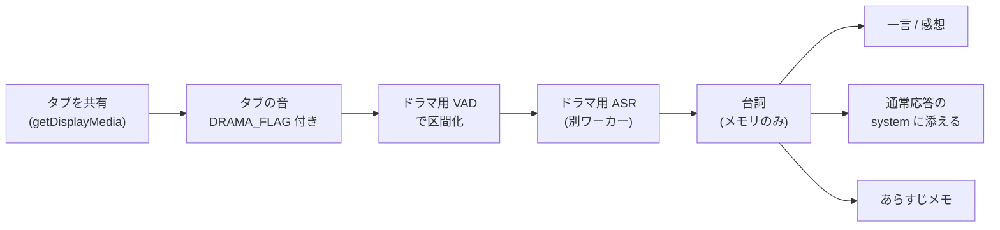

音の取り込み:

- 画面の「ドラマを一緒に見る」で、`getDisplayMedia` によりタブを共有する。
- ブラウザは、音声だけを別の AudioWorklet で 16kHz に落とす。
- ブラウザは、その音声を `DRAMA_FLAG` 付きで送る。
- 映像トラックは、すぐに停止する。
- 音声が共有されていなければ、「タブの音声も共有する」をオンにするよう画面に出す。
- 共有中は `ui.drama=true` である。
- ブラウザの「共有を停止」でも、ドラマモードは終わる。

台詞の認識:

- Director は、ドラマの音を専用の `EnergyVad` で区間化する。
  - この VAD は自動校正で動く。
  - `[vad]` の `ratio` / `onset_ms` / `min_threshold` を流用する。
  - 区間は `max_seg_s` で強制的に切る。
  - `MIN_SEG` 未満の区間は捨てる。
- 区間は、マイクとは別の単一ワーカーで ASR にかける。
- 台詞は、直近 `window_s` 秒だけメモリに置く (`drama.DramaListener`)。
- 台詞は、FSM・相槌・E6 には入れない。

一言:

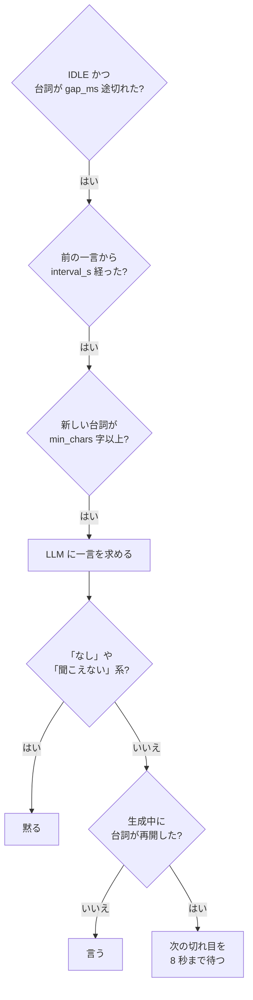

- 一言の発火条件は、次のすべてである。
  - 状態が IDLE である。
  - 台詞が `gap_ms` 以上途切れている。
  - 前の一言から `interval_s` 以上経っている。
  - 前の一言以降の台詞が `min_chars` 字以上溜まっている。
- 一言は、自発発話と同じ経路で LLM に求める。
- 一言は 25 字以内である。
- LLM には、会話履歴と前の一言を渡さない。
- LLM には、前の一言以降の台詞 (`scene_text`) だけを見せる。
- Director は、全文を受け取ってから言うかどうかを決める。
- 「なし」なら黙る。
- 「聞こえない・分からない」系 (`DRAMA_UNHEARD`) も黙る。
- 生成中に台詞が再開していたら、次の切れ目を `DRAMA_HOLD_S`=8 秒まで待つ。
  - 切れ目が来たら、1 行目だけを言う。
  - 来なければ黙る。このとき `drama_skip` を記録する。
- 黙った場合も、次の一言までの間隔は空ける。

総合的な感想:

- 感想の発火条件は、次の両方である。
  - 台詞が `finale_gap_s` 聞こえない。
  - 前の感想 (または開始) から `finale_min_chars` 字以上聞いている。
- 感想は 2〜4 文である。
- 感想は一言より優先する。
- 台詞が `digest_chars` 字溜まるたびに、裏で LLM にあらすじメモを作らせる。
  - メモは 1 件 60 字以内である。
  - メモは計 `NOTES_MAX_CHARS`=1200 字までである。超えたら古い方から捨てる。
  - 利用者が話したら、要約を取り消す。台詞は残して再試行する。
- 感想には、メモと、まだ要約していない台詞を渡す。
- 感想を話したら、メモを捨てる。

通常応答と回り込み:

- 通常応答の system には、直近の台詞を `DRAMA_CONTEXT_PROMPT` で添える。上限は `ctx_chars` 字である。
- マイクの認識結果が直近の台詞と連続一致したら、拾ったドラマの台詞とみなして捨てる。
  - 条件は、認識結果の `ECHO_RATIO`=6 割以上が一致することである。
  - 一致は `ECHO_MIN_CHARS`=4 字以上でなければならない。
  - 捨てたときは `drama_echo_suppressed` を記録する。
- ドラマ側の認識が後に届いた場合は、検出できない。

モードの切り替え:

- ドラマモード中は、普段の自発発話と `IDLE_TIMEOUT` 休止を止める。
- オフにしたら、作りかけ・再生中の一言と感想を取り消す。
- オフにしたら、台詞とメモを捨てる。
- 台詞とメモは、保存も外部送信もしない。

## データモデル (SQLite, 設計書 §3.4)

- DB は `<data-dir>/idle_talk.db` である。
- DB は WAL / synchronous=NORMAL で動く。
- 書き込みは、専用スレッドで直列化する。

| テーブル | 列 |
|---|---|
| `events` | id, ts, epoch, kind, payload_json |
| `turns` | id, ts, role, text, completed(0/1), stop_position_ms, utterance_id |
| `topic_cards` | id, hook, facts, source_url, published_at, expires_at, angle, used_at, user_reaction |
| `memories` | id, content, evidence_utterance_id, updated_at, deletable |
| `speakers` | id, name (NULL = 名前未登録), embedding (float32 単位ベクトルの BLOB), n (平均に使った発話数), updated_at |

- スキーマ版は `PRAGMA user_version` = 2 である。版 2 で `speakers` を追加した。
- 全削除 (`delete_all`) は `speakers` も消す。

### 起動時の検査と復元

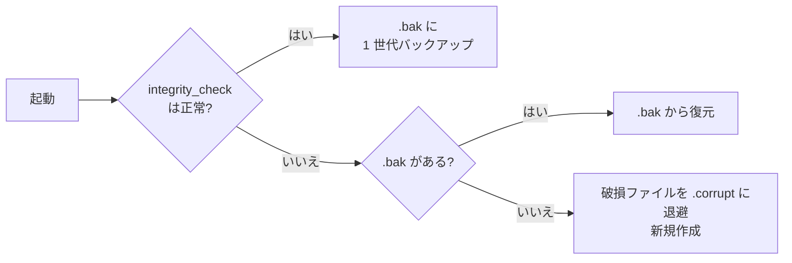

- 破損を検出したときは、5004 を記録する。

### 記憶

- 根拠となる発話が無い記憶は、保存を拒否する。
- 個別に削除できるのは、`deletable=1` の行だけである。

### 話題カード (RSS Topic Worker)

- 話題カードを取得するのは、RSS Topic Worker だけである。
- Worker の停止中は、一切ネットワークに接続しない。
- `idle_talk.toml` の `[topics]` で設定する (`config.load_topics`)。
  - `feeds`: http(s) URL の配列。既定は空
  - `interval_min`: 取得間隔 (分)。既定 30
- `feeds` が空で `[search].on` でもなければ、Worker を作らない。
- `main.topic_loop` は、起動直後と `interval_min` ごとに `TopicWorker.poll_once` を別スレッドで呼ぶ。
- 補充要求 (`worker.wake`) があれば、待たずに補充 (`refill`) する。
- 見出しを `hook` に、概要を `facts` に保存する。
- 概要がタグ除去後 `SUMMARY_MIN_CHARS`=30 字未満なら、リンク先のページを読む (`topic_worker.page_description`)。
  - `og:description` で概要を置き換える。無ければ `description` を使う。
  - charset は `<meta>` の指定で復号する。指定が無ければ UTF-8 で読む。
  - 取得・解析に失敗したら、元の概要のまま保存する。
- Google ニュースのリンクは使わない。記事へ HTTP リダイレクトせず、定型の説明文しか取れないためである。
- `expires_at` は、公開から 24 時間 (`TOPIC_TTL_MS`) である。
- 同じ記事は 1 回だけ保存する。
  - URL で DB を照合する。URL が無ければ見出しで照合する (`topics.has_card`)。
  - 再起動をまたいでも重複しない。
- Director は、状態の変化を `TopicWorker.on_state` に伝える。
  - `rest` に入ると、取得を止める。
  - `rest` から戻ると、取得を再開する。
  - `user_speaking` に入ると、処理中の取得を打ち切る。

### events の kind

| kind | payload | 用途 |
|---|---|---|
| `eot_wait` / `asr_done` / `llm_first_clause` / `tts_first` / `play_start` | `{turn, gpu1_load}` | 段階計測。1 ターン 5 行。G1 = play_start − eot_wait |
| `playback` | `{epoch, utterance_id, chunk_id, state, position_ms}` | G3・履歴整合 (相槌クリップは除外) |
| `cancel` | — | 割り込みによる取消 1 回につき 1 行 (`rest` への遷移による取消は含まない) |
| `echo_chain` | — | 自声起因の応答連鎖 1 回につき 1 行。自声除外の導入後、Director は書かない |
| `echo_suppressed` | `{utterance_id, text}` | 自声として捨てた認識結果 1 件につき 1 行 (M1 計測が有効なときのみ) |
| `g2_sample` | `{latency_ms}` | 発話開始 → duck / 停止開始 |
| `soak_sample` | `{rss_mib, vram_mib}` | 常駐試験 |
| `backchannel` / `backchannel_misfire` | — | 相槌の再生 / 誤発火 |
| `spontaneous_fire` / `spontaneous_cancel` | — | 自発発話の発火 / 取消 |
| `drama_mode` | `{on}` | ドラマモードのオン / オフ |
| `drama_react` / `drama_finale` | `{}` / `{notes, rest}` | 一言 / 総合的な感想の発火 |
| `drama_skip` | `{text, held_s}` | 生成した一言を、台詞の再開で言わずに捨てた |
| `drama_echo_suppressed` | — | マイクが拾ったドラマの台詞を捨てた 1 回につき 1 行 |
| `run_meta` | `{host, started_at, ended_at, app_commit, sample_count}` | 終了時に 1 行。記録の出所を検証するのに使う |

- 以前は、自声の認識を `echo_chain` として記録するだけで応答していた。
- 今は、同じ一致則で自声を捨てる (`echo_suppressed`)。
- そのため、`evaluate_echo_chain` (M5) の連鎖数は常に 0 になる。
- 一致則で検出できない言い換えの連鎖は、測れない (要確認: M5 の判定方法の見直し)。

## 計測と合否判定 (設計書 §1.2 / §11.1)

| ゲート | 判定 |
|---|---|
| G1 応答遅延 | 50 ターンで p50 ≤ 1200ms かつ p95 ≤ 2000ms。`gpu1_load=true` の標本は別集計 (E9: GPU1 負荷下で p50 ≤ 1200ms) |
| G2 割り込み反応 | p95 ≤ 250ms |
| G3 旧世代音声 | 旧 epoch の再生 0 件 |
| 履歴整合 | turns と playback の照合で不整合 0 件 |
| G5 常駐 | 8 時間・1 分ごとの記録で、RSS の回帰傾きが 1.0 MiB/h 以下 (`analyze_soak`) |
| E10 / M5 | 20 分の記録で自声起因の応答連鎖 0 回、cancel 1 件以上 (`evaluate_echo_chain`) |

- `validate_run_meta` は次を検査する。不備があれば `ProvenanceError` を投げる。
  - run_meta の 5 キー
  - 期間の下限
  - ts の単調性
  - `sample_count` と実際の行数の一致
- 常駐試験の間隔検査 (`interval_ms=60000`) は、run_meta 以外の全行の隣接 ts 間隔にかかる。`soak_sample` の行だけではない。
- この点は運用フェーズで確認する (README「運用フェーズでの確認事項」)。

## 設定既定値 (`config.Config`, 設計書 §8.1)

時間は、特記なき限り ms である。

| 分類 | 値 |
|---|---|
| 発話区間と割り込み | `T_silence`=400、`MIN_SEG`=200、`T_confirm`=400 (300〜500)、`OVERLAP_MAX`=300、`DUCK_GAIN`=0.2 |
| 相槌と自発発話 | `SIL_BACKCHANNEL`=300 (250〜350 かつ `T_silence` 未満)、`BC_COOLDOWN`=5s、`spont_interval_s` 10〜3600 (既定 1200) |
| 通信と休止 | `PING_INTERVAL`=5s、`IDLE_TIMEOUT`=1800s |
| 遅延予算と試験 | `VAR_SUM`=750、`G2_SUM`=130、`TTS_RATIO_MAX`=0.7、`TTS_GPU_THRESH`=300、`TEST_N`=20、`N_TURNS`=8、`DB_BACKUP`=1 |

- 範囲外の値は、`Config` を生成した時点で `ValueError` になる。

## ブラウザ (web/)

画面 (`index.html` + `client.js`):

- 画面は WS の接続・再接続を行い、state と error を表示する。
- 設定欄の項目: ミュート・自発発話・ラジオ・間隔・休止時間帯・声・ペルソナ。
- 接続先ポートは `?port=` で決める。無ければ配信元の `/config.json` の `ws_port` を使う。
- 「開始」ボタンは、押したら無効にする。押し直すと、マイク取り込みと接続が二重になるためである。
- 接続までに失敗したときだけ、作りかけの WS を閉じ、「開始」を押せる状態に戻す。
- 接続後に、「ドラマを一緒に見る」が押せるようになる。
- WS が切れた・つながらなかったときは、状態を「再接続中…」にし、2 秒 (`RECONNECT_MS`) ごとにつなぎ直す。マイクと共有中のタブの音はそのまま使い続ける。
- 切断中と hello 前は、マイクのフレームも JSON も送らない。
- 切断時に、再生キューを報告なしで捨て、epoch を 0 から受け直す (`player.reset`)。サーバを再起動すると epoch が 0 に戻るため、前の接続の epoch を覚えていると新しい音声をすべて旧世代として捨ててしまう。
- ミュート中は、状態表示に「(休止)」と添える。状態が `rest` になったら重ねて書かない。
- 検索中は、状態欄に検索語を出す (`search`)。

URL 欄:

- `links` の URL を、画面の URL 欄に出す。
- URL 自体をリンクにする。タイトルは添え書きにする。クリックで別タブに開く。
- 新しいものを先頭に積む。
- 100 行を超えたら、古い順に消す。
- 同じ URL は、先頭へ付け直す。

マイク:

- マイクは次の設定で取る: `echoCancellation: true`・`noiseSuppression: true`・`autoGainControl: false`・モノラル。
- AGC を切るのは、VAD の自動校正の雑音推定を乱すためである。

取り込み (`worklet.js`):

- `worklet.js` は、AudioWorklet で 16kHz mono s16le の 20ms フレームに区切る。
- 各フレームに u32 の連番を付ける。
- 実際のサンプルレートが 16kHz でなければ、変換する。

再生 (`player.js`):

- `player.js` は epoch ごとに再生する。
- `duck` / `cancel` / `resume` を処理し、`playback` を通知する。
- 旧 epoch のチャンクは再生しない。
- PCM は 24kHz として再生する (`DEFAULT_PCM_RATE`)。`clients.TTS_RATE` と一致させる。
- 再生中 1 + 先読み `MAX_LOOKAHEAD`=1 チャンクを超えて届いたチャンクは、`dropped` で捨てる。

下りのフロー制御:

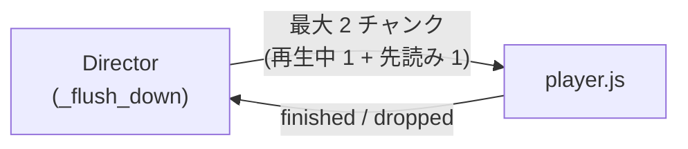

- Director は、送出済みで報告の無いチャンクを、再生中 1 + `DOWN_LOOKAHEAD`=1 までに抑える。
- 報告を待ってから、次のチャンクを送る (`director._flush_down`)。
- `dropped` も再生終了として扱う。待ち続けると完了判定が来ず、応答・自発発話が止まるためである。

その他のファイル:

- `web/*.js` は、ブラウザでは classic script として同じグローバルスコープに読まれる。そのため各ファイルを IIFE で閉じる。
- `web/tests/browser_globals.test.js` が、同時読込を検査する。
- `capture_check.html` / `capture_check.js` は、取り込みの実現性 C1〜C4 を判定する。結果 JSON を保存する。
  - C1: echoCancellation 制約
  - C2: フレームの配信
  - C3: 連番の連続性
  - C4: フレーム長
- `aec_probe.js` は、AEC の実測プローブである。`getUserMedia({echoCancellation:true})` を使う。

## テスト

- 既定のテスト: `pytest` (`-m 'not integration'`) と `node --test web/tests/*.test.js`。実サービスは不要である。
- 実機のテスト: `pytest -m integration` と `web/tests/capture_record_live.js`。
- 実機のテストは、運用フェーズで実施する。手順と合格条件は README にある。
- 実機のテストは skip を使わない。前提が欠けていれば失敗する。

## 用語集

| 用語 | 意味 |
|---|---|
| Director | 状態機械を持ち、ブラウザ・ASR・LLM・TTS・DB をつなぐ Python の本体プロセス |
| epoch | 取消の世代番号。取消が確定するたびに +1 し、古い世代の生成物を捨てる |
| チャンク | 下りで送る音声の単位。`epoch/utterance_id/chunk_id` で識別する |
| 節 | LLM の出力を句点・読点などで区切った、合成できる最小のまとまり |
| duck | AI の音量を下げること (`DUCK_GAIN`) |
| 確認窓 | 割り込みの発話開始から `T_confirm` の半開区間。相槌かどうかを判定する |
| 停止語 | 言うと AI の発話を即止める語 (`STOP_WORDS`) |
| 相槌語 | 確認窓内なら AI の発話を止めない語 (うん・へえ 等) |
| 自声除外 | スピーカーから回り込んだ AI 自身の声の認識結果を捨てること |
| 回り込み | スピーカーの音をマイクが拾うこと |
| 幻聴 | 音声認識が無音や雑音から出した偽の文字列 |
| 語なし | 認識結果に英数字・かな漢字が無い、または 1 音だけであること |
| 自発発話 | 沈黙が続いたときに AI から話しかけること |
| 雑談モード | 自発発話が動く前提のモード。コード上に切り替えは無く、`spontaneous.py` の説明にだけ現れる (要確認) |
| ラジオモード | 返事を求めず、AI が数秒おきに独り語りを続けるモード |
| 休止 (`rest`) | ミュート・無操作・連続失敗で入る状態。背景処理を止める |
| 休止時間帯 | 自発発話をしない時刻の範囲 (`quiet_start`〜`quiet_end`) |
| 話題カード | ニュース記事から作る、自発発話の話題 (`topic_cards`) |
| 記憶 | 利用者の好み・習慣などを「利用者は〜」の 1 文で保存したもの (`memories`) |
| ペルソナ | AI の人物設定 (名前・性格・口調)。声とは別に選ぶ |
| 話者埋め込み | 声の特徴を表すベクトル。話者識別に使う |
| ドラマモード | 共有したタブの音を聞き、一言や感想を言うモード |
| 一言 | ドラマの場面の切れ目に AI が言う 25 字以内の短い感想 |
| 総合的な感想 | ドラマの台詞が長く途切れたときに話す、2〜4 文の感想 |
| あらすじメモ | ドラマの台詞を裏で要約した 60 字以内のメモ。感想の材料にする |
